# 02 Premier lancement

Au premier démarrage, Kadenz vous présente l'application en quatre pages, puis un assistant d'installation en six étapes crée votre entreprise, votre compte administrateur et vos réglages de départ. À la fin, vous vous connectez et l'écran principal s'ouvre.

Ce chapitre suit l'édition Kadenz (un poste). Les données saisies dans les captures sont fictives : l'entreprise « Comptoir Exemple SARL » et l'administrateur « Awa Exemple ».

## 2.1 Les quatre pages d'accueil

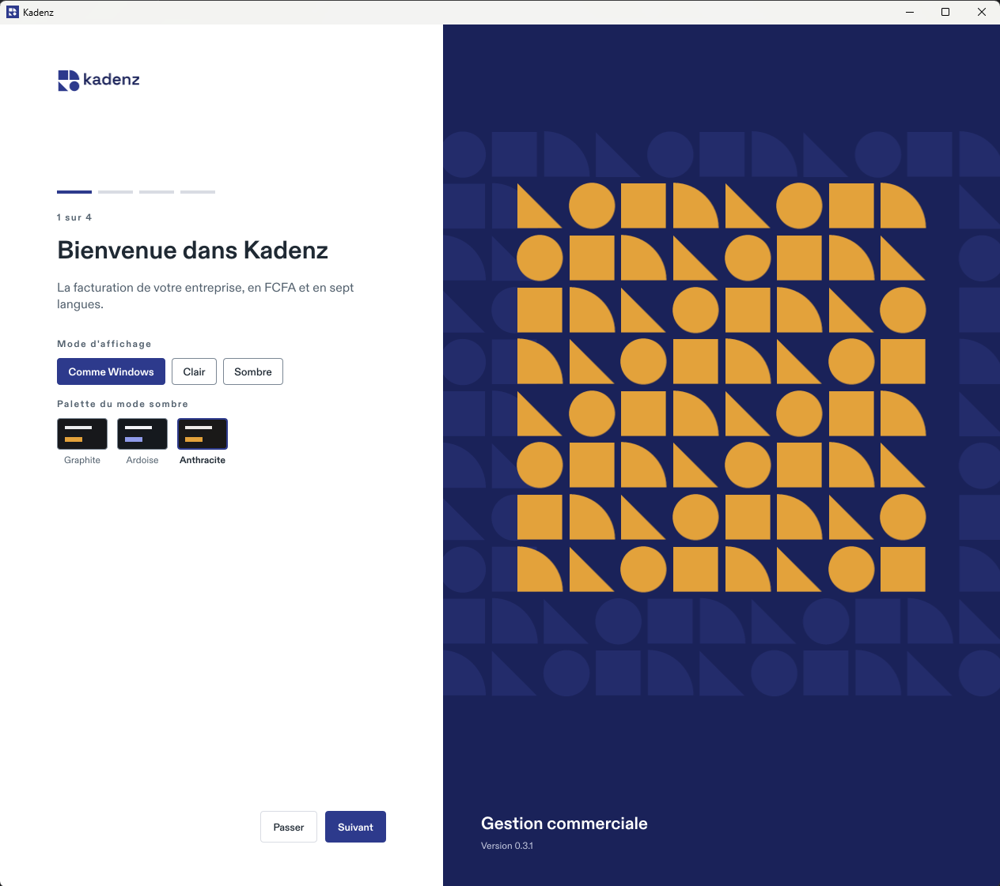

La première page, « Bienvenue dans Kadenz », propose le **Mode d'affichage** : **Comme Windows** (par défaut), **Clair** ou **Sombre**. Une **Palette du mode sombre** (Graphite, Ardoise ou Anthracite) s'applique quand l'affichage est sombre. Ces choix se changent plus tard dans les Paramètres.

Les trois pages suivantes présentent l'application :

- « Vos documents » : du devis à l'avoir, chaque document validé reçoit son numéro et s'exporte en PDF.
- « Vos paiements » : vous saisissez un règlement sur la facture, et l'état Impayé, Partiel ou Payé se calcule seul.
- « Vos données » : chacun se connecte avec son propre compte, et chaque validation est inscrite dans l'historique.

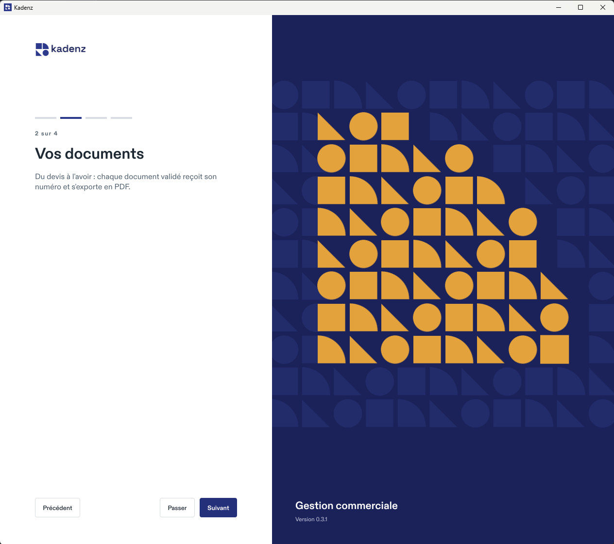

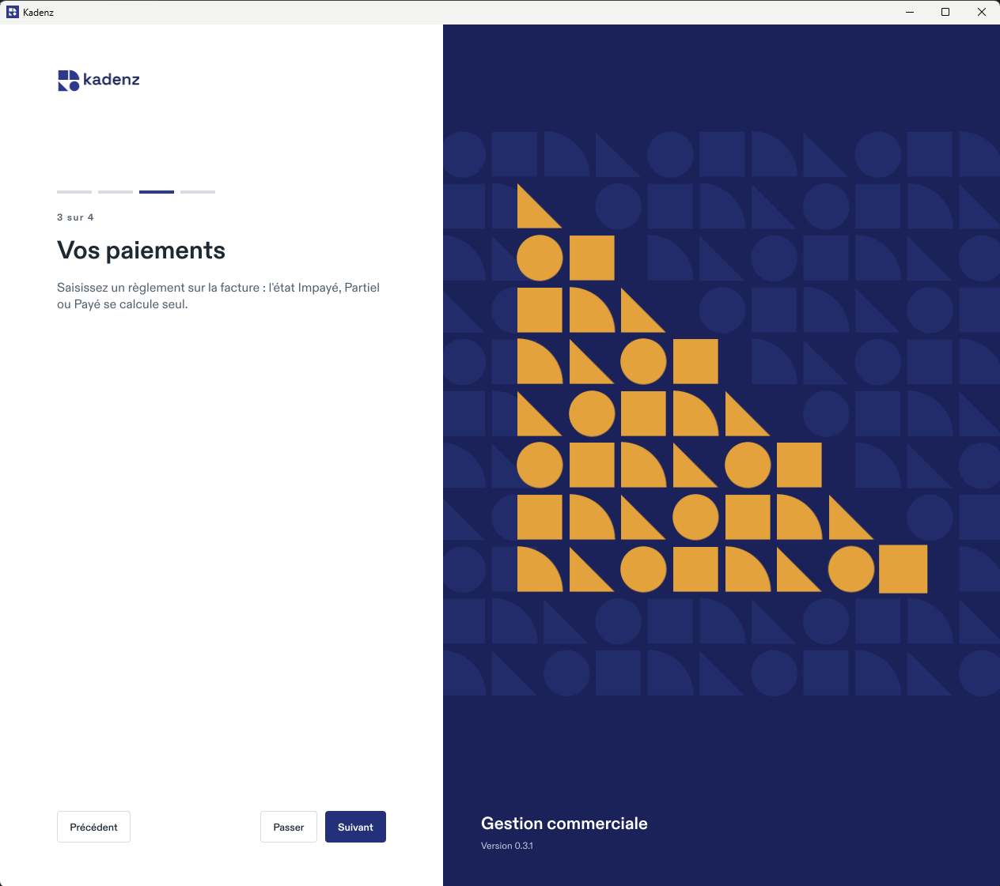

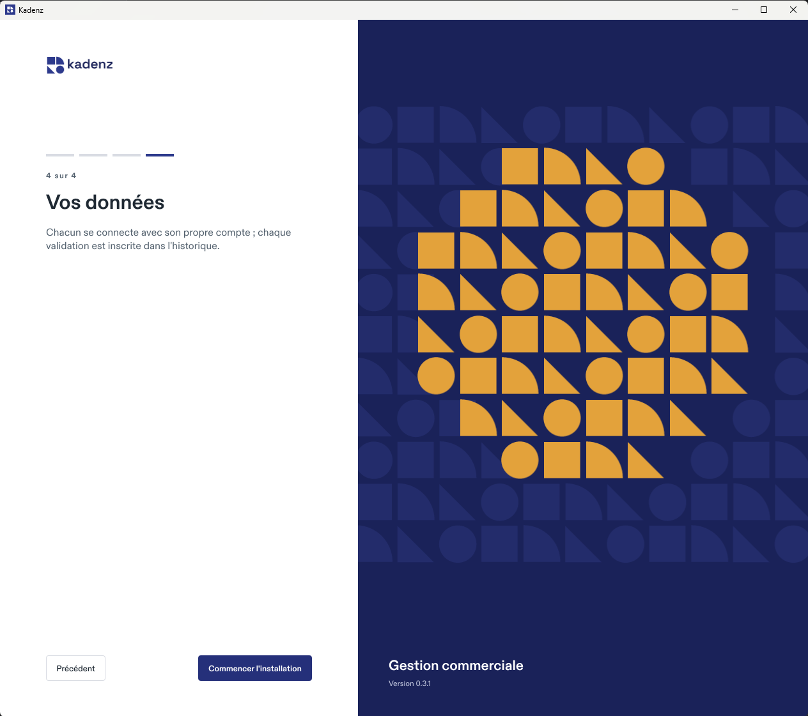

Utilisez **Suivant** et **Précédent** pour naviguer. **Passer** met fin à la présentation ; sur la quatrième page, le bouton **Commencer l'installation** lance l'assistant.

## 2.2 L'assistant d'installation

L'assistant a six étapes, listées dans la colonne de gauche sous « Première installation » : Licence, Entreprise, Administrateur, Taux et paiements, Sauvegardes, Récapitulatif. Une coche signale chaque étape terminée, et **Précédent** revient à l'étape précédente.

### Étape 1 : Licence

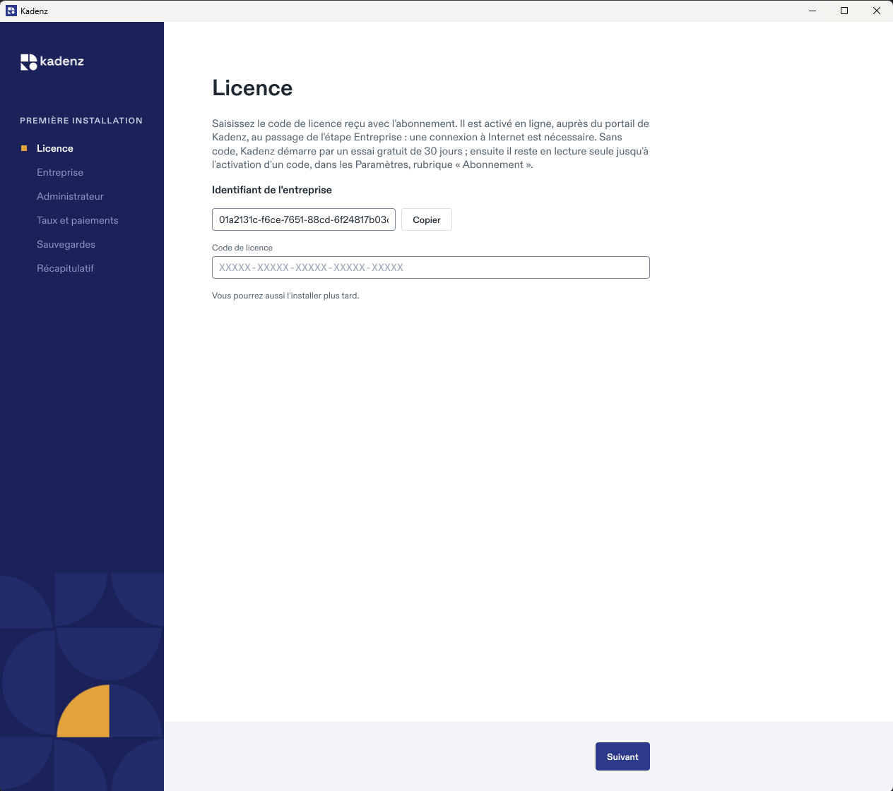

Cette étape affiche l'**Identifiant de l'entreprise**, un code propre à votre installation, avec un bouton **Copier**. Il sert à obtenir votre code de licence.

Si vous avez déjà un code, saisissez-le dans **Code de licence** (cinq groupes de cinq caractères). Il est activé en ligne, auprès du portail de Kadenz, au passage de l'étape Entreprise : une connexion à Internet est nécessaire.

Sans code, Kadenz démarre par un **essai gratuit de 30 jours**, avec tous les modules. Passé ce délai, il reste en lecture seule jusqu'à l'activation d'un code, dans les Paramètres, rubrique « Abonnement ». Vous pourrez aussi installer le code plus tard.

> **Astuce** Recopiez l'identifiant avec le bouton Copier plutôt qu'à la main : il est long et ne tolère aucune erreur.

### Étape 2 : Entreprise

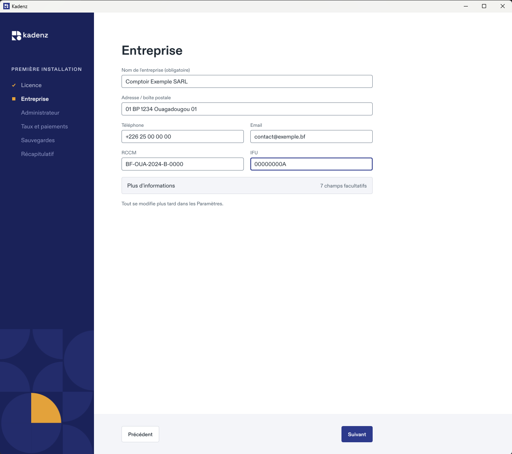

Seul le **Nom de l'entreprise** est obligatoire. Renseignez aussi, si vous les avez : l'**Adresse / boîte postale**, le **Téléphone**, l'**Email**, le **RCCM** et l'**IFU**. Ces informations servent à l'en-tête et au pied de vos documents.

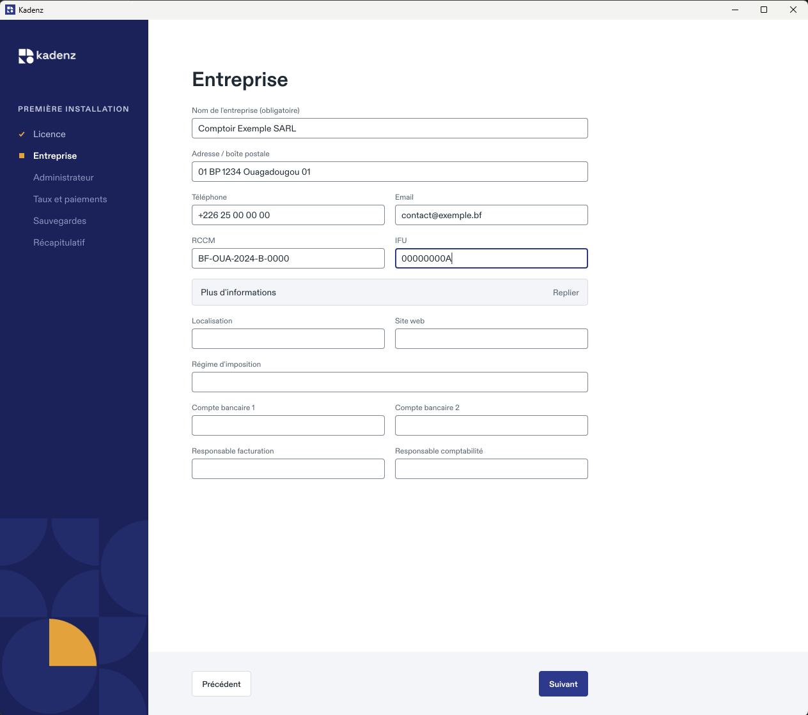

Le bandeau **Plus d'informations** déplie sept champs facultatifs, dont la localisation, le site web, le régime d'imposition et les comptes bancaires. Cliquez sur **Replier** pour le refermer.

> **Astuce** Tout ce que vous saisissez ici se modifie plus tard dans les Paramètres.

### Étape 3 : Administrateur

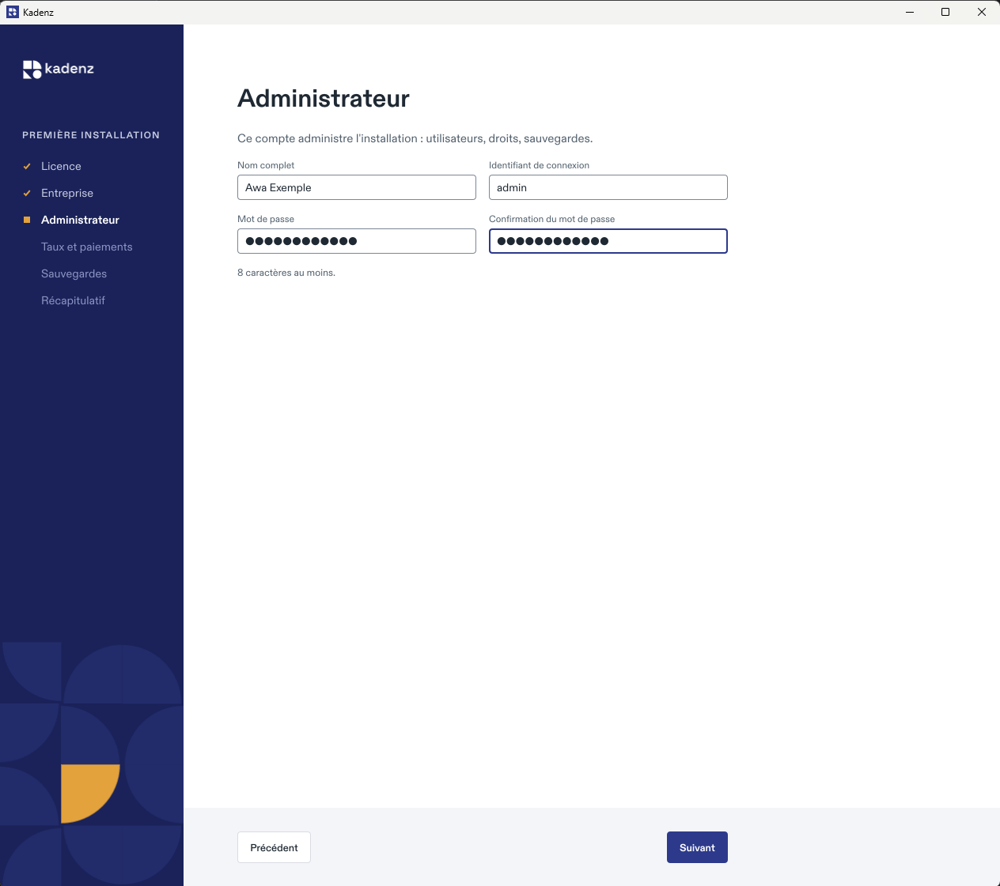

Ce compte administre l'installation : utilisateurs, droits, sauvegardes. Renseignez le **Nom complet**, l'**Identifiant de connexion**, le **Mot de passe** et sa **Confirmation**. Le mot de passe doit comporter 8 caractères au moins.

> **Attention** Notez l'identifiant et le mot de passe de l'administrateur en lieu sûr. Ce compte sert à créer les autres utilisateurs et à gérer leurs droits.

### Étape 4 : Taux et paiements

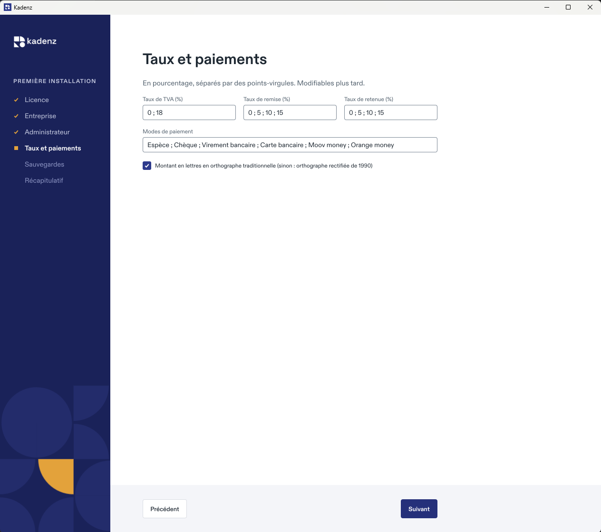

Cette étape fixe les listes proposées dans vos documents. Les valeurs par défaut conviennent à la plupart des entreprises ; on les saisit en pourcentage, séparées par des points-virgules.

- **Taux de TVA (%)** : 0 ; 18.
- **Taux de remise (%)** : 0 ; 5 ; 10 ; 15.
- **Taux de retenue (%)** : 0 ; 5 ; 10 ; 15.
- **Modes de paiement** : Espèce ; Chèque ; Virement bancaire ; Carte bancaire ; Moov money ; Orange money.
- Case **Montant en lettres en orthographe traditionnelle** : cochée par défaut ; décochée, le montant s'écrit en orthographe rectifiée de 1990.

Ces réglages sont modifiables plus tard.

### Étape 5 : Sauvegardes

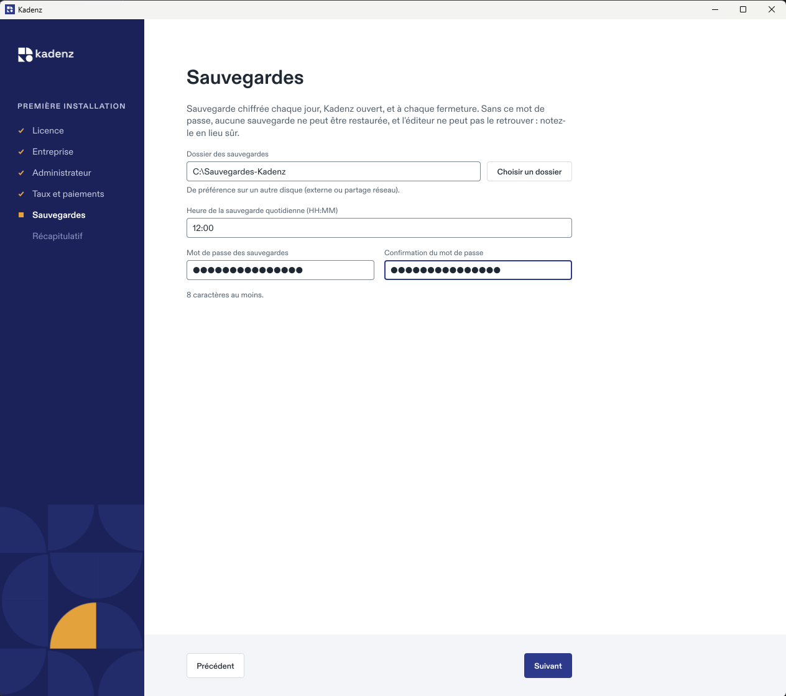

Kadenz fait une sauvegarde chiffrée chaque jour, Kadenz ouvert, et à chaque fermeture. Indiquez :

- le **Dossier des sauvegardes** (bouton **Choisir un dossier**), de préférence sur un autre disque, externe ou en partage réseau ;
- l'**Heure de la sauvegarde quotidienne** au format HH:MM (12:00 par défaut) ;
- le **Mot de passe des sauvegardes** et sa confirmation, 8 caractères au moins.

> **Attention** Sans ce mot de passe, aucune sauvegarde ne peut être restaurée, et l'éditeur ne peut pas le retrouver. Notez-le en lieu sûr.

### Étape 6 : Récapitulatif

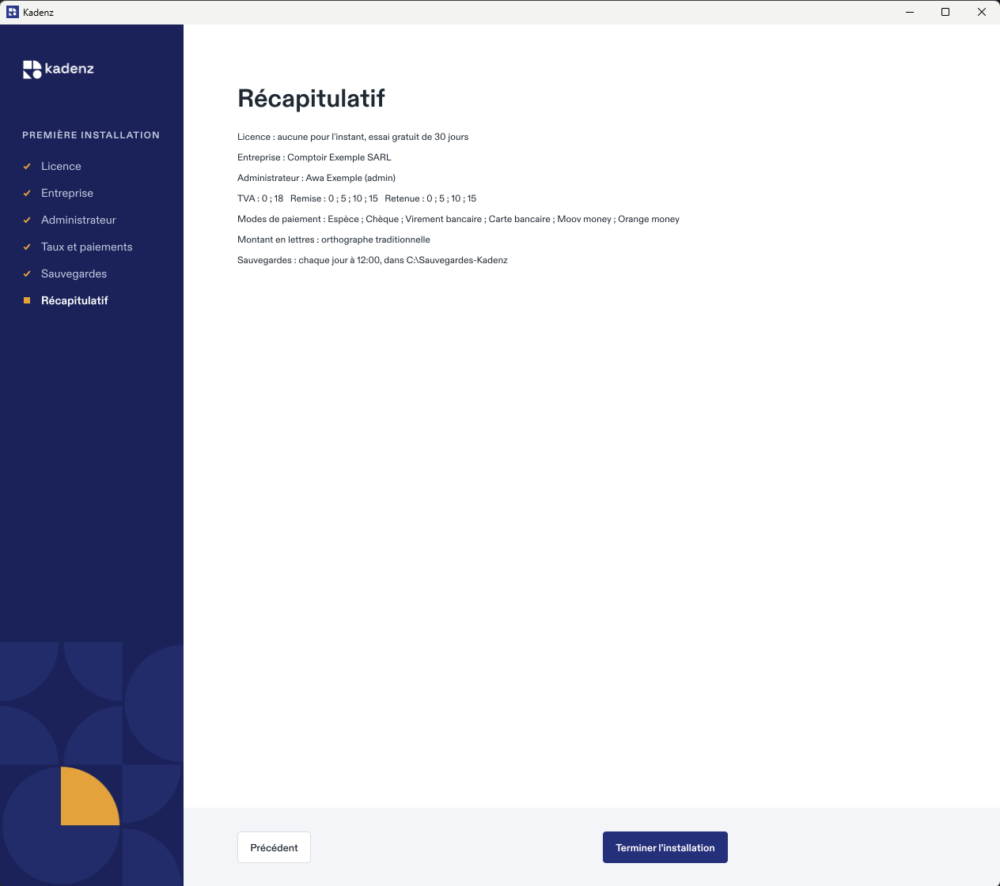

Le récapitulatif reprend vos choix : licence (ou essai gratuit de 30 jours), entreprise, administrateur, taux, modes de paiement, orthographe du montant en lettres et sauvegardes. Vérifiez-les, puis cliquez sur **Terminer l'installation**. Pour corriger un point, utilisez **Précédent**.

## 2.3 Se connecter

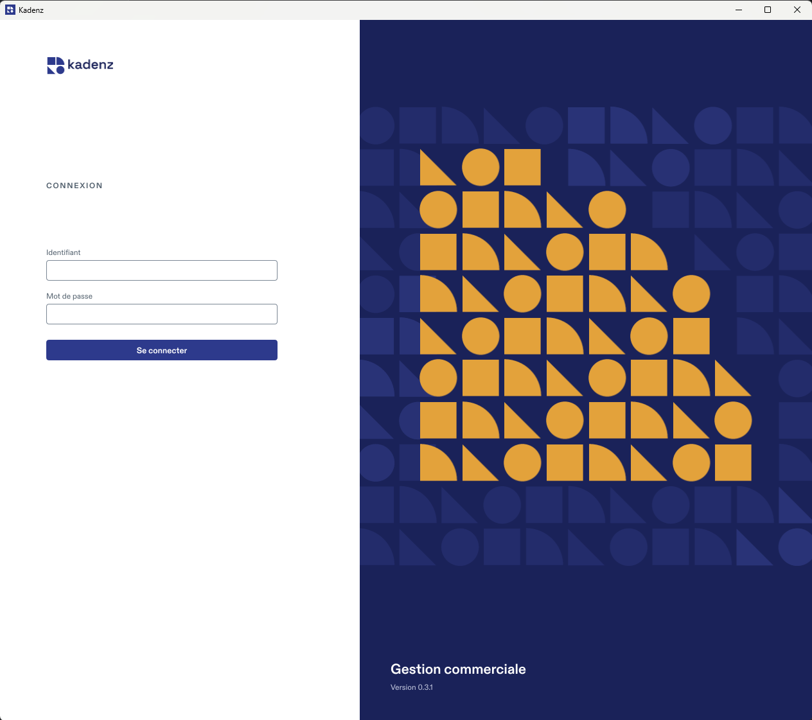

Après l'installation, l'écran de connexion s'affiche. Saisissez l'**Identifiant** et le **Mot de passe** du compte administrateur, puis cliquez sur **Se connecter**.

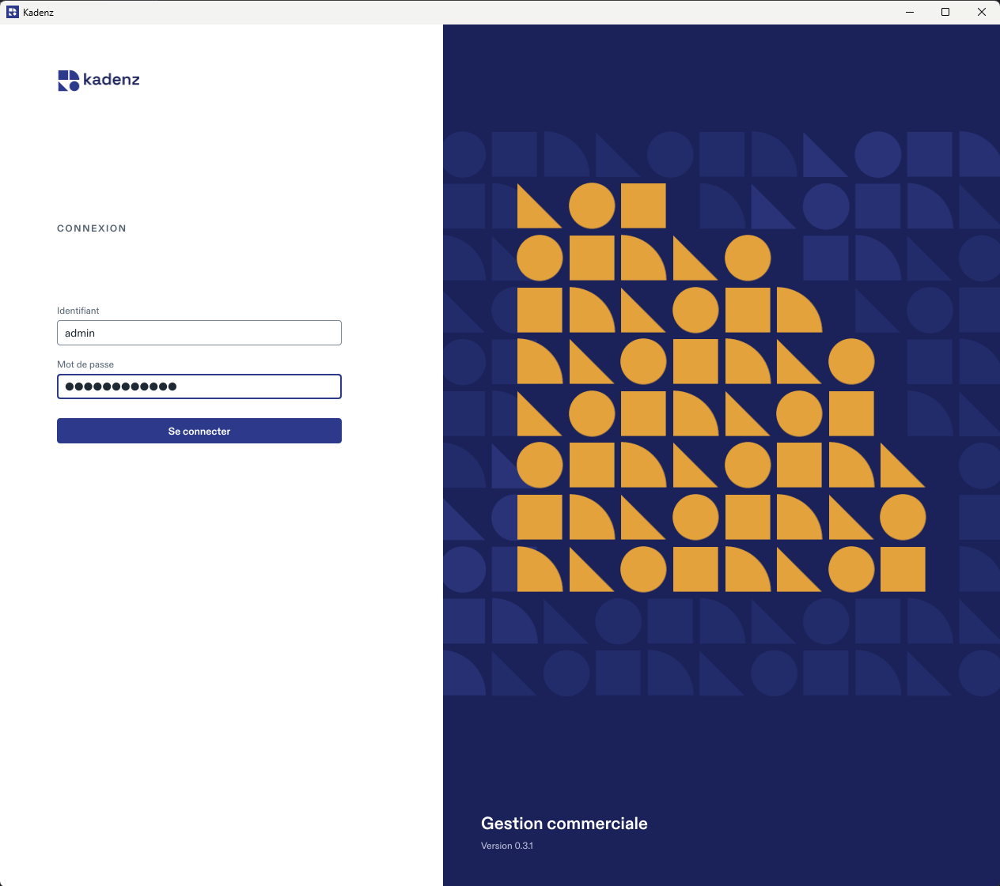

## 2.4 L'écran principal

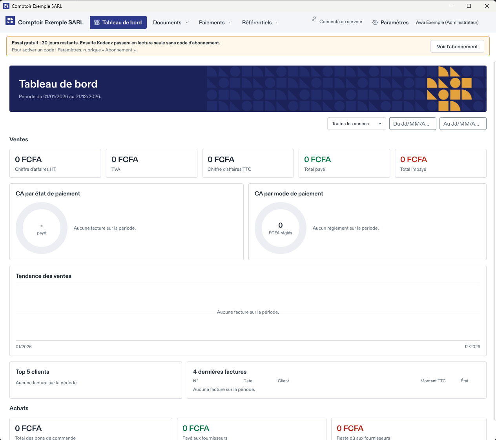

Une fois connecté, vous arrivez sur le **Tableau de bord** (chapitre 06, section 6.7), vide pour l'instant : les montants sont à 0 FCFA tant qu'aucune facture n'existe.

- **Barre du haut** : le nom de l'entreprise, le **Tableau de bord**, les menus **Documents**, **Paiements** et **Référentiels**, l'état de la connexion au serveur, **Paramètres** et le compte connecté avec son rôle.
- **Bandeau d'essai** : « Essai gratuit : 30 jours restants. Ensuite Kadenz passera en lecture seule sans code d'abonnement. » Le bouton **Voir l'abonnement** ouvre la rubrique Abonnement des Paramètres. Ce bandeau d'essai disparaît quand un code d'abonnement est activé.
- **Tableau de bord** : le chiffre d'affaires, la TVA, le total payé et le total impayé de la période, la répartition par état et par mode de paiement, la tendance des ventes, les meilleurs clients et les dernières factures, puis les achats.
- **Les factures** se trouvent dans le menu **Documents** (chapitre 04).

Vous êtes prêt à créer vos premiers clients et produits : c'est l'objet du chapitre suivant.
