# 03 Tiers et produits

Avant d'établir un devis ou une facture, il faut créer vos **tiers** (clients et fournisseurs) et vos **produits et services**. Ces fiches se trouvent dans le menu **Référentiels**. Elles sont réutilisées dans tous les documents : on les crée une fois, on les choisit ensuite.

Les données des captures sont fictives et se retrouvent dans les chapitres suivants : trois tiers (deux clients et un fournisseur) et trois articles (deux produits et un service).

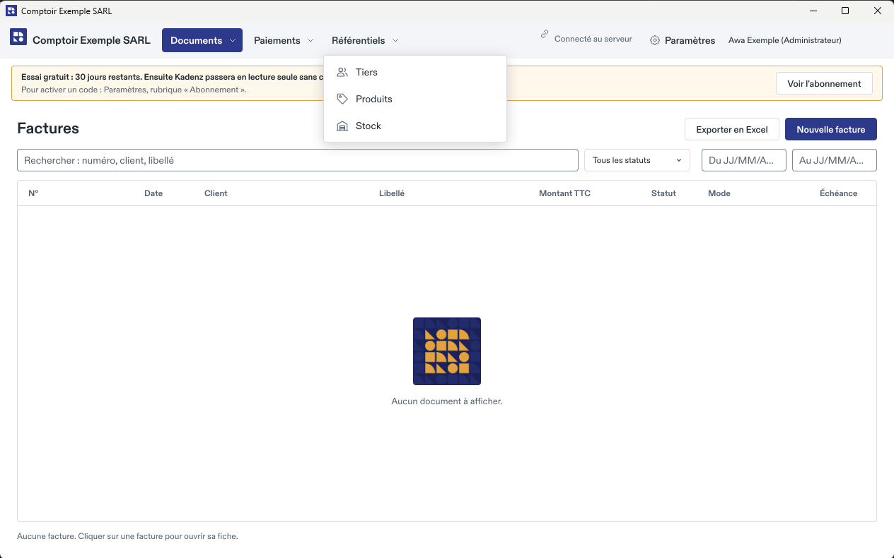

Le menu **Référentiels** propose **Tiers**, **Produits** et **Stock**. Le stock fait l'objet du chapitre 05.

## 3.1 Les tiers

### La page Tiers

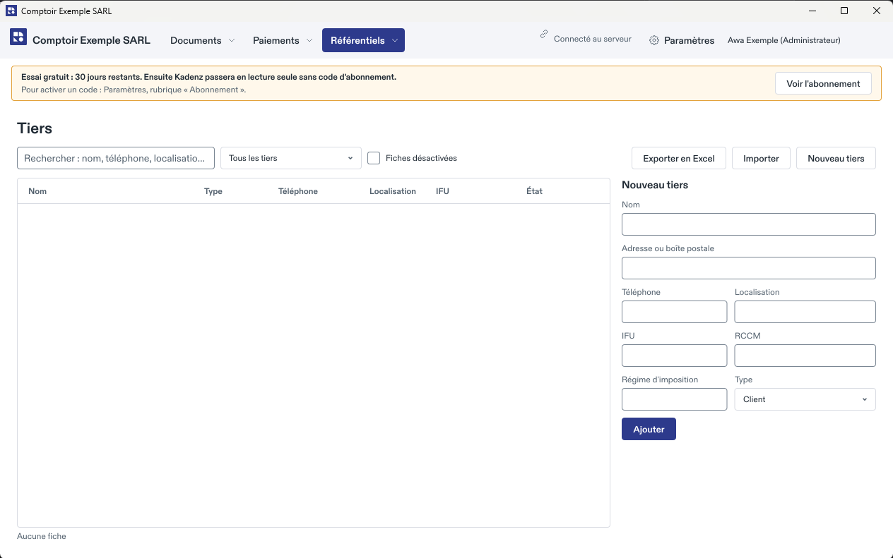

La page se compose de deux zones :

- à gauche, la **liste** des fiches, avec les colonnes Nom, Type, Téléphone, Localisation, IFU et État, et au-dessus une zone de recherche (nom, téléphone, localisation), un filtre de type et la case **Fiches désactivées** ;
- à droite, le **formulaire** : « Nouveau tiers » pour une création, « Fiche du tiers » quand une fiche est sélectionnée.

En haut à droite se trouvent **Exporter en Excel**, **Importer** (chapitre 07) et **Nouveau tiers**.

### Créer un tiers

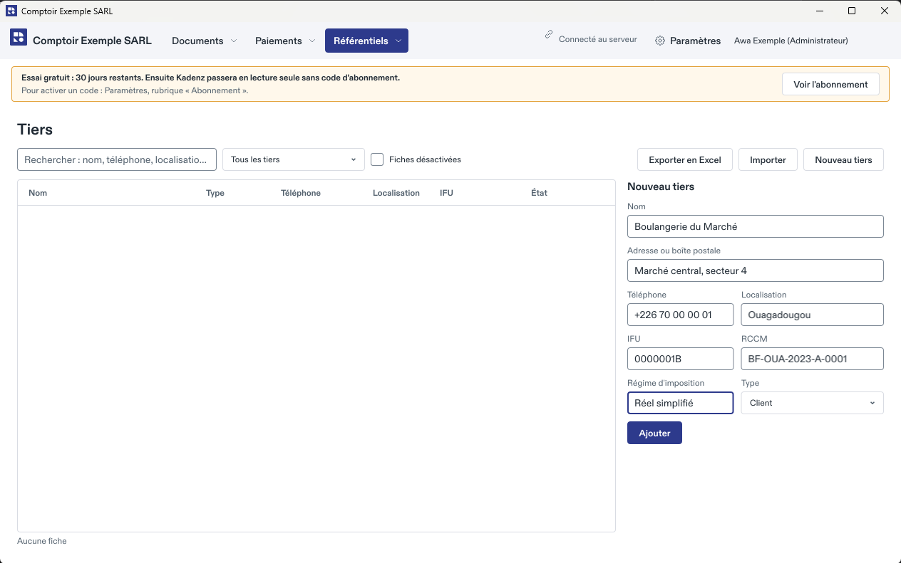

Dans le formulaire, renseignez :

- **Nom** ;
- **Adresse ou boîte postale** ;
- **Téléphone** et **Localisation** ;
- **IFU** et **RCCM** ;
- **Régime d'imposition** ;
- **Type**.

Cliquez ensuite sur **Ajouter**. Le message « Tiers ajouté. » confirme l'enregistrement et la fiche apparaît dans la liste.

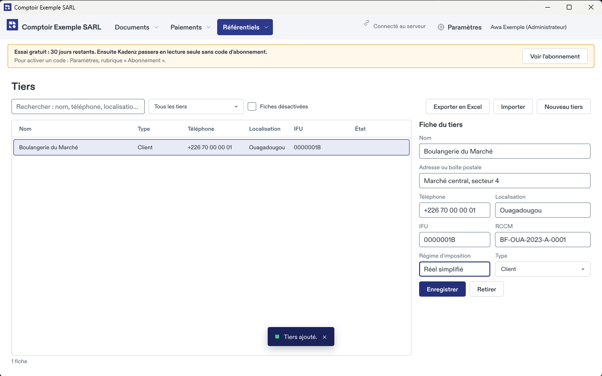

Le champ **Type** distingue trois cas :

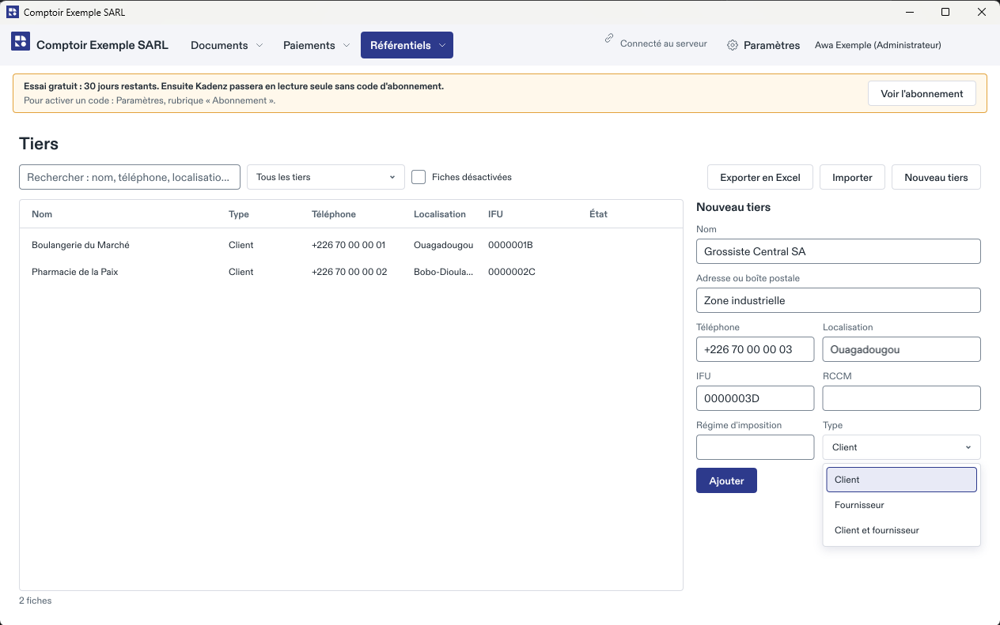

- **Client** : la fiche s'utilise dans les documents de vente ;
- **Fournisseur** : la fiche s'utilise dans les documents d'achat ;
- **Client et fournisseur** : les deux.

### Retrouver un tiers

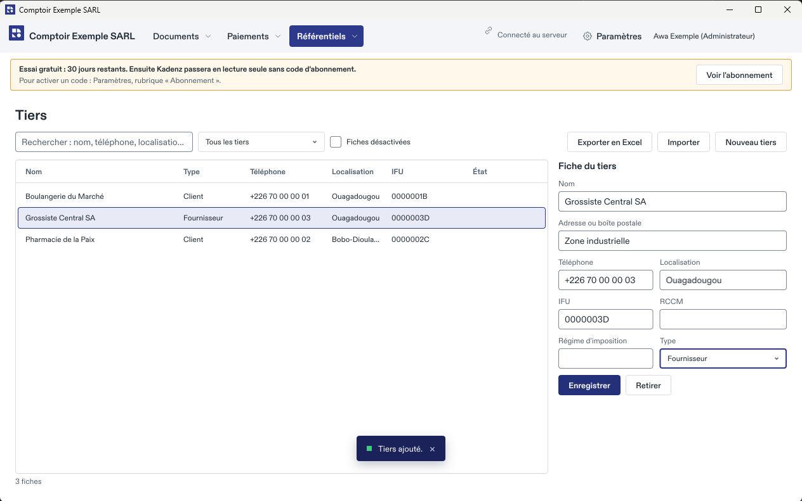

Tapez quelques lettres dans la zone de recherche pour réduire la liste. Le filtre à côté limite l'affichage à un type :

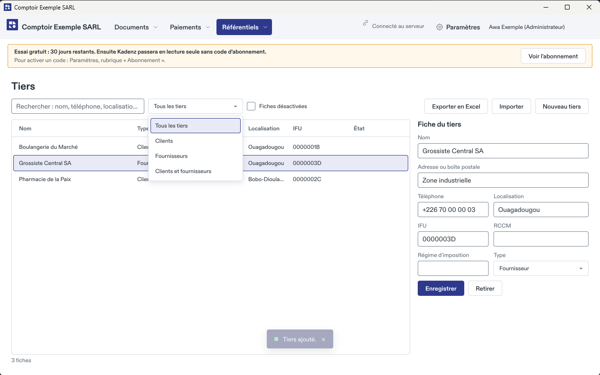

**Tous les tiers**, **Clients**, **Fournisseurs** ou **Clients et fournisseurs**.

### Modifier ou retirer un tiers

Cliquez sur une ligne de la liste : sa fiche s'ouvre dans le formulaire. Corrigez ce qui doit l'être, puis cliquez sur **Enregistrer**.

**Retirer** demande confirmation. Si aucun document ne cite la fiche, elle est supprimée ; sinon elle est seulement désactivée, pour ne pas fausser l'historique. Une fiche désactivée n'apparaît plus dans la liste, sauf si vous cochez **Fiches désactivées** ; le bouton **Réactiver** la remet en service.

## 3.2 Les produits et services

### La page Produits et services

Le menu **Référentiels**, rubrique **Produits**, ouvre la page « Produits et services ».

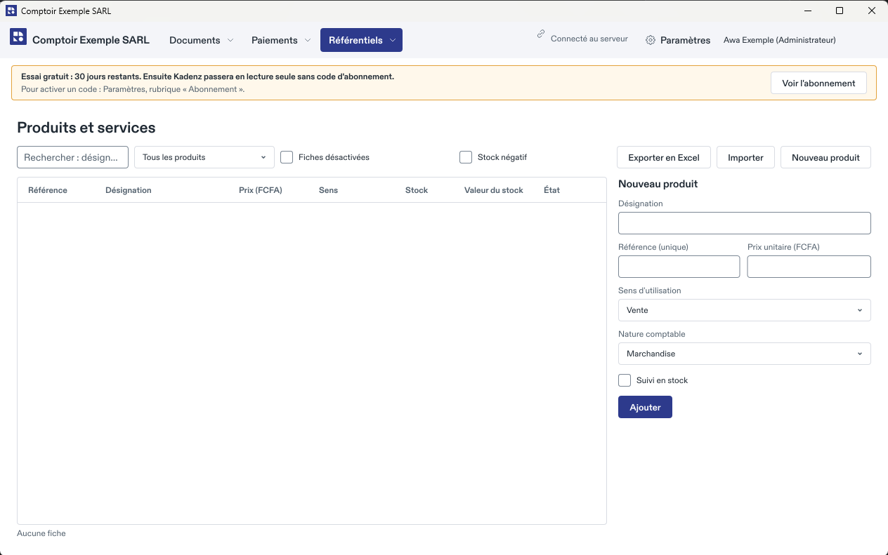

Elle suit la même organisation que les tiers : la liste à gauche (Référence, Désignation, Prix en FCFA, Sens, Stock, Valeur du stock, État), le formulaire à droite. Au-dessus de la liste, outre la recherche et le filtre, deux cases : **Fiches désactivées** et **Stock négatif**.

### Créer un produit

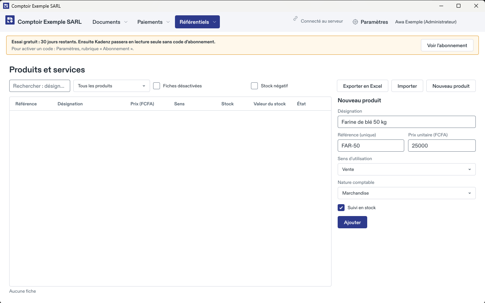

Renseignez :

- **Désignation** : le libellé qui figurera sur les documents ;
- **Référence (unique)** : un code court, différent pour chaque article ;
- **Prix unitaire (FCFA)** ;
- **Sens d'utilisation** ;
- **Nature comptable** ;
- la case **Suivi en stock**.

Cliquez sur **Ajouter**.

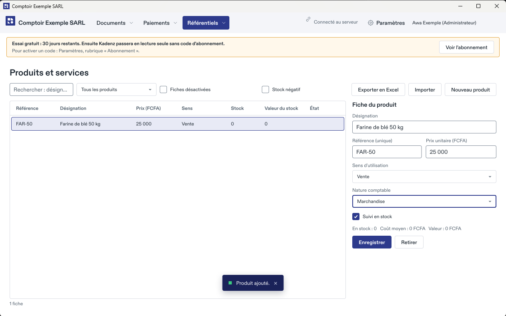

**Sens d'utilisation.** Il indique dans quels documents l'article est proposé :

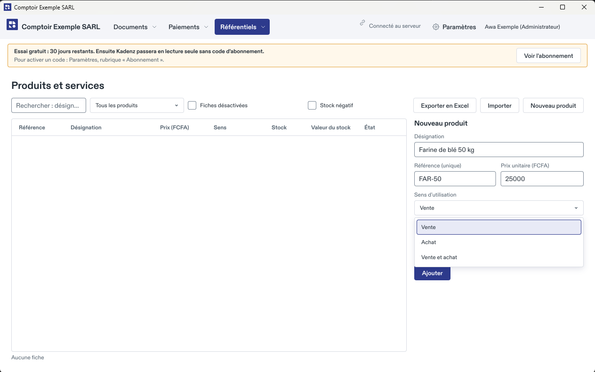

- **Vente** : proposé dans les documents de vente ;
- **Achat** : proposé dans les documents d'achat, dont le tiers est un fournisseur ;
- **Vente et achat** : proposé dans les deux.

**Nature comptable.** Choisissez **Marchandise** ou **Service** :

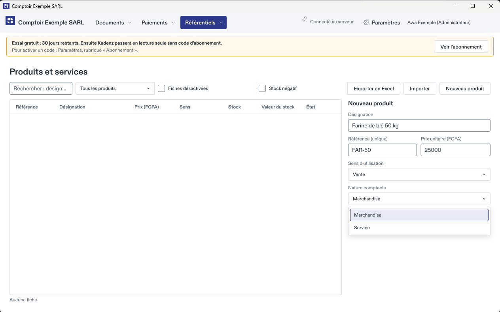

**Suivi en stock.** Cochez la case pour les articles dont vous voulez connaître la quantité en magasin. Leurs colonnes Stock et Valeur du stock se remplissent dans la liste. Laissez-la décochée pour un service, qui n'a pas de stock.

### Créer un service

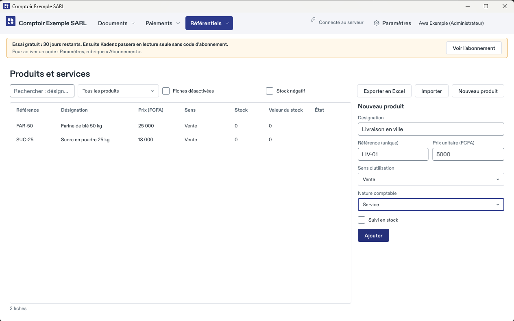

Un service se saisit comme un produit : choisissez la nature **Service** et laissez **Suivi en stock** décochée. Ici, « Livraison en ville », référence LIV-01, à 5 000 FCFA.

### La liste complète

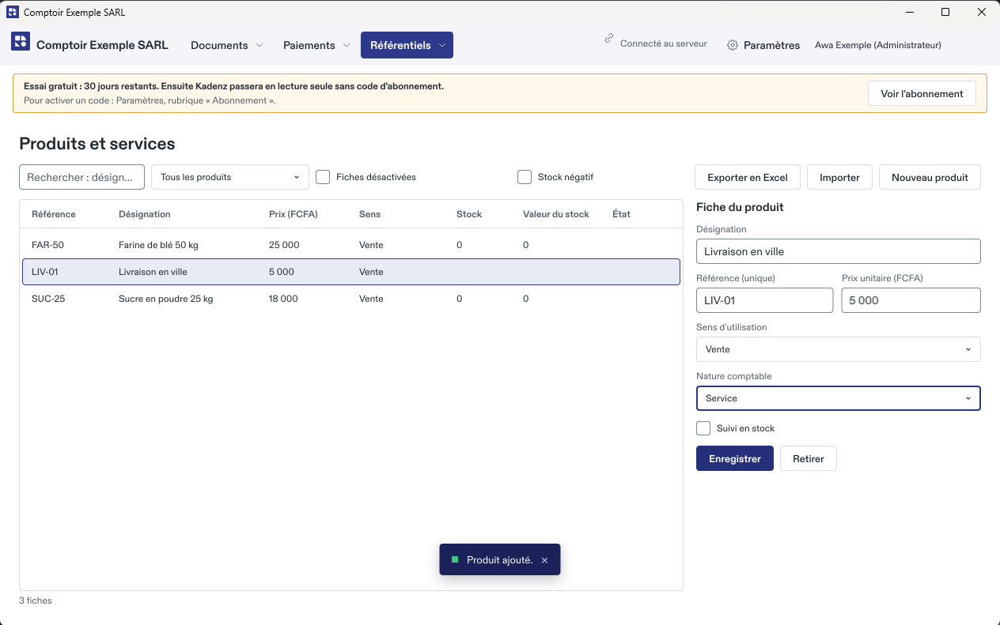

Les prix s'affichent avec le séparateur de milliers (25 000). Les articles suivis en stock affichent leur quantité et leur valeur ; le service n'en a pas. La case **Stock négatif** ne garde que les articles dont le stock est passé sous zéro, ce qui arrive quand des livraisons dépassent la quantité connue (voir le chapitre 05).

### Retirer un produit

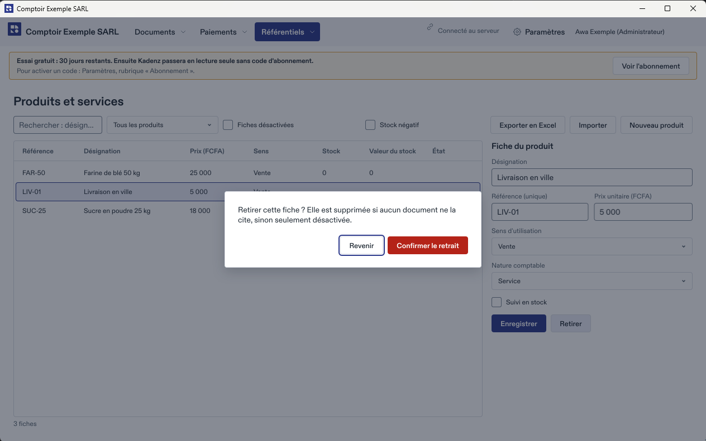

Le bouton **Retirer** ouvre une confirmation : « Retirer cette fiche ? Elle est supprimée si aucun document ne la cite, sinon seulement désactivée. » Cliquez sur **Confirmer le retrait**, ou sur **Revenir** pour renoncer. Comme pour les tiers, **Réactiver** remet une fiche désactivée en service.

## 3.3 Importer vos listes existantes

Si vous avez déjà vos clients et vos produits dans un tableur, le bouton **Importer** les charge d'un coup, au lieu de les saisir un par un. Les fichiers modèles `modele-tiers.xlsx` et `modele-produits.xlsx` sont livrés dans le dossier `modeles` de l'installation. Cette procédure est détaillée au chapitre 07.

Vous pouvez aussi sortir vos listes avec **Exporter en Excel**.

## 3.4 À retenir

- Créez les tiers et les articles avant les documents : ils se choisissent ensuite dans une liste.
- La référence d'un produit doit être unique.
- Une fiche utilisée par un document ne se supprime pas : elle se désactive.
- Le suivi en stock se décide article par article.

Un client se crée aussi directement depuis un document, sans quitter l'écran ; sa fiche se complète ensuite ici. Le chapitre suivant montre comment établir un devis puis une facture avec ces fiches.
