# 05 Stock

Kadenz tient le stock des produits que vous suivez. Il bouge tout seul quand vous recevez une commande de fournisseur et quand vous confirmez une livraison. Vous pouvez aussi le corriger par un ajustement ou par un inventaire. Ce chapitre suit un réapprovisionnement chez le fournisseur Grossiste Central SA, puis les corrections.

Le stock se trouve dans le menu **Référentiels**, rubrique **Stock**. Il n'est calculé que par le serveur : il apparaît donc sur un poste relié à un serveur, ce qui est le cas de l'édition Kadenz (un poste). Seuls les produits dont la case **Suivi en stock** est cochée (chapitre 03) ont un stock.

## 5.1 Le principe

- **Entrées** : la réception d'un bon de commande, un ajustement positif, un inventaire qui trouve plus que prévu.
- **Sorties** : la confirmation d'un bordereau de livraison, un ajustement négatif, un inventaire qui trouve moins que prévu.
- **Valorisation au coût moyen.** Chaque produit a un coût moyen. Une entrée entre à son coût, hors TVA et après remise, et une sortie sort au coût moyen du moment. La valeur du stock est la quantité multipliée par ce coût.
- **Jamais de blocage.** Une livraison n'est pas refusée faute de stock : le produit passe en stock négatif et Kadenz le signale.

## 5.2 Réapprovisionner : le bon de commande et la réception

### Préparer les produits

Un bon de commande est un document d'achat : il ne propose que les produits dont le **Sens d'utilisation** est **Achat** ou **Vente et achat** (chapitre 03). Dans l'exemple, les deux produits ont été passés à **Vente et achat**.

### Établir le bon de commande

Dans le menu **Documents**, rubrique **Bons de commande**, le bouton **Nouveau bon de commande** ouvre le formulaire.

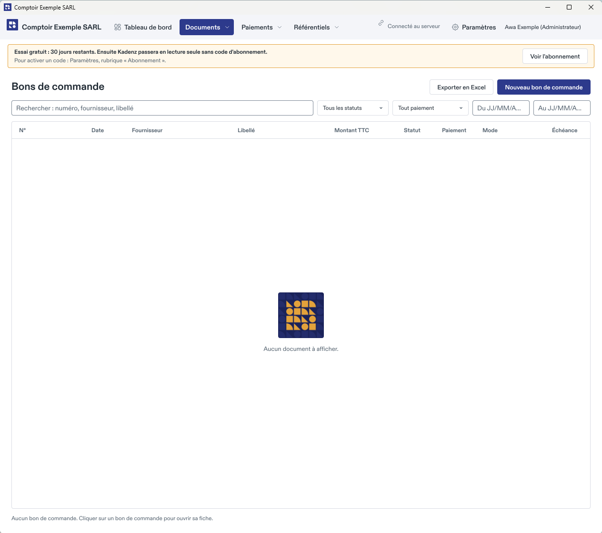

Le formulaire ressemble à celui d'un devis (chapitre 04), avec trois différences : on choisit un **Fournisseur** et non un client ; la liste des produits ne contient que les articles d'achat ; et une **Retenue** s'ajoute à la remise et à la TVA.

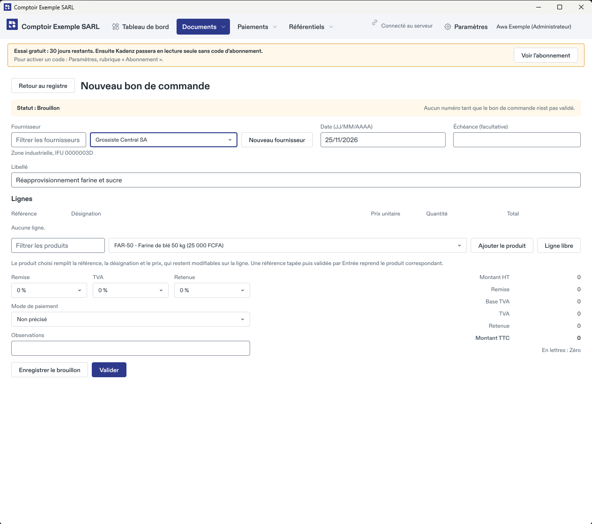

Ajoutez les articles avec **Ajouter le produit**.

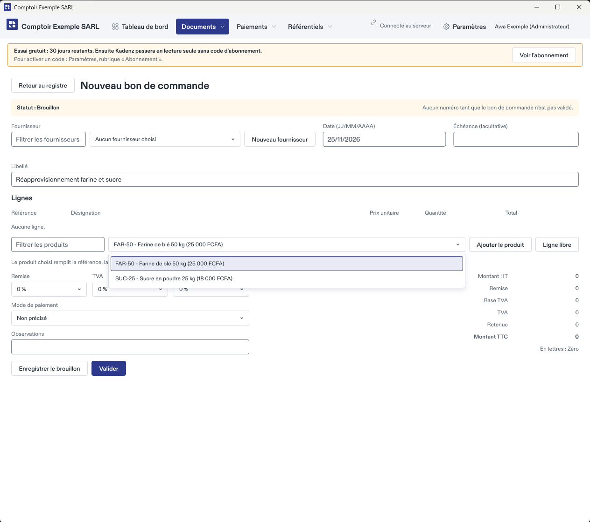

Le prix proposé est le prix de vente du produit : remplacez-le par votre prix d'achat sur la ligne. C'est ce prix qui valorise le stock. Dans l'exemple : 50 sacs de farine à 20 000 FCFA et 40 sacs de sucre à 14 000 FCFA, soit 1 560 000 FCFA.

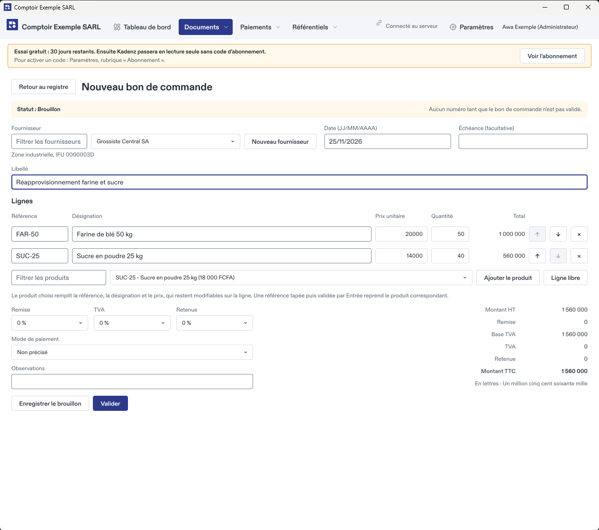

Cliquez sur **Valider** puis **Confirmer la validation** : le bon de commande reçoit son numéro, ici C2026-11-0001. Il propose les boutons habituels, et une zone **Règlements** pour payer le fournisseur (chapitre 06).

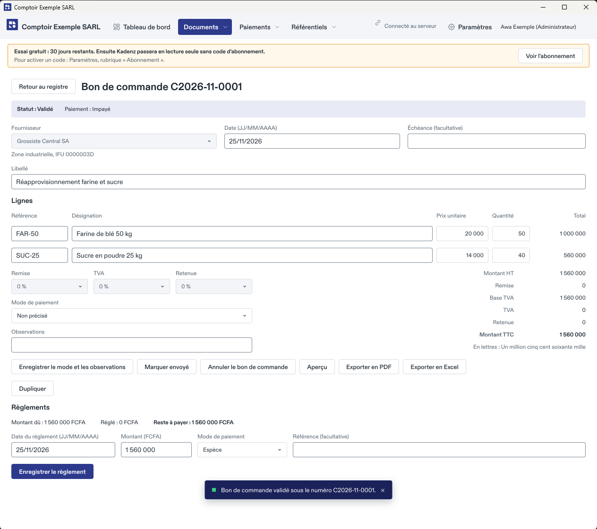

> **Astuce** Le prix d'achat saisi sur le bon de commande est le coût de l'entrée en stock. Une erreur de prix ici fausse la valeur du stock.

### Marquer envoyé, puis recevoir

La réception se saisit une fois le bon de commande **envoyé** : cliquez sur **Marquer envoyé**. Une colonne **Reçue** apparaît, avec le bouton **Enregistrer la réception**.

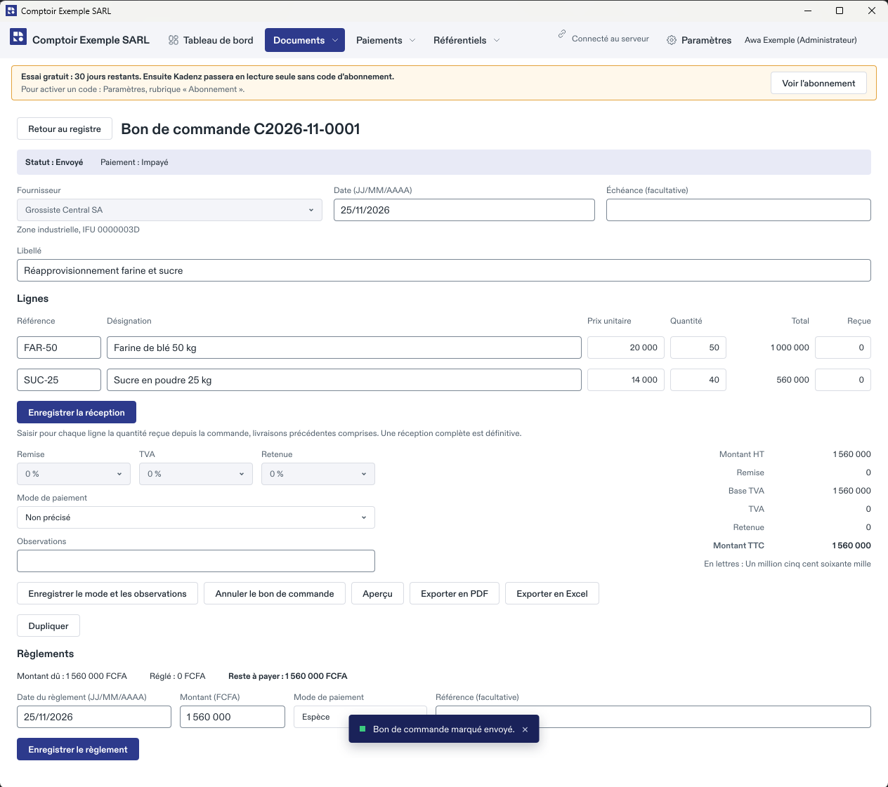

Saisissez, pour chaque ligne, la quantité reçue depuis la commande, livraisons précédentes comprises. Kadenz le rappelle sous le bouton : « Une réception complète est définitive. » Dans l'exemple, on reçoit les 50 sacs de farine et seulement 30 des 40 sacs de sucre.

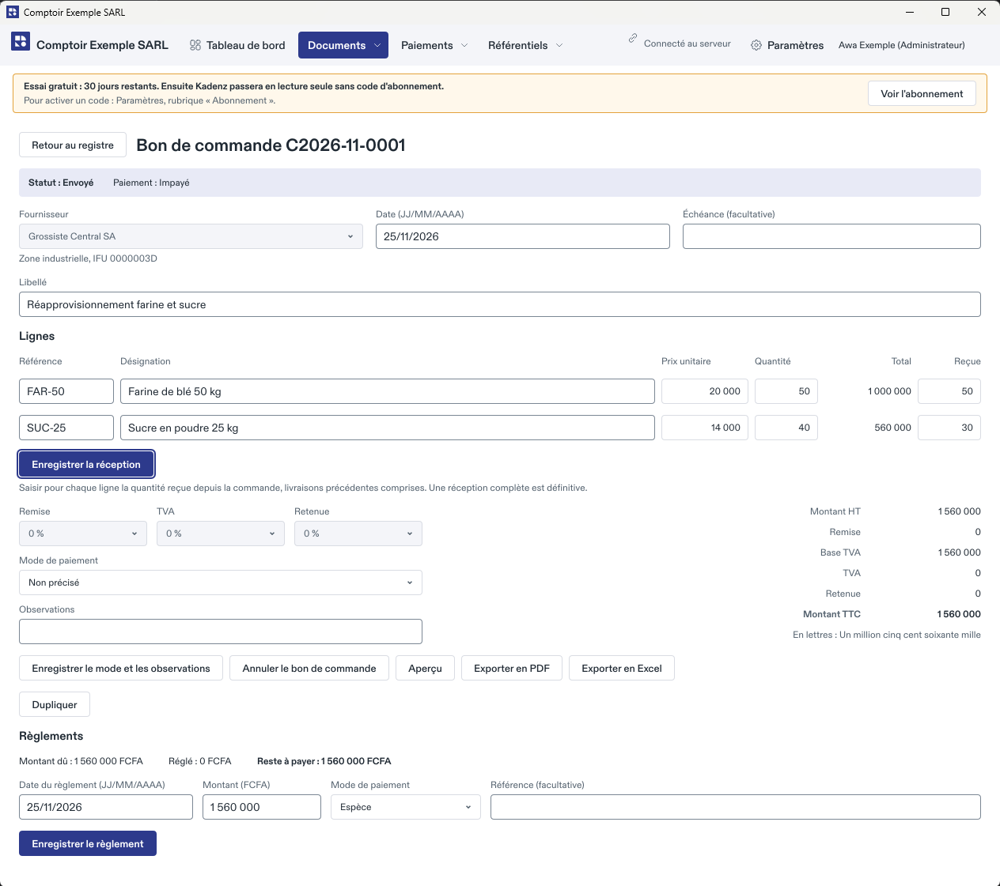

Cliquez sur **Enregistrer la réception**. Le message « Réception enregistrée. » apparaît, le statut passe à **Réception partielle** et le stock augmente. Quand toutes les quantités sont reçues, le statut devient **Réception complète**, et la réception ne se modifie plus.

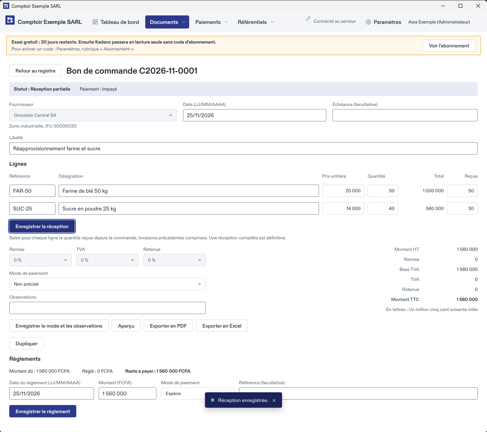

## 5.3 L'état du stock

Le menu **Référentiels**, rubrique **Stock**, ouvre trois onglets : **État du stock**, **Mouvements** et **Inventaire**.

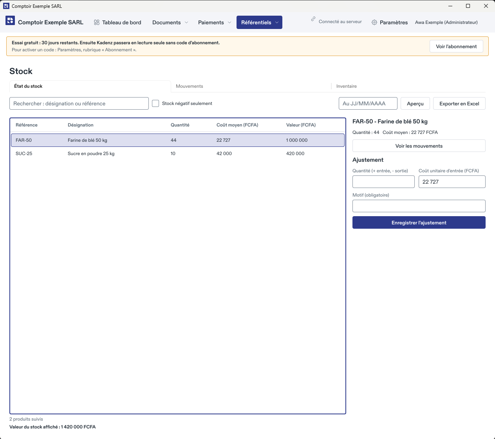

L'état du stock liste les produits suivis, avec leur **Quantité**, leur **Coût moyen (FCFA)** et leur **Valeur (FCFA)**. En bas de la liste, la **Valeur du stock affiché** donne le total. Au-dessus :

- la zone de recherche (désignation ou référence) ;
- la case **Stock négatif seulement** ;
- une date **Au JJ/MM/AAAA** pour connaître l'état du stock à un jour donné ;
- **Aperçu**, qui prépare l'état à imprimer, et **Exporter en Excel**.

Un clic sur un produit affiche, à droite, sa quantité, son coût moyen, le bouton **Voir les mouvements** et le formulaire d'ajustement.

## 5.4 Les mouvements

L'onglet **Mouvements** garde la trace de chaque entrée et de chaque sortie.

Chaque ligne indique la date, la référence, la **Nature** du mouvement, la **Quantité**, la **Valeur (FCFA)**, le **Stock après** et la **Valeur après**, le **Document** d'origine (ici le bon de commande C2026-11-0001 ou le bordereau L2026-11-0001), le **Motif** et le **Compte** qui l'a enregistré. Le bouton **Ouvrir le document** ouvre le document d'origine de la ligne sélectionnée.

On choisit le produit dans la liste de gauche, on borne la période avec les dates, et on filtre par nature : **Réceptions**, **Livraisons**, **Ajustements** ou **Inventaires**.

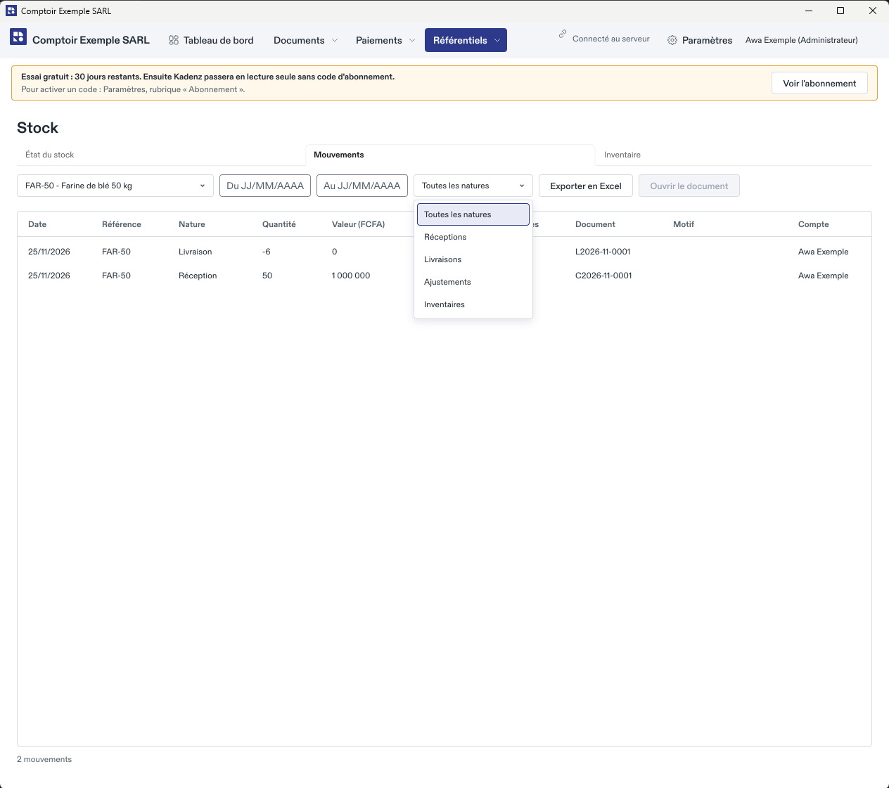

## 5.5 Corriger par un ajustement

Pour corriger un seul produit, par exemple après une casse, utilisez le formulaire **Ajustement** de l'état du stock. Sélectionnez le produit, puis renseignez :

- la **Quantité (+ entrée, - sortie)** : un nombre positif ajoute, un nombre négatif retire ;
- le **Coût unitaire d'entrée (FCFA)**, proposé au coût moyen du moment, qui compte pour une entrée ;
- le **Motif (obligatoire)**.

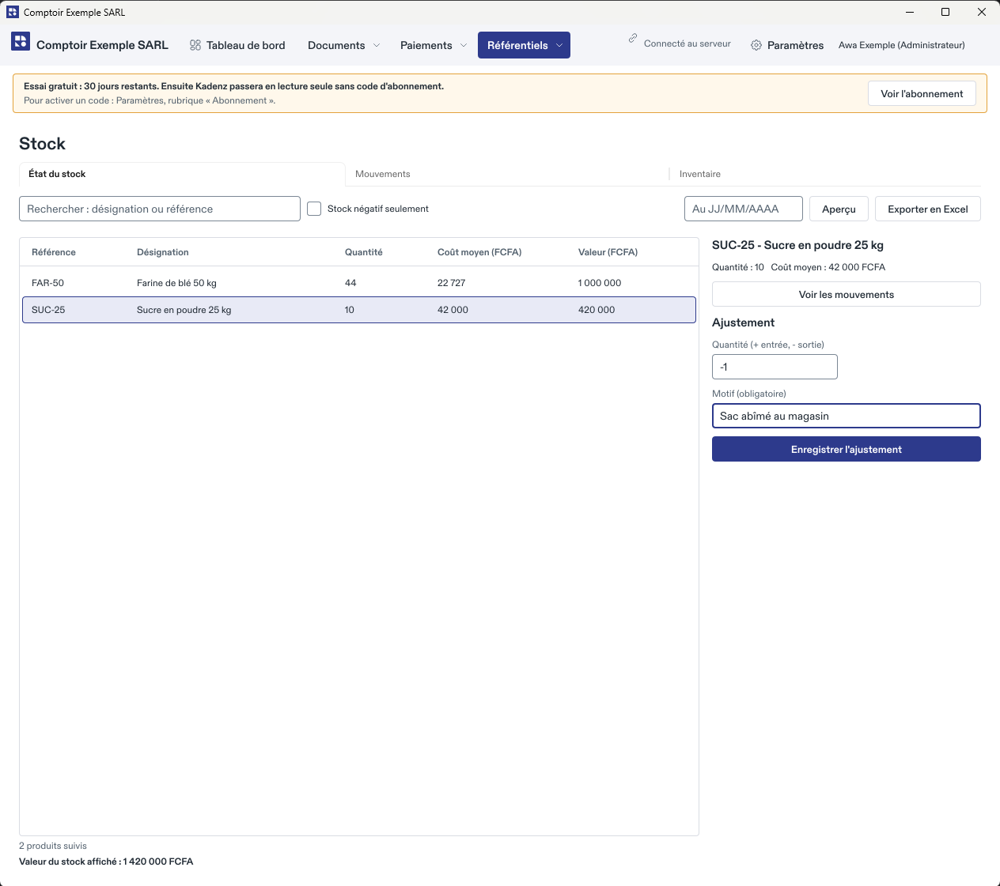

Dans l'exemple, un sac de sucre est abîmé : quantité -1, motif « Sac abîmé au magasin ». Cliquez sur **Enregistrer l'ajustement**. Le message « Ajustement enregistré. » confirme, le stock du sucre passe de 10 à 9 et sa valeur baisse de 42 000 FCFA, un sac au coût moyen.

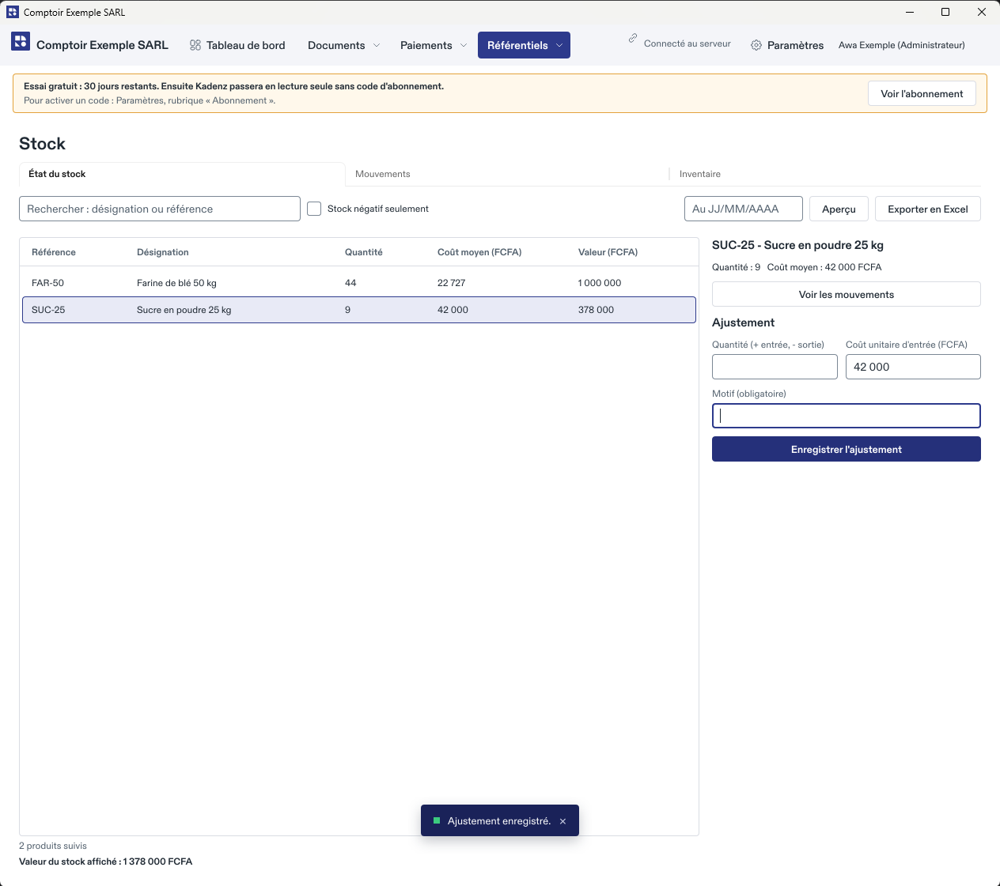

## 5.6 Contrôler par un inventaire

L'inventaire compare le stock compté au stock que Kadenz connaît, pour tous les produits d'un coup.

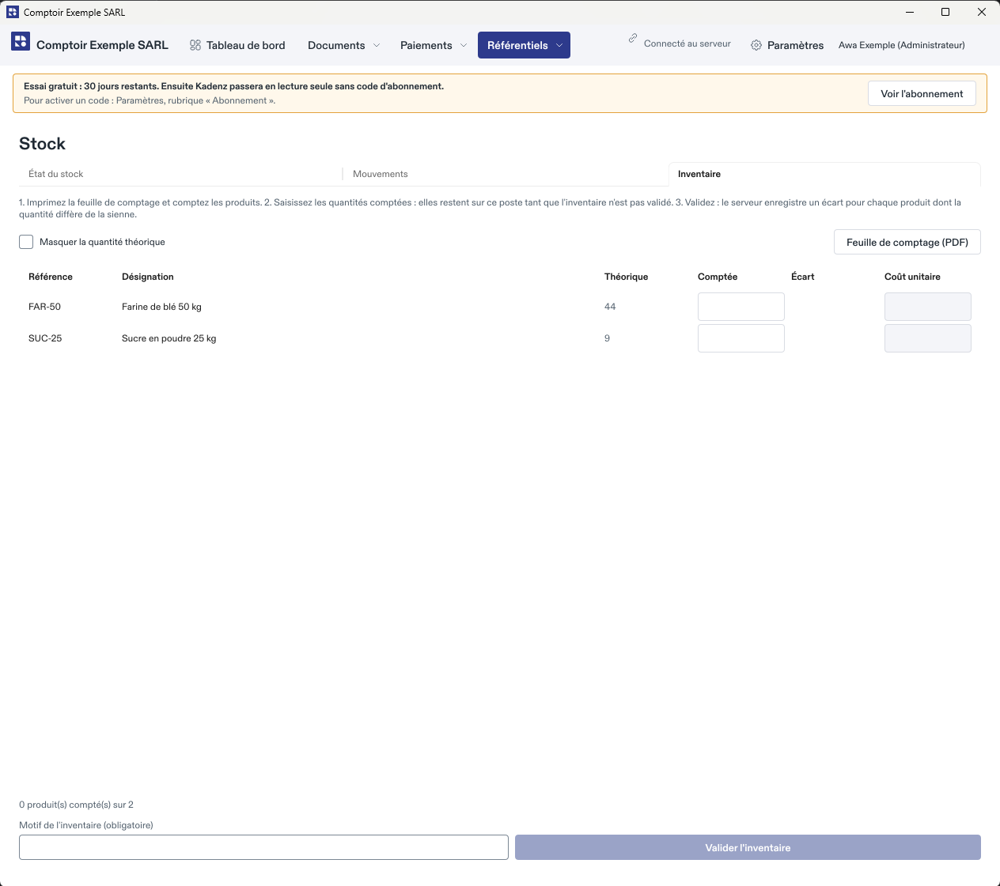

Les trois temps sont rappelés en haut de l'écran :

1. Imprimez la **Feuille de comptage (PDF)** et comptez les produits. La case **Masquer la quantité théorique** donne une feuille sans le stock attendu, pour un comptage à l'aveugle.
2. Saisissez les quantités **Comptée**s. La colonne **Écart** affiche la différence avec la quantité **Théorique**. Les quantités saisies restent sur ce poste tant que l'inventaire n'est pas validé : **Abandonner la saisie** les efface.
3. Renseignez le **Motif de l'inventaire (obligatoire)** et cliquez sur **Valider l'inventaire**.

> **Attention** Les quantités théoriques sont celles de l'ouverture de l'écran Stock. Si vous venez de saisir un ajustement, quittez l'écran Stock et rouvrez-le avant de saisir l'inventaire, pour partir des quantités à jour.

Dans l'exemple, on compte 43 sacs de farine (écart de -1) et 12 sacs de sucre (écart de +3).

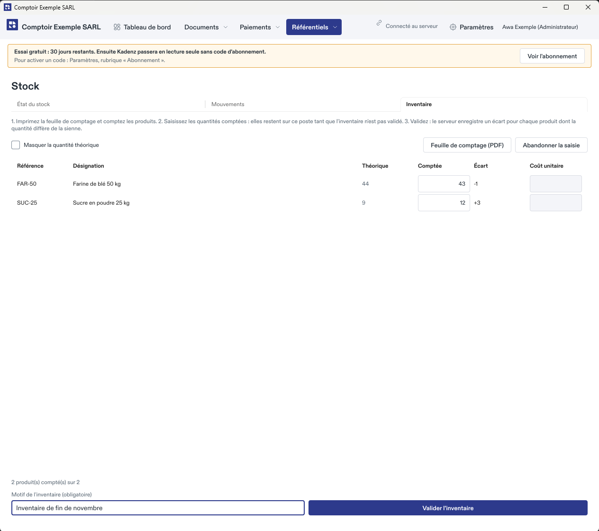

Kadenz demande confirmation : « Le serveur enregistre un mouvement d'écart pour chaque produit compté dont la quantité diffère de la sienne. Cette opération ne s'annule pas. »

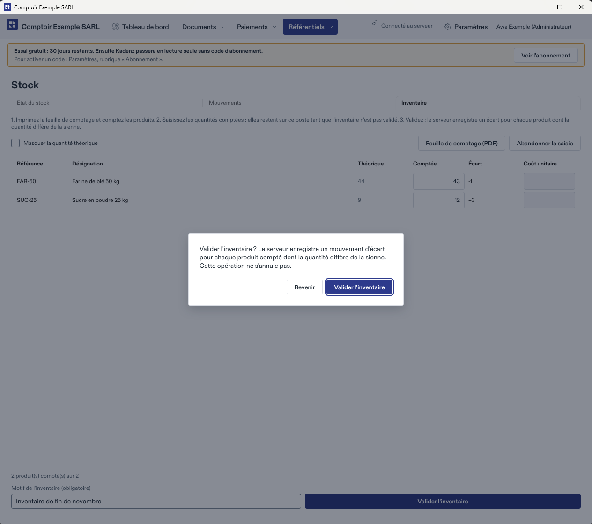

Après validation, le stock affiche les quantités comptées, et l'onglet **Mouvements** garde un mouvement d'inventaire pour chaque écart, avec son motif.

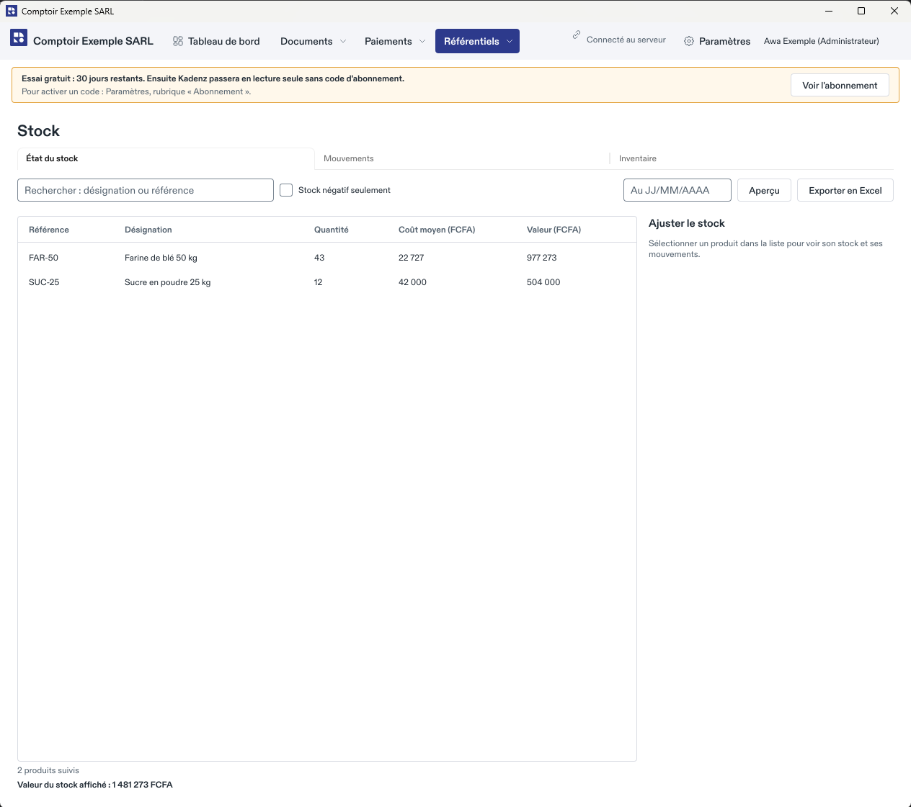

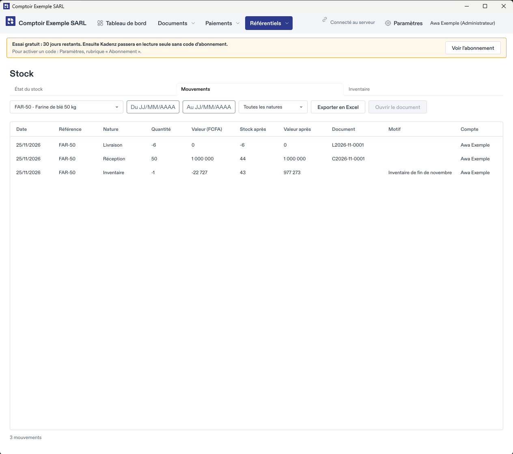

Un écart est valorisé au coût moyen du moment. Seul un produit dont la quantité part de zéro demande un **Coût unitaire** : c'est l'inventaire d'ouverture (section 5.8).

## 5.7 Le stock négatif

Quand une livraison dépasse la quantité connue, le produit passe en stock négatif. Kadenz prévient avant de confirmer la livraison (chapitre 04) et signale le produit : dans la liste des produits (case **Stock négatif**), dans l'état du stock (case **Stock négatif seulement**) et dans le tableau de bord.

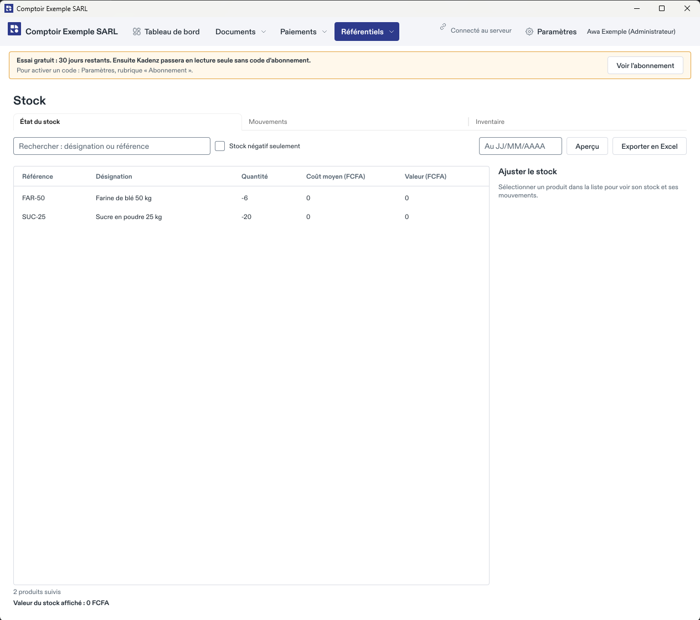

Dans cette capture, prise avant la réception du bon de commande, la farine est à -6 et le sucre à -20 : les livraisons du chapitre 04 ont eu lieu sans stock. Kadenz affiche aussi : « Corrigez-le par un ajustement ou un inventaire. » En pratique, la réception d'un bon de commande comble d'abord le négatif.

## 5.8 Ouvrir le stock proprement

Le stock de départ de Kadenz est zéro. Pour un produit qui a déjà du stock réel, enregistrez-le avant de vendre.

- Le plus simple est l'**inventaire d'ouverture** : comptez vos produits, saisissez les quantités et, pour chaque produit dont le stock part de zéro, son **Coût unitaire**.
- Pour un seul produit, un **ajustement** positif avec son **Coût unitaire d'entrée** fait le même travail.

> **Attention** Une livraison faite sans stock sort à un coût de zéro tant que le produit n'a jamais été acheté. Quand la marchandise arrive ensuite, ce manque se répercute sur le coût moyen. Dans l'exemple, la farine acquise à 20 000 FCFA affiche 22 727 FCFA de coût moyen, et le sucre acquis à 14 000 FCFA affiche 42 000 FCFA. Pour des coûts justes, enregistrez le stock de départ avant les premières livraisons.

## 5.9 À retenir

- Le stock bouge par les réceptions, les livraisons confirmées, les ajustements et les inventaires.
- La réception se saisit sur un bon de commande envoyé ; sa valeur vient du prix d'achat de la ligne.
- Un ajustement corrige un produit, un inventaire les corrige tous ; les deux demandent un motif.
- Le stock négatif est permis mais signalé : corrigez-le sans attendre.
- Saisissez le stock de départ avant les premières livraisons.

Le chapitre suivant traite des paiements, du tableau de bord et des relances.
