# 06 Paiements, tableau de bord et relances

Ce chapitre suit l'argent : les règlements que vous recevez de vos clients, ceux que vous versez à vos fournisseurs, les factures en retard à relancer, et le tableau de bord qui résume le tout. Le menu **Paiements** réunit **Règlements**, **Suivi fournisseurs**, **Relances** et **Comptabilité** (chapitre 09). Le **Tableau de bord** a sa propre entrée dans la barre du haut.

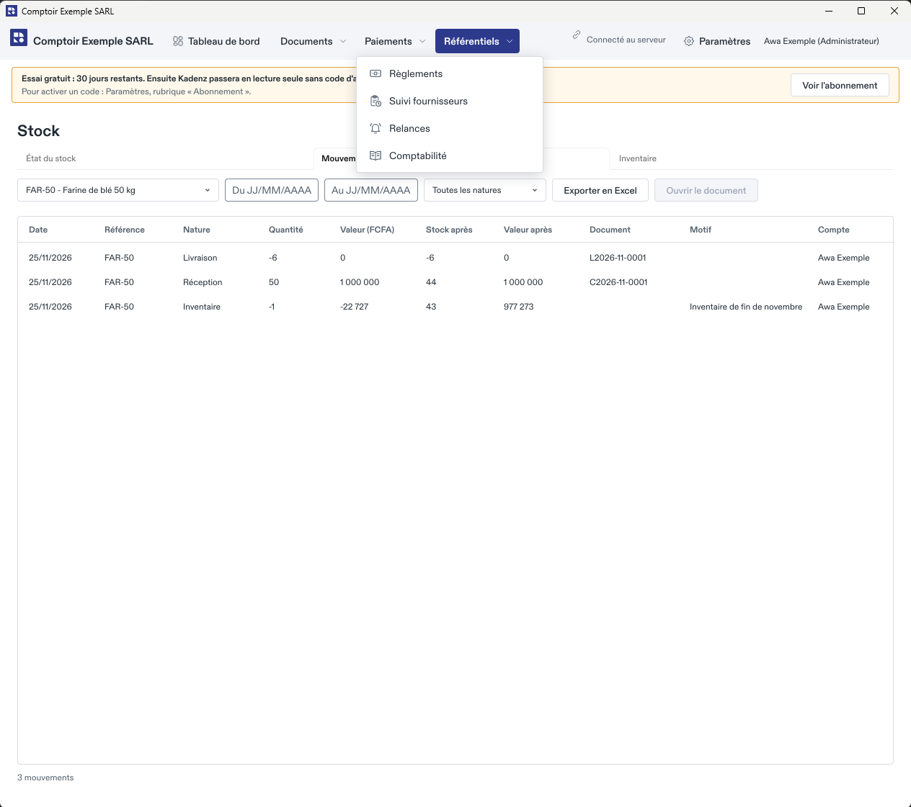

Les menus **Suivi fournisseurs**, **Relances** et **Tableau de bord** dépendent des modules de votre abonnement. Pendant l'essai gratuit, tous les modules sont actifs.

## 6.1 Les états de paiement

Chaque facture porte un état de paiement, calculé tout seul à partir des règlements saisis :

- **Impayé** : aucun règlement ;
- **Partiel** : une partie du montant dû est réglée ;
- **Payé** : le montant dû est entièrement réglé.

Le **montant dû** est le montant TTC de la facture, moins les avoirs émis sur elle. Dans l'exemple, la facture F2026-11-0001 fait 683 810 FCFA et l'avoir A2026-11-0001 en retire 40 356 : il reste 643 454 FCFA à encaisser, et c'est ce montant que Kadenz demande.

## 6.2 Encaisser un règlement sur une facture

Ouvrez la facture validée : sous les boutons d'action, la zone **Règlements** affiche le **Montant dû**, le **Réglé** et le **Reste à payer**.

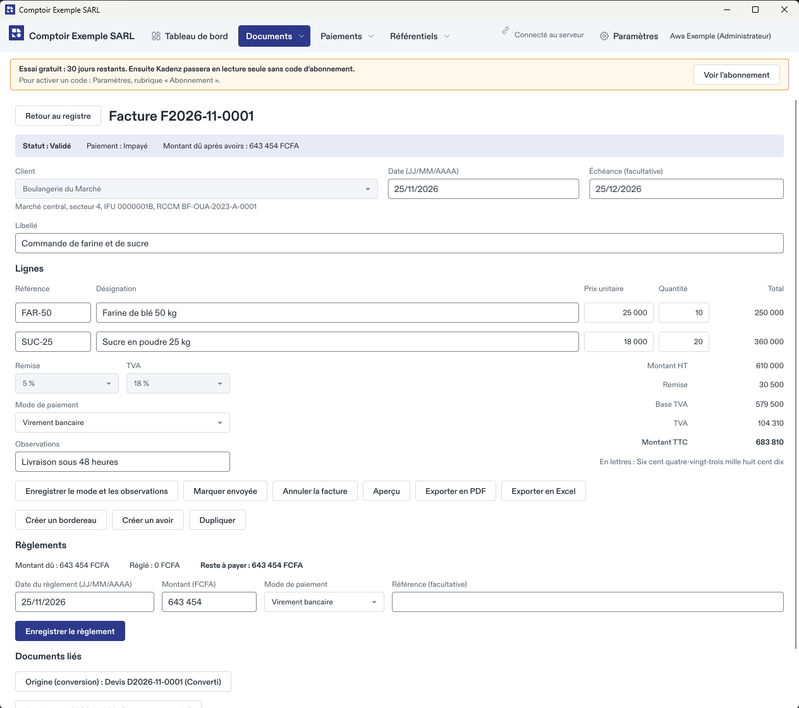

Pour enregistrer un règlement, renseignez :

- la **Date du règlement** (aujourd'hui par défaut) ;
- le **Montant (FCFA)**, proposé au reste à payer ;
- le **Mode de paiement**, parmi la liste fixée à l'installation (Espèce, Chèque, Virement bancaire, Carte bancaire, Moov money, Orange money) ;
- une **Référence** facultative : numéro de chèque, de virement ou de transaction.

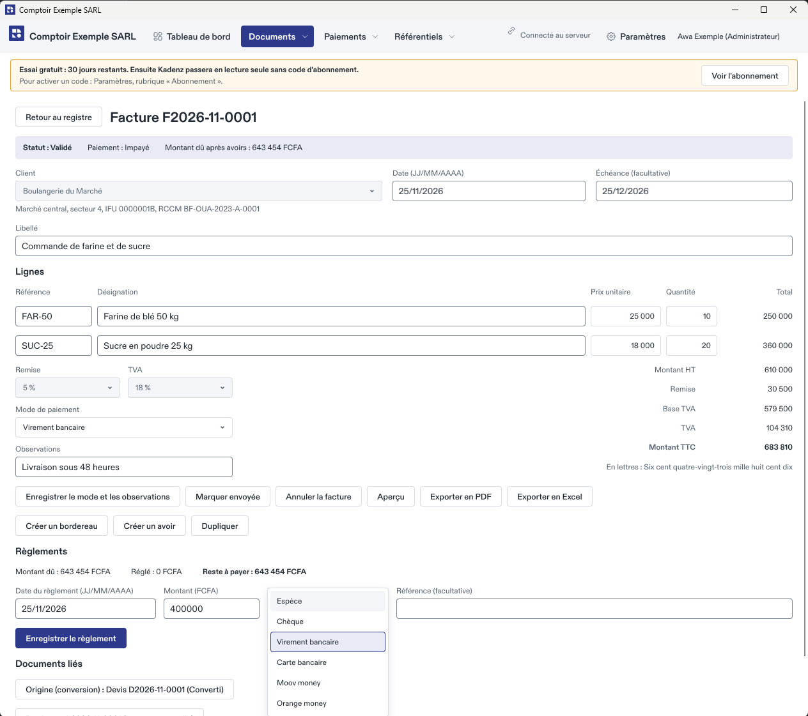

Cliquez sur **Enregistrer le règlement**. Le message « Règlement enregistré. » apparaît, le règlement s'ajoute à la liste avec le nom de la personne qui l'a saisi, et l'état de la facture passe à **Partiel**. Ici, un premier virement de 400 000 FCFA (référence VIR-0001) laisse 243 454 FCFA à payer.

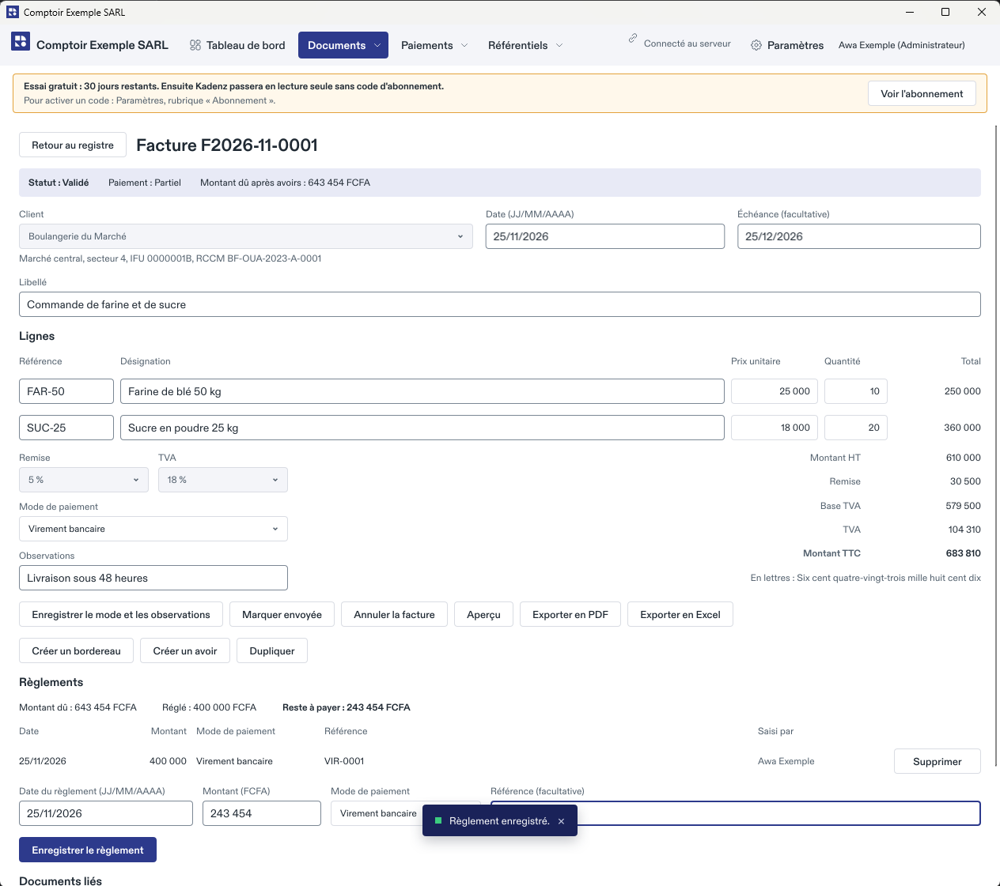

Le second virement de 243 454 FCFA (VIR-0002) solde la facture : le reste à payer tombe à 0 et l'état devient **Payé**.

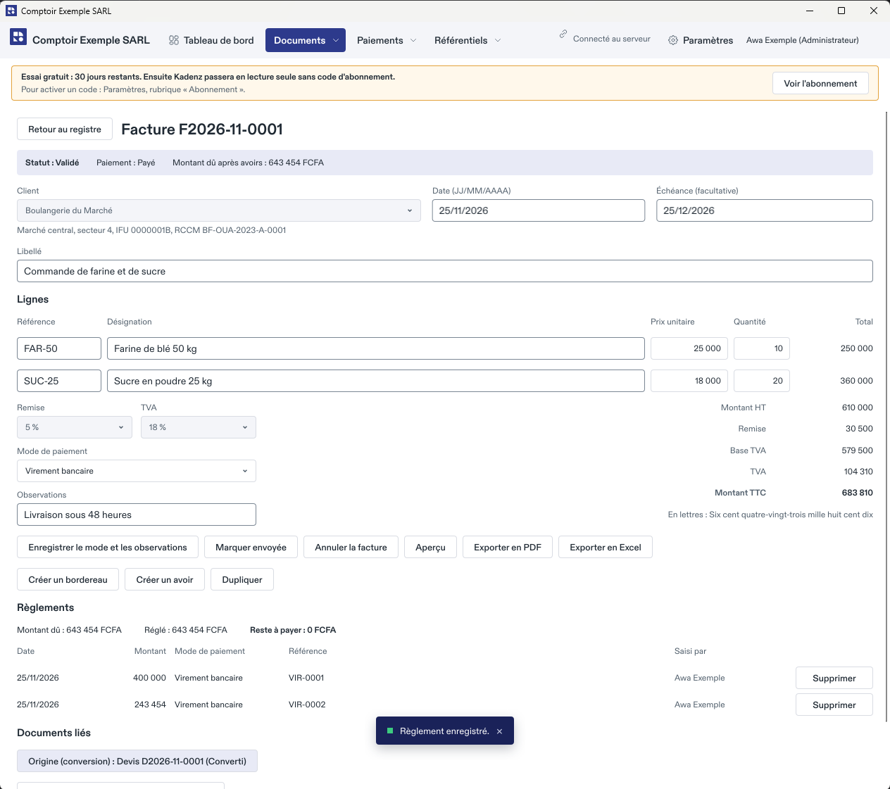

> **Attention** Kadenz refuse un règlement qui dépasse le reste à payer, ou dont le montant est nul ou négatif. Le montant se saisit en nombre entier de FCFA, sans espace ni lettre.

Pour corriger une erreur, le bouton **Supprimer** en bout de ligne retire un règlement. L'opération est inscrite dans l'historique du document, comme toute modification.

## 6.3 Le registre des règlements

Le menu **Paiements**, rubrique **Règlements**, liste tous les règlements de tous les documents.

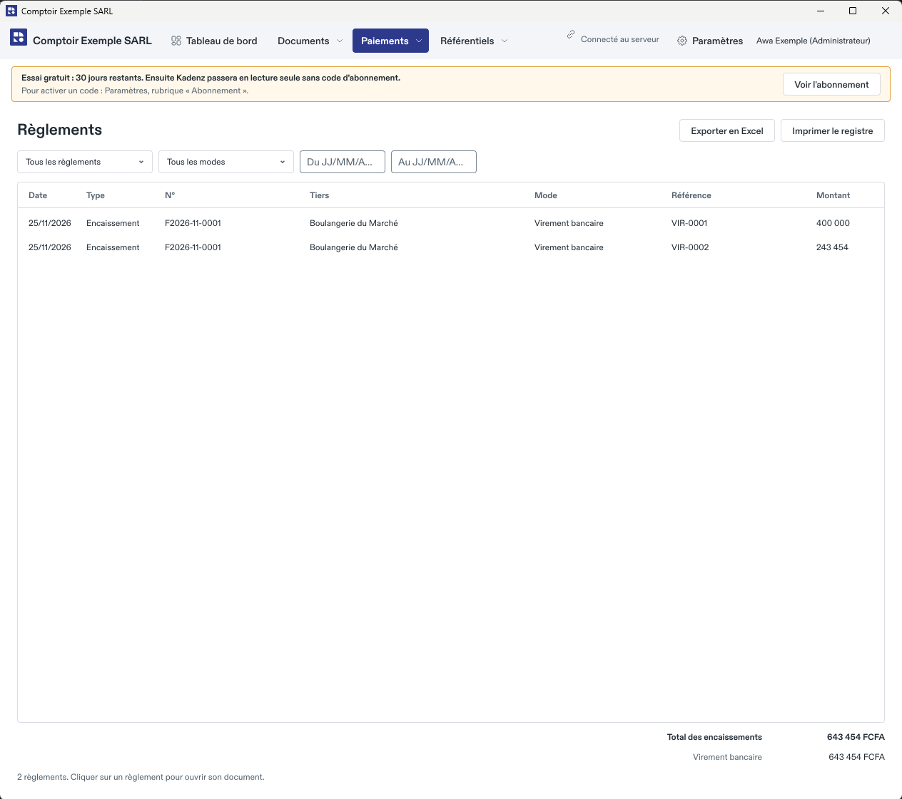

Chaque ligne indique la date, le **Type** (**Encaissement** pour une facture, **Décaissement** pour un bon de commande), le numéro du document, le tiers, le mode, la référence et le montant. En bas, **Total des encaissements** (ou des décaissements) est ventilé par mode de paiement. Un clic sur une ligne ouvre le document concerné.

Trois filtres réduisent la liste : le type (**Tous les règlements**, **Encaissements**, **Décaissements**), le mode de paiement, et une période (**Du** et **Au**, au format JJ/MM/AAAA).

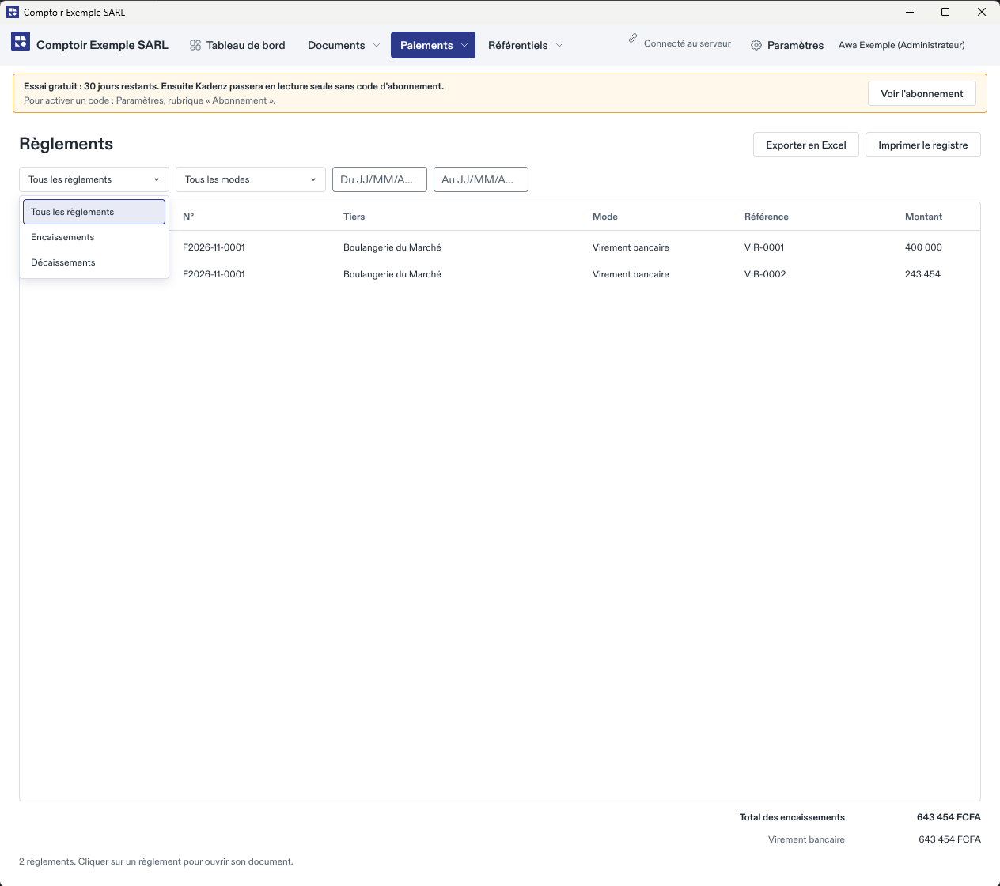

Deux boutons sortent le registre : **Exporter en Excel** et **Imprimer le registre**.

## 6.4 Payer un fournisseur

Un bon de commande validé a la même zone **Règlements**, avec les mêmes champs. Dans l'exemple, un premier paiement de 600 000 FCFA en espèces (ESP-0001) est versé sur le bon de commande C2026-11-0001 de 1 560 000 FCFA.

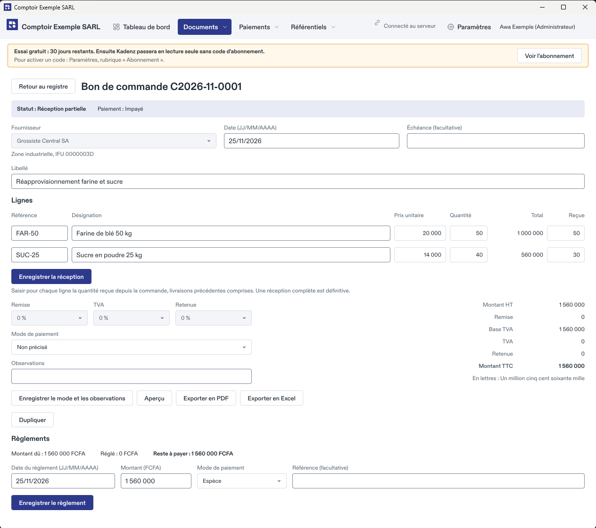

L'état du bon de commande passe à **Partiel**, et le reste à payer s'établit à 960 000 FCFA.

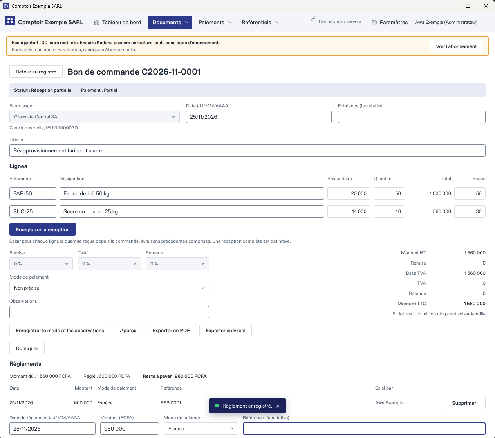

Le paiement d'un bon de commande est indépendant de sa réception : on peut payer avant, pendant ou après la livraison de la marchandise (chapitre 05).

## 6.5 Le suivi fournisseurs

Le menu **Paiements**, rubrique **Suivi fournisseurs**, liste les bons de commande qui restent à payer.

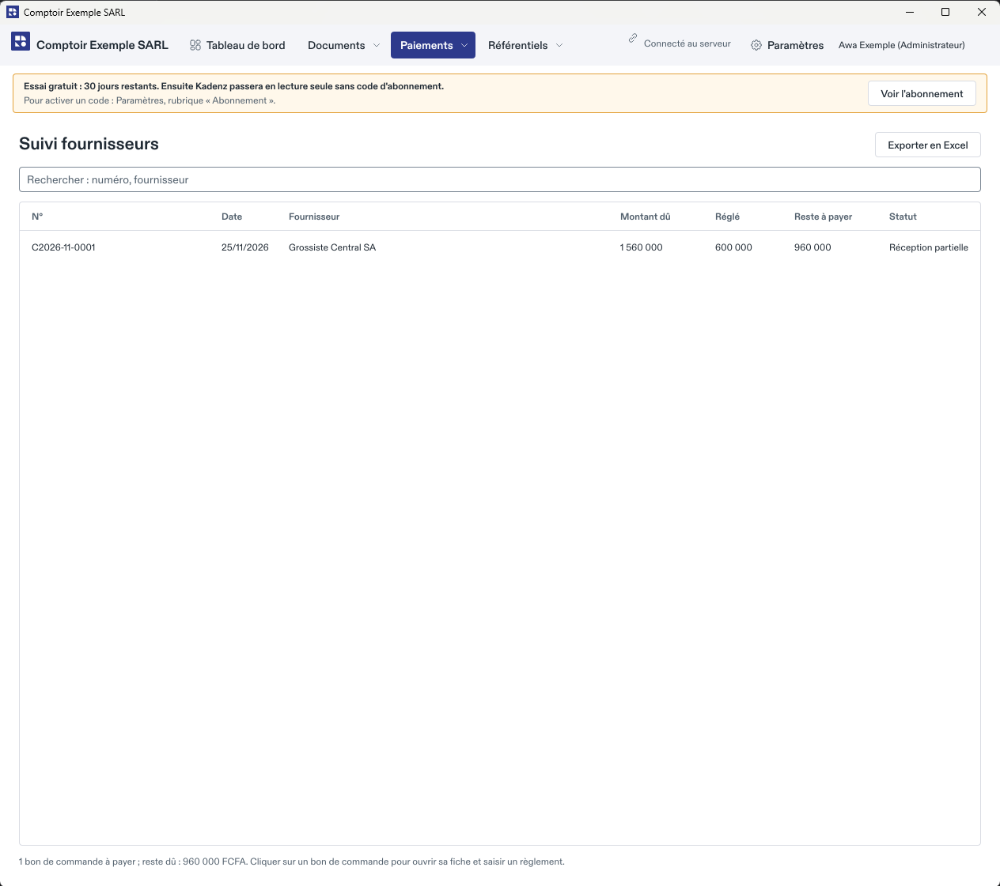

Les colonnes donnent le numéro, la date, le fournisseur, le **Montant dû**, le **Réglé**, le **Reste à payer** et le **Statut**. Une zone de recherche retrouve un numéro ou un fournisseur. En bas, Kadenz totalise ce qui reste dû. Un clic sur un bon de commande ouvre sa fiche pour saisir un règlement. Le bouton **Exporter en Excel** sort la liste.

## 6.6 Les relances

Le menu **Paiements**, rubrique **Relances**, rassemble les factures **échues** : celles dont l'échéance est dépassée et qui ne sont pas soldées. Une facture sans échéance n'est jamais relancée : renseignez donc l'**Échéance** dans la facture (chapitre 04).

Dans l'exemple, une facture du 1er octobre 2026, échue le 15 octobre, reste impayée à la date du jour.

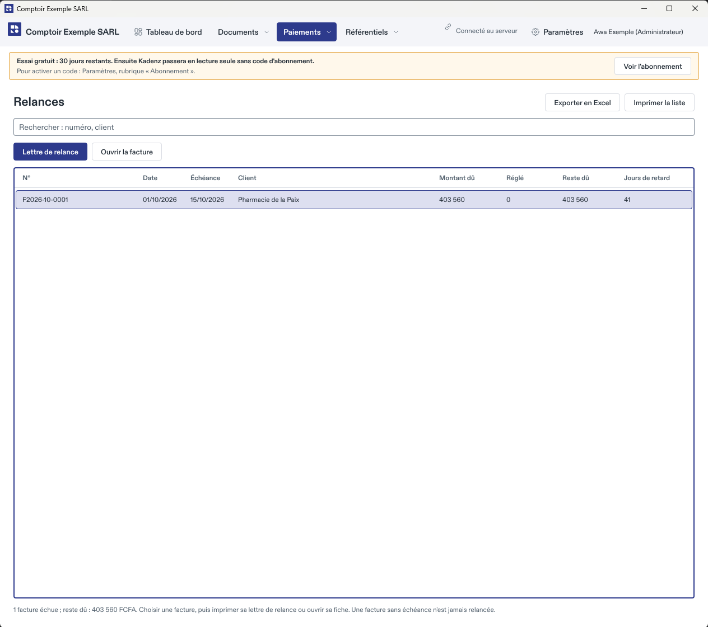

La liste donne le numéro, la date, l'échéance, le client, le **Montant dû**, le **Réglé**, le **Reste dû** et les **Jours de retard**. Au-dessus, une zone de recherche retrouve un numéro ou un client.

Sélectionnez une facture, puis :

- **Lettre de relance** prépare la lettre, datée du jour, à imprimer ou à enregistrer en PDF ;
- **Ouvrir la facture** l'ouvre pour saisir le règlement attendu.

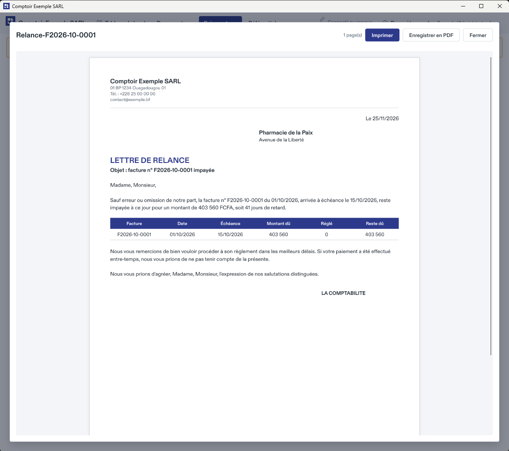

La lettre reprend l'en-tête de votre entreprise, le client, la facture en retard, le nombre de jours de retard et le montant restant dû. Son texte se règle dans **Paramètres**, rubrique **Paiements** (section 6.8). Les boutons **Imprimer** et **Enregistrer en PDF** la sortent, **Fermer** revient à la liste. **Exporter en Excel** et **Imprimer la liste** sortent la liste des factures échues.

## 6.7 Le tableau de bord

Le **Tableau de bord** résume l'activité sur une période. Il s'ouvre en premier au lancement de Kadenz.

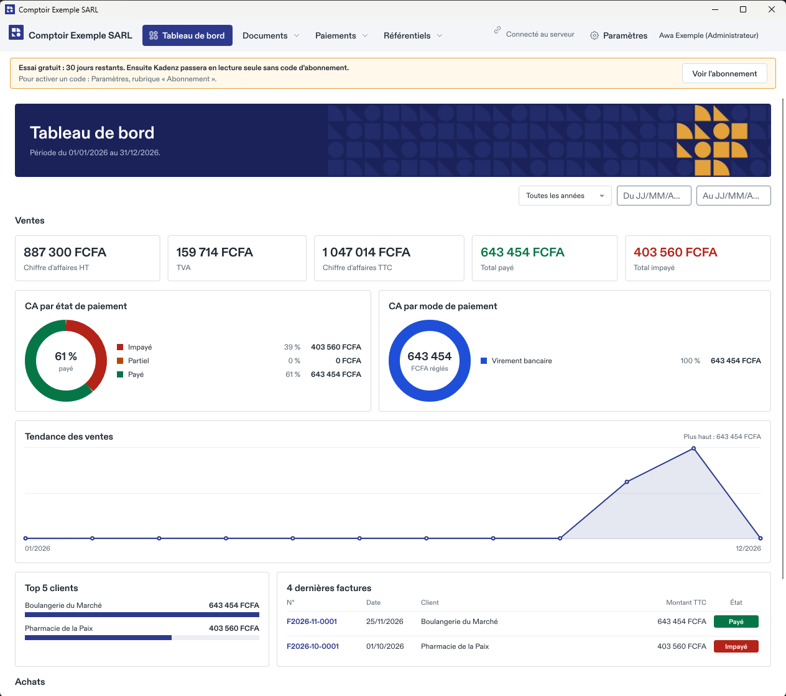

### Choisir la période

En haut à droite, la liste **Toutes les années** permet de choisir une année, et les champs **Du** et **Au** bornent une période précise (JJ/MM/AAAA). Le bandeau rappelle la période affichée.

### Les ventes

- **Cinq indicateurs** : le **Chiffre d'affaires HT**, la **TVA**, le **Chiffre d'affaires TTC**, le **Total payé** (en vert) et le **Total impayé** (en rouge). Ils tiennent compte des avoirs.
- **CA par état de paiement** : un anneau qui répartit le chiffre d'affaires entre **Impayé**, **Partiel** et **Payé**, avec le pourcentage et le montant de chaque part.
- **CA par mode de paiement** : un anneau qui répartit les règlements encaissés entre les modes.
- **Tendance des ventes** : la courbe du chiffre d'affaires, mois par mois.
- **Top 5 clients** : les cinq clients qui pèsent le plus.
- **Dernières factures** : les quatre plus récentes, avec leur état (**Payé**, **Partiel**, **Impayé**). Un clic sur un numéro ouvre la facture.

Dans l'exemple, le chiffre d'affaires TTC atteint 1 047 014 FCFA : 643 454 FCFA payés (61 %) et 403 560 FCFA impayés (39 %).

### Les achats et le stock

Plus bas, le tableau de bord affiche **Total des bons de commande**, **Payé aux fournisseurs** et **Reste dû aux fournisseurs** (ici 1 560 000, 600 000 et 960 000 FCFA). Une dernière ligne, **Produits en stock négatif**, compte les produits sous zéro : un clic dessus ouvre l'état du stock sur ces seuls produits (chapitre 05).

## 6.8 Régler les modes de paiement et la lettre de relance

La rubrique **Paiements** des **Paramètres** fixe la liste des **Modes de paiement**, séparés par des points-virgules, qui alimente le choix dans les règlements. Elle règle aussi la **Lettre de relance** : le **Titre imprimé**, l'**Objet**, le texte avant et après le tableau récapitulatif, et le **Signataire**.

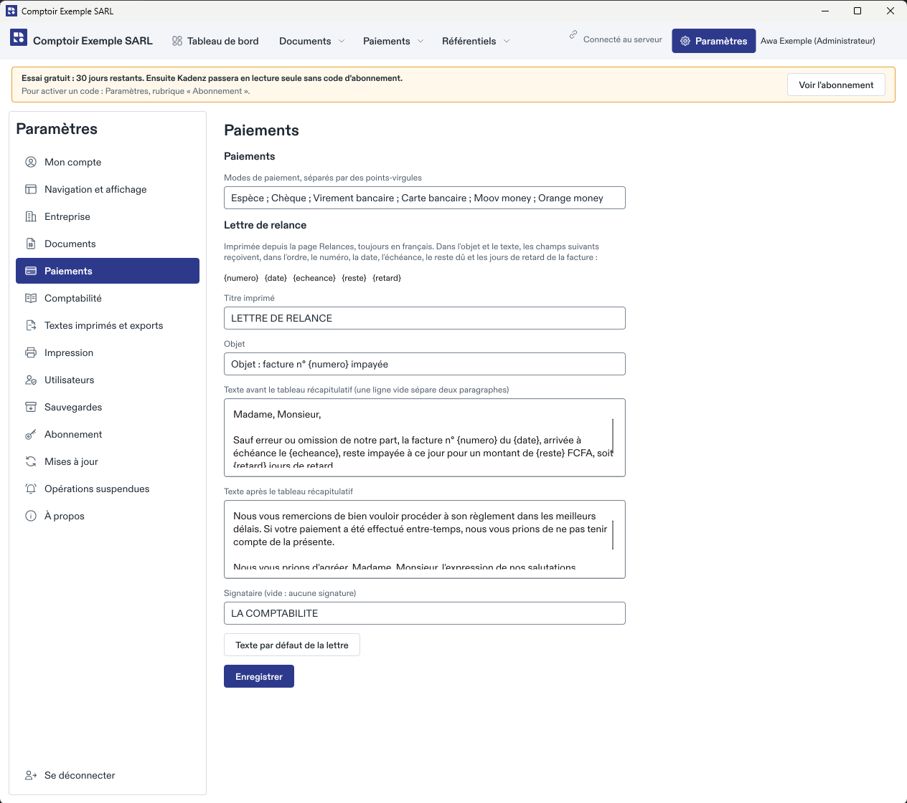

Dans l'objet et le texte, cinq champs sont remplacés à l'impression : `{numero}`, `{date}`, `{echeance}`, `{reste}` et `{retard}` (numéro, date, échéance, reste dû et jours de retard de la facture). Une ligne vide sépare deux paragraphes. **Texte par défaut de la lettre** rétablit le texte d'origine ; **Enregistrer** valide.

## 6.9 À retenir

- L'état Impayé, Partiel ou Payé se calcule seul à partir des règlements.
- Un règlement ne peut dépasser le reste à payer ; on le corrige avec **Supprimer**.
- Le registre des règlements regroupe encaissements et décaissements, filtrables et exportables.
- Renseignez l'échéance de chaque facture : sans elle, aucune relance n'est possible.
- Le tableau de bord se lit sur une période que vous choisissez.

Le chapitre suivant explique comment importer vos clients, vos produits et vos fournisseurs depuis un tableur.
