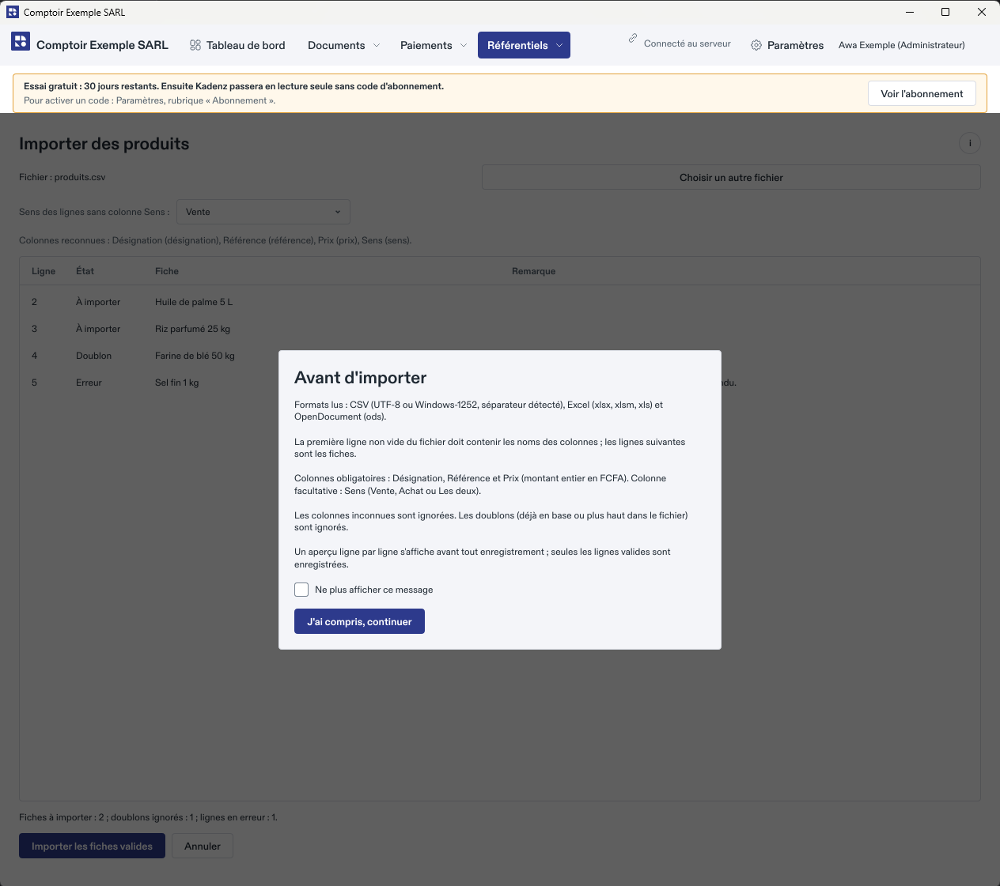
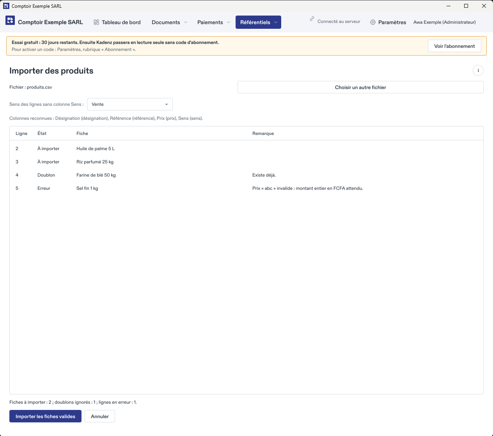
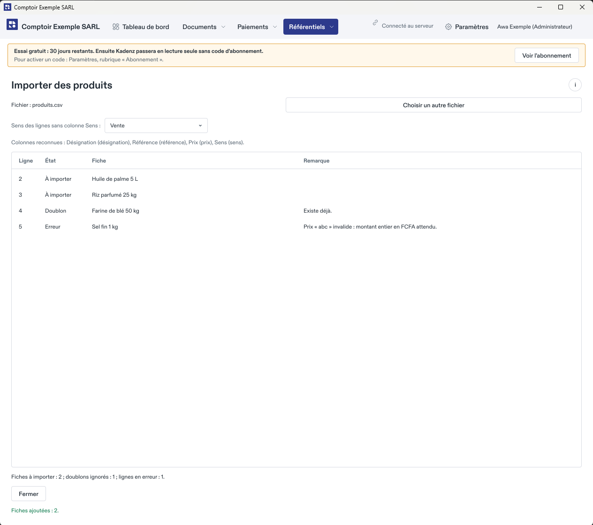
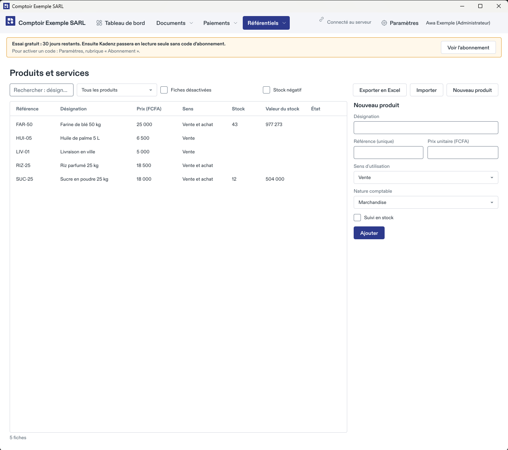
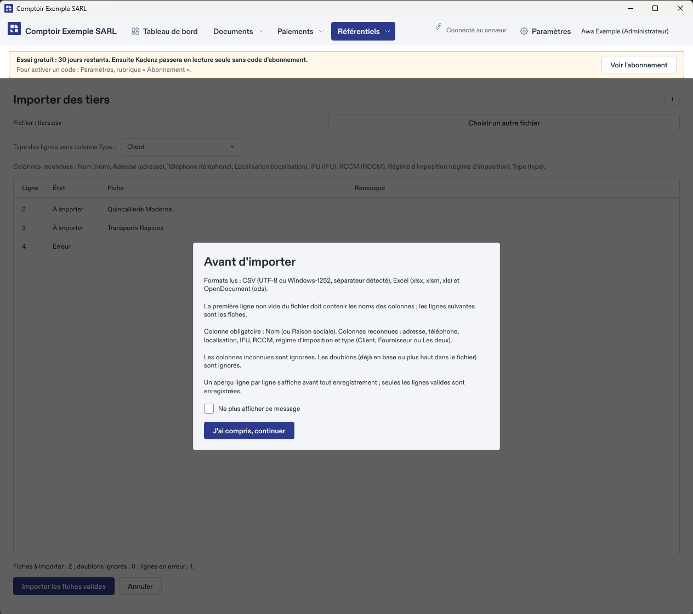
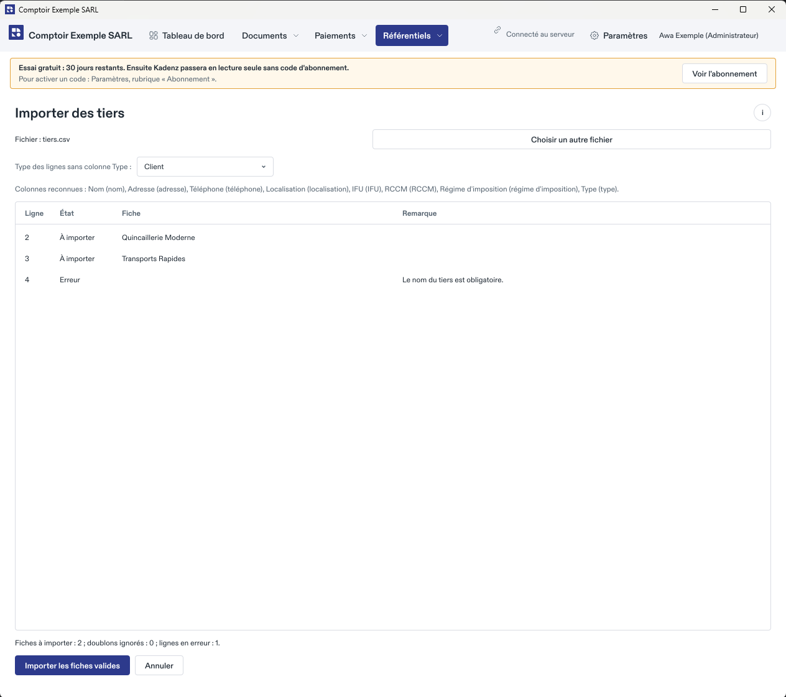
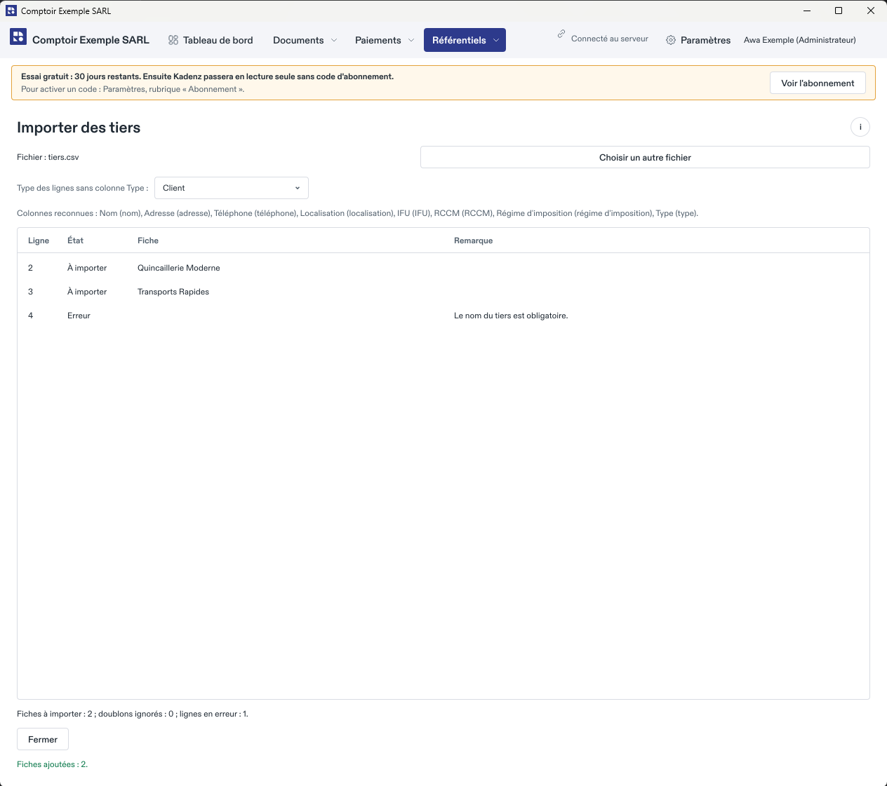
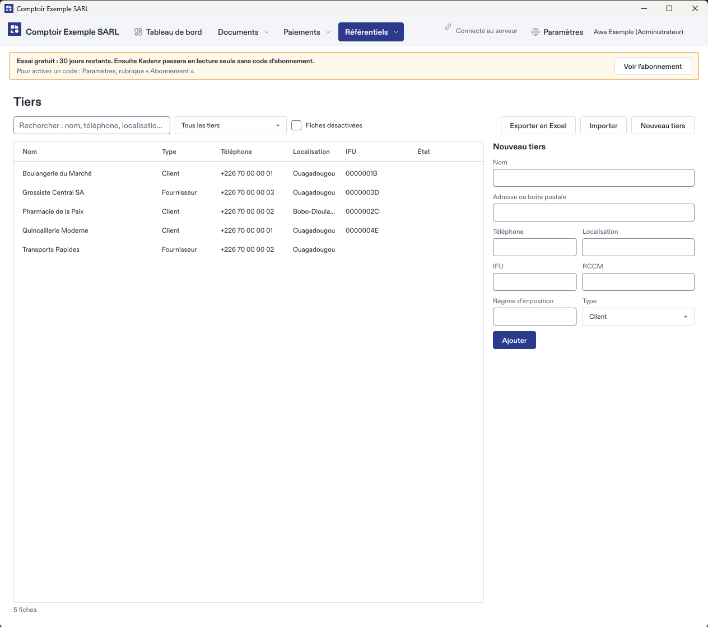

# 07 Importer vos tiers et vos produits

Si vous avez déjà vos clients, vos fournisseurs et vos produits dans un tableur, inutile de les ressaisir : Kadenz les charge d'un coup depuis un fichier. L'import se lance depuis les pages **Tiers** et **Produits** du menu **Référentiels**, avec le bouton **Importer**.

Dans tous les cas, Kadenz montre d'abord un aperçu ligne par ligne. Rien n'est enregistré tant que vous ne l'avez pas confirmé, et seules les lignes valides sont enregistrées.

Les fichiers de ce chapitre sont fictifs : deux petites listes de quatre et trois lignes.

## 7.1 Préparer le fichier

### Formats acceptés

Kadenz lit les fichiers **CSV** (codage UTF-8 ou Windows-1252, séparateur détecté automatiquement), **Excel** (xlsx, xlsm, xls) et **OpenDocument** (ods).

### Les fichiers modèles

Deux modèles sont livrés avec Kadenz, dans le dossier `modeles` de l'installation, en deux formats chacun :

- `modele-tiers.xlsx` et `modele-tiers.csv` ;
- `modele-produits.xlsx` et `modele-produits.csv`.

Ouvrez le modèle dans votre tableur, remplacez les lignes d'exemple par vos données, puis enregistrez. Vous pouvez aussi partir de votre propre fichier, pourvu que sa première ligne non vide contienne les noms de colonnes.

### Les colonnes d'un fichier de tiers

| Colonne | Obligatoire | Contenu |
| --- | --- | --- |
| **Nom** (ou **Raison sociale**) | oui | le nom du client ou du fournisseur |
| Adresse | non | adresse ou boîte postale |
| Téléphone | non | numéro de téléphone |
| Localisation | non | ville ou quartier |
| IFU | non | identifiant fiscal |
| RCCM | non | numéro du registre du commerce |
| Régime d'imposition | non | régime fiscal |
| Type | non | **Client**, **Fournisseur** ou **Les deux** |

### Les colonnes d'un fichier de produits

| Colonne | Obligatoire | Contenu |
| --- | --- | --- |
| **Désignation** | oui | le libellé de l'article |
| **Référence** | oui | un code court, unique |
| **Prix** | oui | un montant entier en FCFA, sans espace |
| Sens | non | **Vente**, **Achat** ou **Les deux** |

Les colonnes qui ne figurent pas dans ces tableaux sont ignorées. Les accents et les majuscules des titres de colonnes n'ont pas d'importance.

> **Astuce** Un fichier de produits n'a pas de colonne de suivi en stock : les produits importés n'ont donc pas de stock. Pour suivre un produit en stock, ouvrez sa fiche après l'import et cochez **Suivi en stock** (chapitre 03).

## 7.2 Importer des produits

Dans le menu **Référentiels**, ouvrez **Produits**, puis cliquez sur **Importer**.

Kadenz ouvre une fenêtre de choix de fichier, propre à Windows. Choisissez votre fichier : son nom s'affiche ensuite en haut de l'écran d'import.

Un message « Avant d'importer » rappelle les formats lus et les colonnes attendues. Lisez-le, puis cliquez sur **J'ai compris, continuer**. Cochez **Ne plus afficher ce message** si vous n'en avez plus besoin.

### Lire l'aperçu

L'aperçu liste chaque ligne du fichier, avec son numéro de **Ligne** dans le fichier, son **État**, la **Fiche** concernée et une **Remarque**.

Au-dessus, la ligne **Colonnes reconnues** vous dit comment Kadenz a lu vos titres : si une colonne attendue n'y figure pas, corrigez son titre dans le fichier. Une liste **Sens des lignes sans colonne Sens** fixe le sens appliqué aux produits quand le fichier n'a pas cette colonne (pour un fichier de tiers : **Type des lignes sans colonne Type**).

Chaque ligne a l'un de ces trois états :

- **À importer** : la ligne est valide, elle sera enregistrée ;
- **Doublon** : la fiche existe déjà, soit dans Kadenz, soit plus haut dans le fichier ; elle est ignorée (« Existe déjà » ou « Déjà présent ligne N ») ;
- **Erreur** : la ligne est refusée, et la remarque dit pourquoi, par exemple « Prix « abc » invalide : montant entier en FCFA attendu ».

Dans l'exemple, la farine existe déjà (référence FAR-50) et le sel a un prix illisible. Il reste deux produits à importer. Le décompte en bas de la liste résume : « Fiches à importer : 2 ; doublons ignorés : 1 ; lignes en erreur : 1. »

> **Attention** Un produit se reconnaît comme doublon à sa **référence**, sans tenir compte des majuscules. Un tiers se reconnaît à son **nom**.

### Confirmer

Cliquez sur **Importer les fiches valides**. Le résultat s'affiche sous l'aperçu : « Fiches ajoutées : 2. » Le bouton **Fermer** revient à la liste, qui contient désormais les nouveaux produits.

**Annuler** abandonne l'import sans rien enregistrer. **Choisir un autre fichier** repart d'un autre fichier, par exemple après avoir corrigé les erreurs et enregistré le fichier à nouveau.

Les erreurs n'empêchent pas d'importer les lignes valides. Pour reprendre les lignes en erreur, corrigez-les dans votre fichier et importez-le de nouveau : les lignes déjà importées sortent en doublons, et seules les corrections sont ajoutées.

## 7.3 Importer des tiers

Dans **Référentiels**, ouvrez **Tiers** et cliquez sur **Importer**. Le déroulement est le même. Le message « Avant d'importer » rappelle ici la colonne obligatoire (**Nom** ou **Raison sociale**) et les colonnes reconnues.

Dans l'exemple, la troisième ligne n'a pas de nom : elle est refusée, avec la remarque « Le nom du tiers est obligatoire. » Les deux autres sont valides.

Le type de chaque tiers vient de la colonne **Type**. Pour une ligne sans type, Kadenz applique celui que vous avez choisi dans la liste **Type des lignes sans colonne Type**.

## 7.4 À retenir

- Préparez le fichier à partir des modèles livrés, avec les colonnes obligatoires.
- L'aperçu précède toujours l'enregistrement : lisez les doublons et les erreurs.
- Seules les lignes valides sont importées ; corrigez le fichier et recommencez pour le reste.
- Un produit importé n'a pas de suivi en stock : cochez-le dans sa fiche.
- Un montant s'écrit en nombre entier de FCFA, sans espace ni symbole.

Le chapitre suivant décrit l'impression des documents et la personnalisation de leurs en-têtes.
