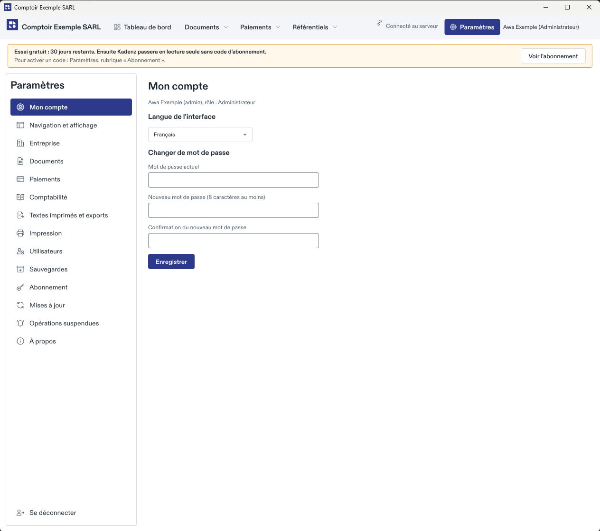
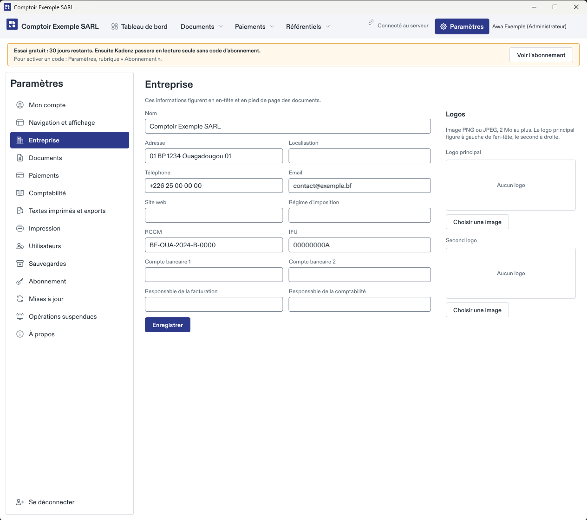
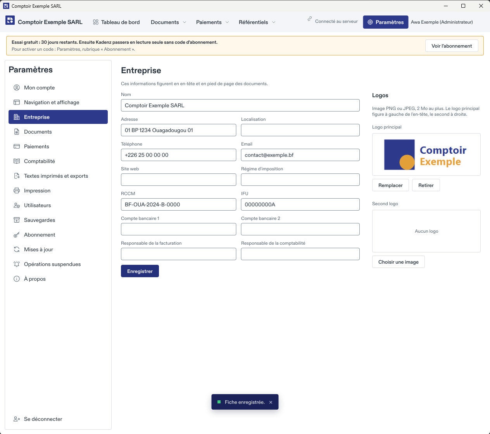
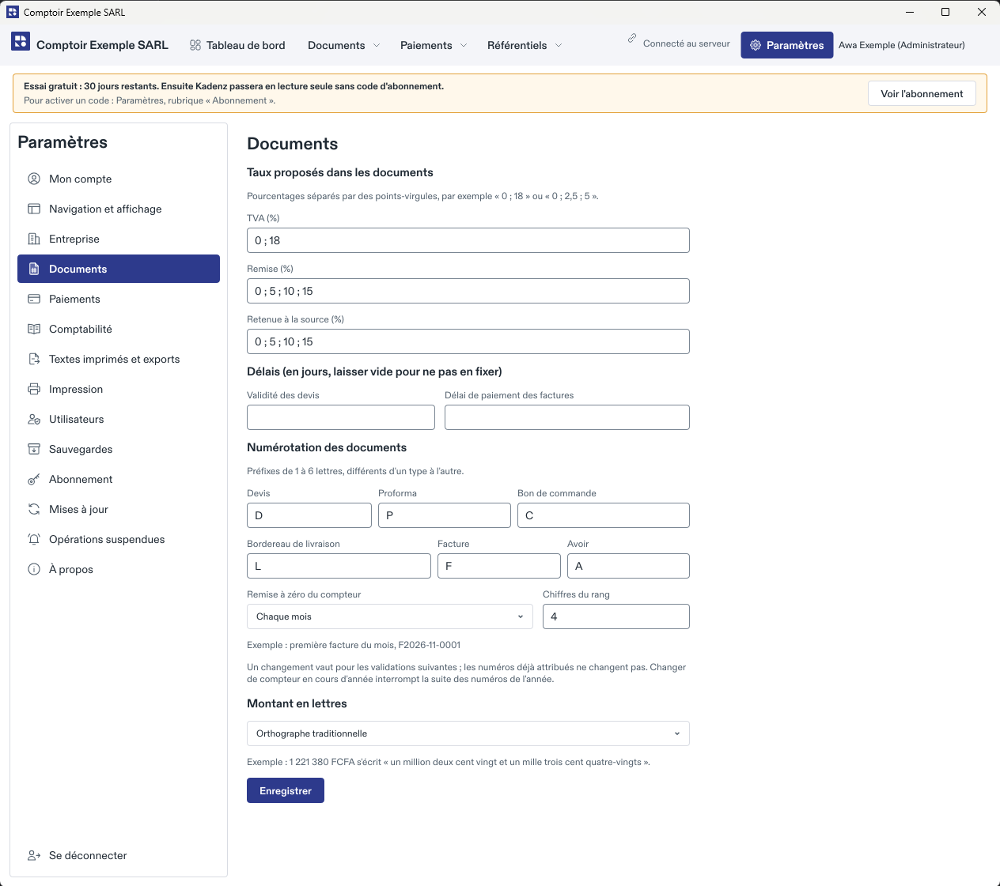
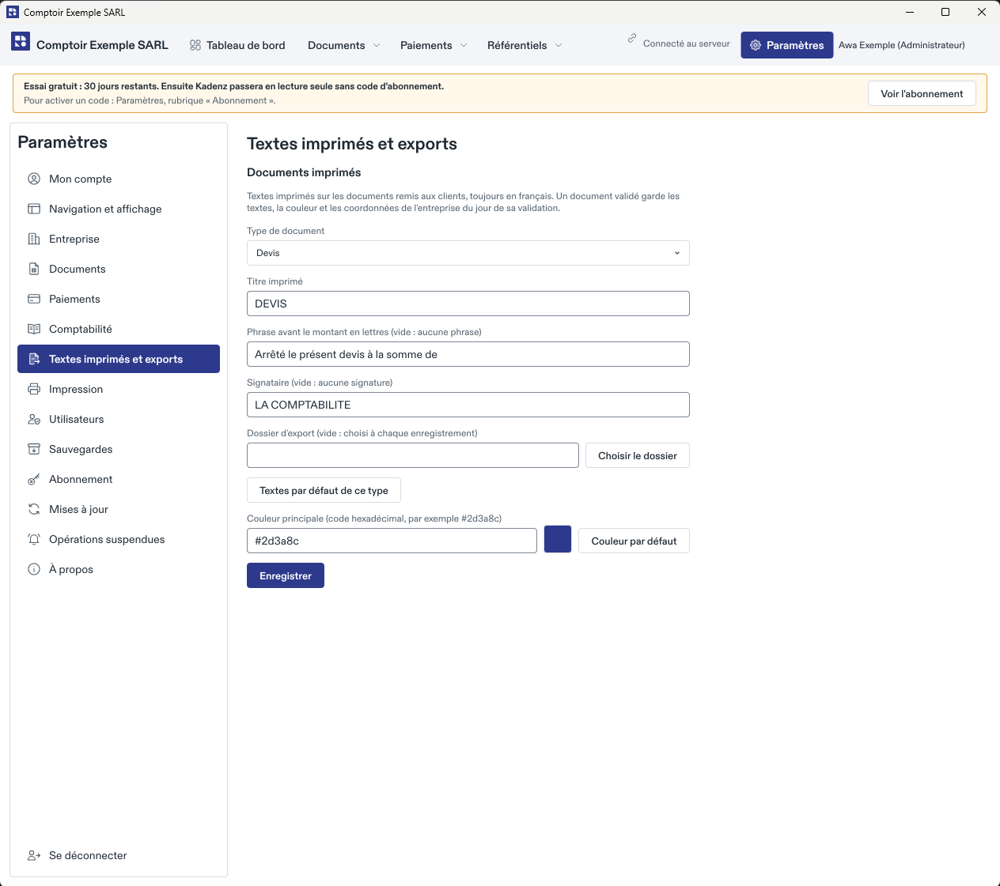
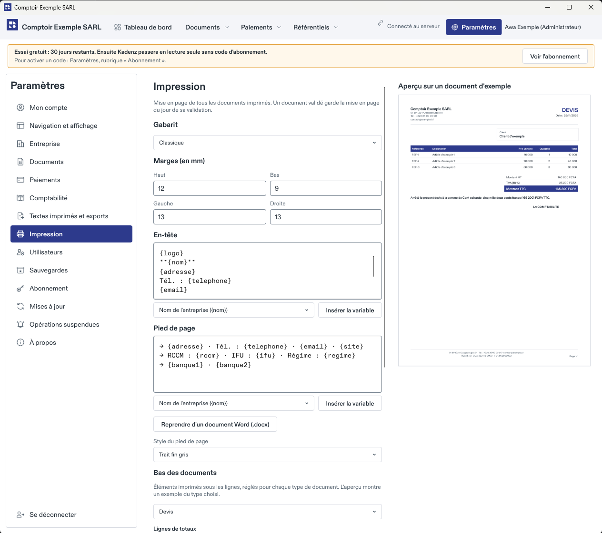
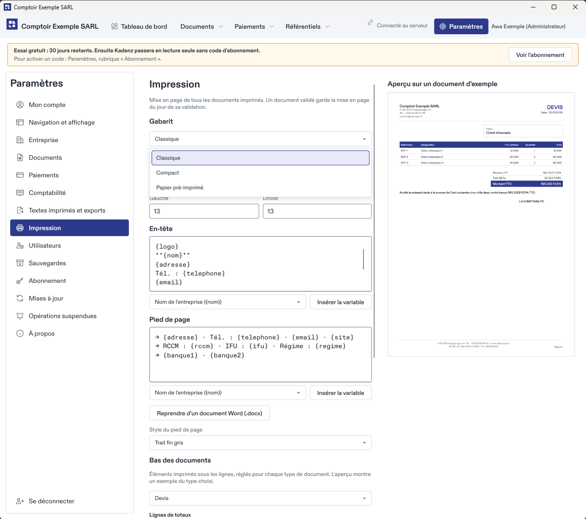
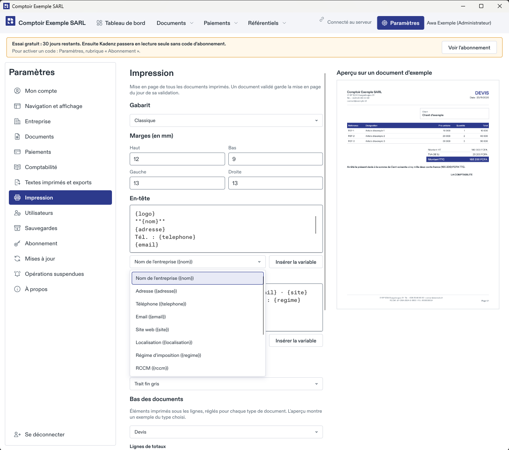
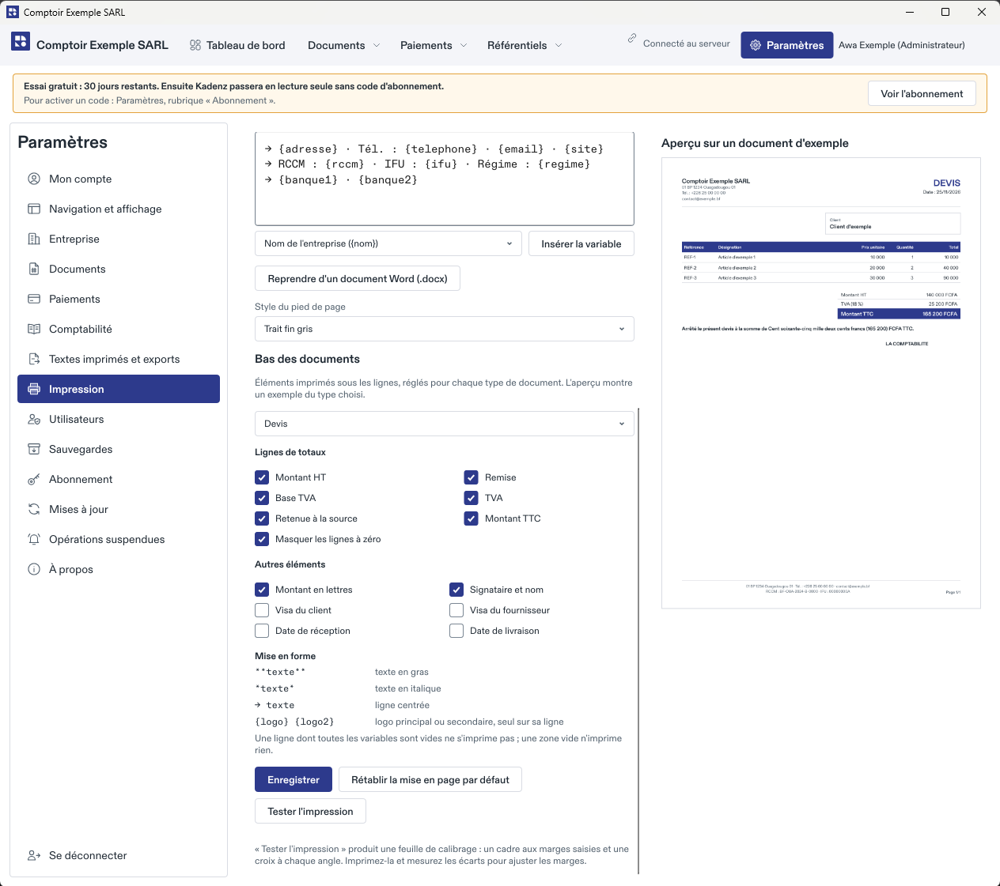
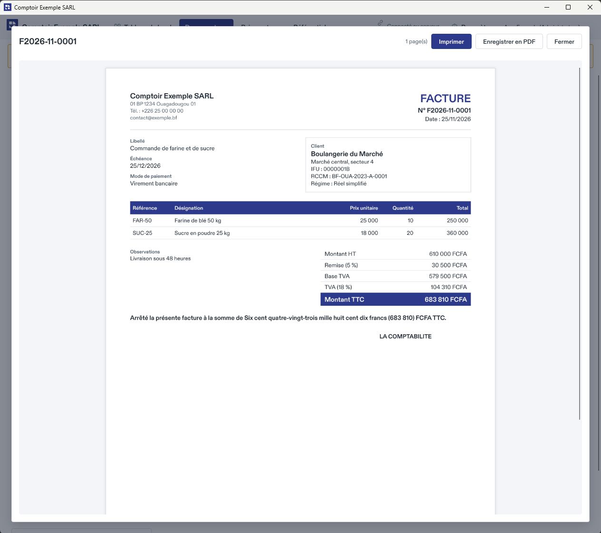

# 08 Impression et en-têtes

Ce chapitre décrit tout ce qui touche à l'aspect de vos documents imprimés : les informations de l'entreprise, le logo, la numérotation, les textes imprimés, l'en-tête, le pied de page et les marges. Ces réglages se trouvent dans **Paramètres**, ouvert par le bouton en haut à droite de la fenêtre.

La colonne de gauche liste les rubriques. Quatre d'entre elles concernent l'impression : **Entreprise**, **Documents**, **Textes imprimés et exports** et **Impression**. Les autres rubriques sont traitées dans les chapitres 06 (Paiements), 09 (Comptabilité), 10 (Utilisateurs), 11 (Sauvegardes) et 12 (Abonnement et mises à jour).

> **Attention** Un document validé garde la mise en page, les textes, la couleur et les coordonnées de l'entreprise du jour de sa validation. Changer un réglage ne modifie donc pas les documents déjà validés : il s'applique aux validations suivantes.

## 8.1 Les informations de l'entreprise

La rubrique **Entreprise** contient ce qui figure en en-tête et en pied de page des documents.

Renseignez le **Nom**, l'**Adresse**, la **Localisation**, le **Téléphone**, l'**Email**, le **Site web**, le **Régime d'imposition**, le **RCCM** et l'**IFU**. Les champs **Compte bancaire 1** et **Compte bancaire 2** permettent d'imprimer vos coordonnées bancaires en pied de page. **Responsable de la facturation** et **Responsable de la comptabilité** sont deux noms facultatifs. Cliquez sur **Enregistrer** pour valider.

### Les logos

À droite, la zone **Logos** accepte deux images au format PNG ou JPEG, de 2 Mo au plus : le **Logo principal**, imprimé à gauche de l'en-tête, et un **Second logo**, imprimé à droite.

**Choisir une image** ouvre la fenêtre de choix de fichier de Windows. Une fois l'image chargée, les boutons **Remplacer** et **Retirer** apparaissent.

## 8.2 La numérotation et les taux

La rubrique **Documents** règle les listes proposées dans les documents et la numérotation.

- **Taux proposés dans les documents** : TVA, remise et retenue à la source, en pourcentages séparés par des points-virgules (par exemple « 0 ; 18 » ou « 0 ; 2,5 ; 5 »).
- **Délais**, en jours : **Validité des devis** et **Délai de paiement des factures**. Laissés vides, aucun délai n'est fixé.
- **Numérotation des documents** : un préfixe de 1 à 6 lettres par type de document, différent d'un type à l'autre (par défaut D pour le devis, P pour la proforma, C pour le bon de commande, L pour le bordereau de livraison, F pour la facture, A pour l'avoir).
- **Remise à zéro du compteur** : **Chaque mois** ou **Chaque année**. Le rang recommence alors à 1.
- **Chiffres du rang** : la longueur du rang (4 par défaut). L'exemple affiché au-dessous montre le résultat : « première facture du mois, F2026-11-0001 ».
- **Montant en lettres** : **Orthographe traditionnelle** (« quatre-vingts ») ou **Orthographe rectifiée (1990)**, avec un exemple pour chacune.

> **Attention** Un changement de numérotation vaut pour les validations suivantes ; les numéros déjà attribués ne changent pas. Changer de compteur en cours d'année interrompt la suite des numéros de l'année.

## 8.3 Les textes imprimés

La rubrique **Textes imprimés et exports** règle les textes de chaque type de document, toujours en français.

Choisissez d'abord le **Type de document** (devis, proforma, bon de commande, bordereau, facture, avoir), puis modifiez :

- le **Titre imprimé** (par exemple DEVIS) ;
- la **Phrase avant le montant en lettres**, par exemple « Arrêté le présent devis à la somme de » ; vide, aucune phrase n'est imprimée ;
- le **Signataire**, imprimé sous le montant ; vide, aucune signature ;
- le **Dossier d'export** : le dossier où s'enregistrent vos fichiers exportés ; vide, Kadenz demande le dossier à chaque enregistrement (**Choisir le dossier**) ;
- la **Couleur principale**, en code hexadécimal (par exemple #2d3a8c), avec un aperçu de la teinte.

**Textes par défaut de ce type** rétablit les textes d'origine du type choisi, et **Couleur par défaut** la couleur d'origine. Cliquez sur **Enregistrer** pour valider.

## 8.4 La mise en page : en-tête, pied de page et marges

La rubrique **Impression** règle la mise en page de tous les documents. À droite, un **Aperçu sur un document d'exemple** se met à jour à mesure que vous modifiez les réglages.

### Le gabarit

Trois gabarits sont proposés :

- **Classique** : en-tête et pied de page complets, tableau sur toute la largeur ;
- **Compact** : texte et interlignes resserrés, pour tenir plus de lignes par page ;
- **Papier pré-imprimé** : pour du papier déjà imprimé à votre en-tête, sans logo, sans en-tête ni pied de page.

### Les marges

Les **Marges (en mm)** **Haut**, **Bas**, **Gauche** et **Droite** se règlent séparément. Dans l'exemple : 12, 9, 13 et 13 mm.

### L'en-tête et le pied de page

Ces deux zones sont des textes libres dans lesquels vous placez des **variables** entre accolades. À l'impression, chaque variable est remplacée par la donnée de l'entreprise. Par défaut, l'en-tête reprend le logo, le nom en gras, l'adresse, le téléphone et l'email.

Pour insérer une variable, choisissez-la dans la liste puis cliquez sur **Insérer la variable**. Les variables sont : le nom (`{nom}`), l'adresse (`{adresse}`), le téléphone (`{telephone}`), l'email (`{email}`), le site web (`{site}`), la localisation (`{localisation}`), le régime d'imposition (`{regime}`), le RCCM (`{rccm}`), l'IFU (`{ifu}`) et les deux comptes bancaires (`{banque1}`, `{banque2}`), ainsi que `{logo}` et `{logo2}` pour les images.

Une aide de mise en forme est rappelée sous les réglages :

- `**texte**` met le texte en gras ;
- `*texte*` met le texte en italique ;
- `→ texte` (flèche en début de ligne) centre la ligne ;
- `{logo}` et `{logo2}` impriment le logo principal ou le second logo, seuls sur leur ligne.

Une ligne dont toutes les variables sont vides n'est pas imprimée, et une zone vide n'imprime rien : inutile de supprimer une ligne « Site web » si vous n'avez pas de site.

Le **Style du pied de page** choisit entre **Trait fin gris** et **Trait épais de la couleur principale, mentions en gras**.

### Reprendre un en-tête et un pied de page depuis Word

Si votre en-tête existe déjà dans un document Word, **Reprendre d'un document Word (.docx)** en lit l'en-tête et le pied de page et les place dans les zones de texte. Le message affiché invite à vérifier le texte et à remplacer les données fixes par des variables. Si le document n'a ni en-tête ni pied de page, Kadenz le dit.

### Le bas des documents

Sous **Bas des documents**, choisissez un type de document : l'aperçu en montre un exemple. Vous réglez, type par type, ce qui s'imprime sous les lignes.

- **Lignes de totaux** : **Montant HT**, **Remise**, **Base TVA**, **TVA**, **Retenue à la source**, **Montant TTC**, et **Masquer les lignes à zéro** ;
- **Autres éléments** : **Montant en lettres**, **Signataire et nom**, **Visa du client**, **Visa du fournisseur**, **Date de réception** et **Date de livraison**.

Les boutons du bas : **Enregistrer**, **Rétablir la mise en page par défaut** et **Tester l'impression**. Ce dernier produit une feuille de calibrage : un cadre aux marges saisies et une croix à chaque angle. Imprimez-la et mesurez les écarts pour ajuster les marges selon votre imprimante.

## 8.5 Aperçu, impression et PDF d'un document

Depuis une facture ou tout autre document validé, le bouton **Aperçu** ouvre le document tel qu'il s'imprimera.

L'aperçu indique le nombre de pages. Trois boutons figurent en haut à droite : **Imprimer** (vers votre imprimante), **Enregistrer en PDF** (vers le dossier d'export, ou un dossier à choisir) et **Fermer**. Le bouton **Exporter en PDF** de la fiche d'un document enregistre le PDF sans passer par l'aperçu.

Le montant en lettres reprend la phrase du type de document (ici « Arrêté la présente facture à la somme de ... »), suivie du montant en chiffres.

## 8.6 À retenir

- Les réglages d'impression s'appliquent aux documents validés ensuite, jamais aux documents déjà validés.
- L'en-tête et le pied de page sont des textes libres complétés par des variables : le logo, le nom, l'adresse, le téléphone, etc.
- Trois gabarits : Classique, Compact et Papier pré-imprimé.
- L'aperçu de la rubrique Impression se met à jour en direct : essayez avant d'enregistrer.
- Imprimez la feuille de calibrage pour régler les marges à votre imprimante.

Le chapitre suivant décrit la comptabilité et l'export au plan SYSCOHADA.
