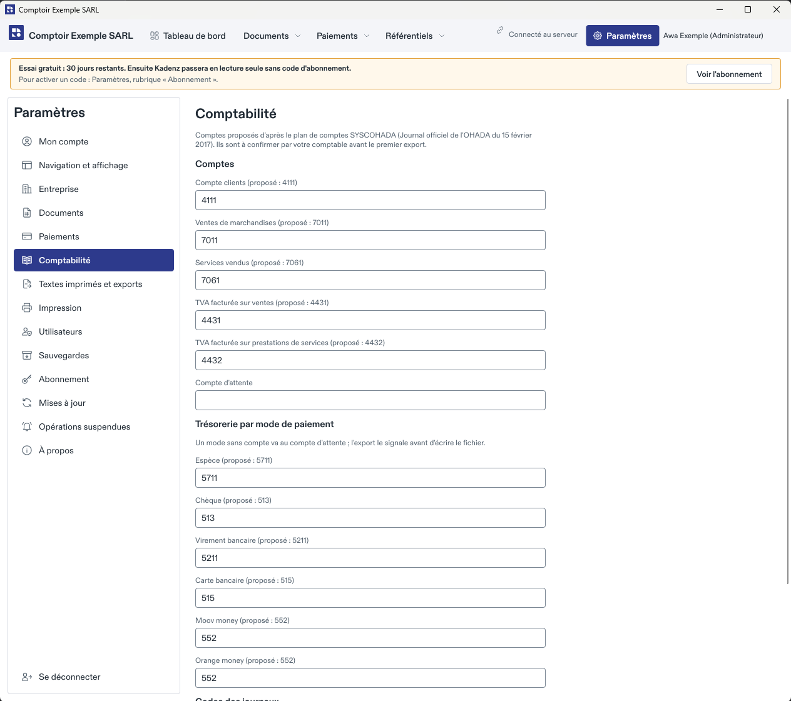
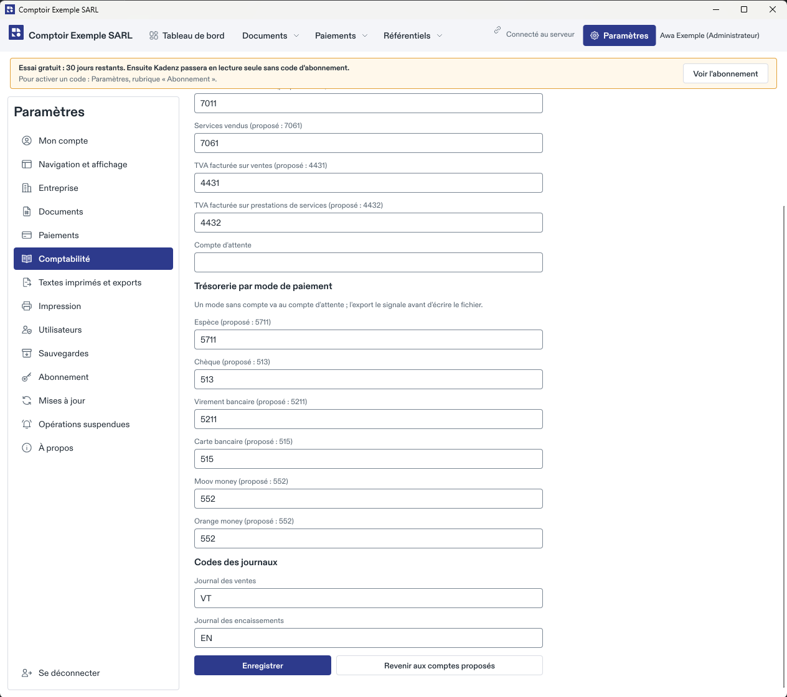
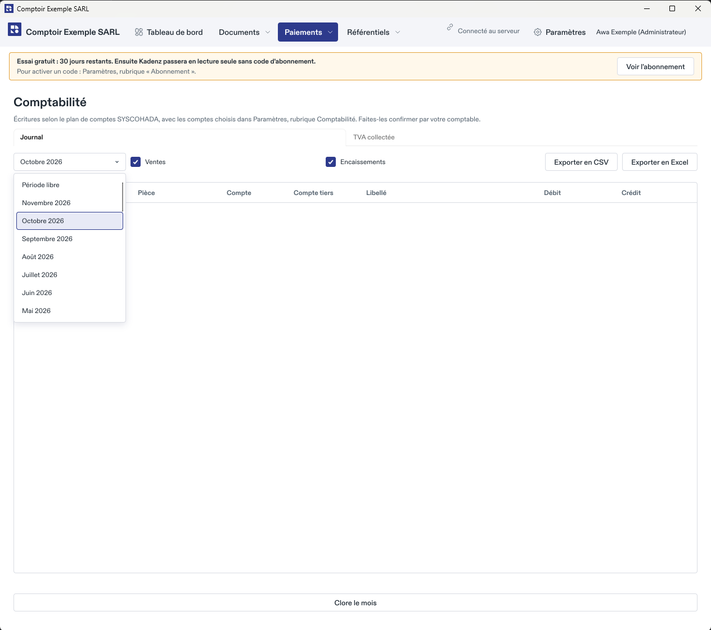
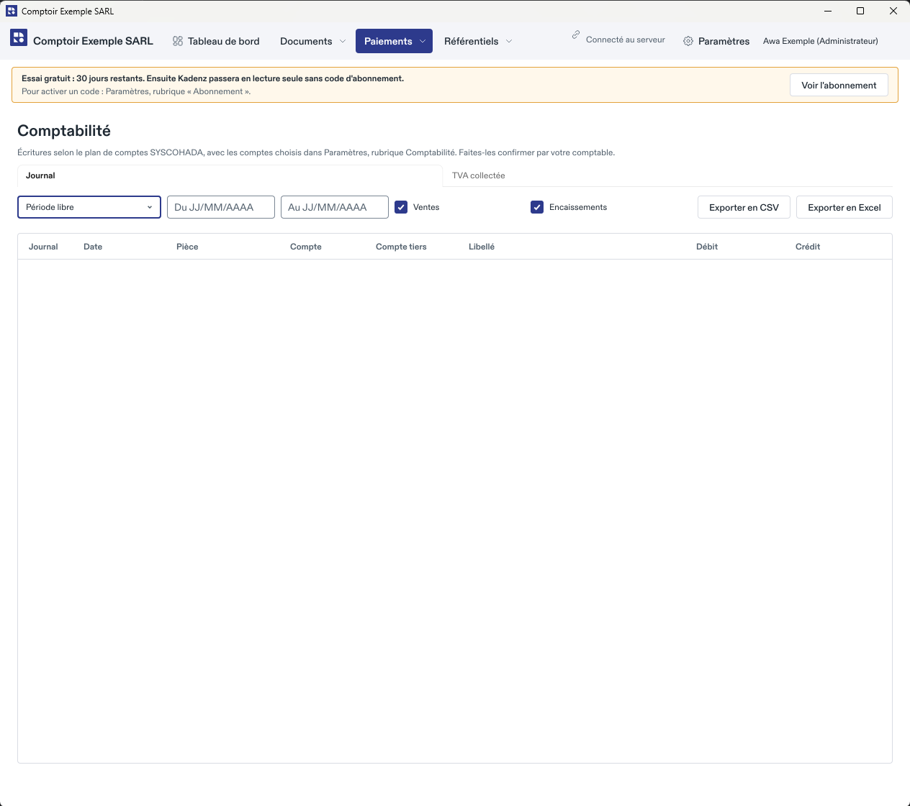
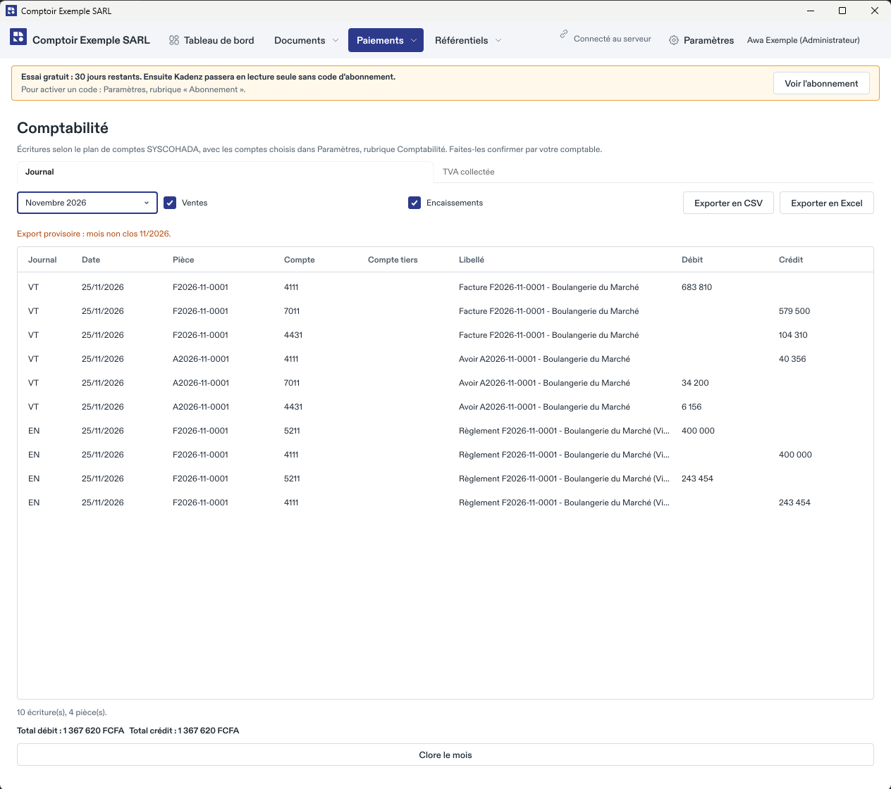
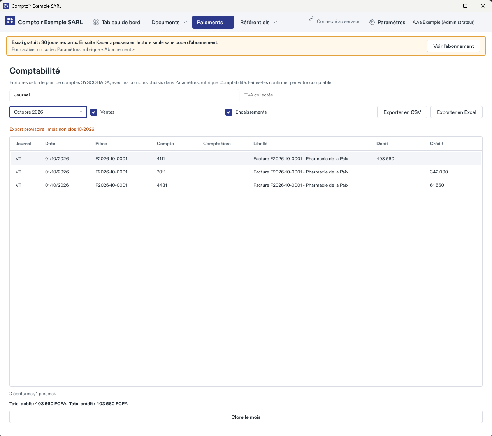
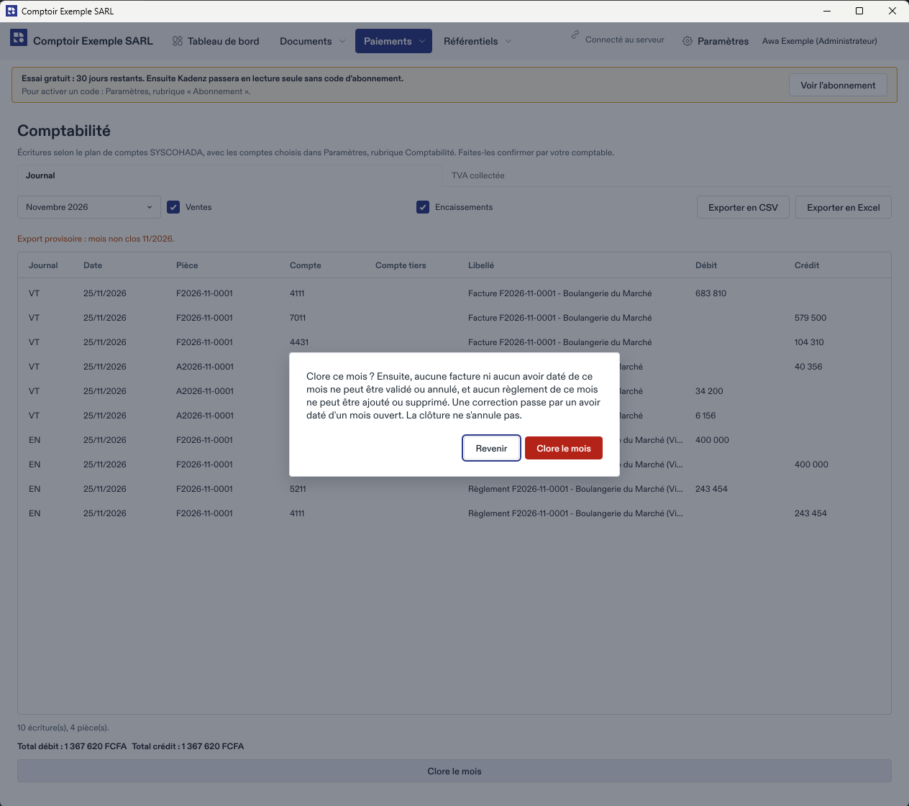
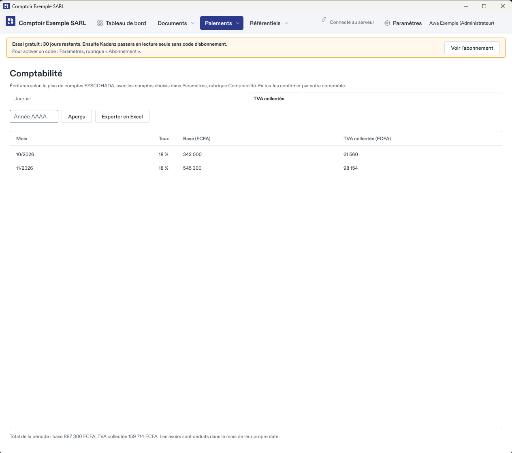
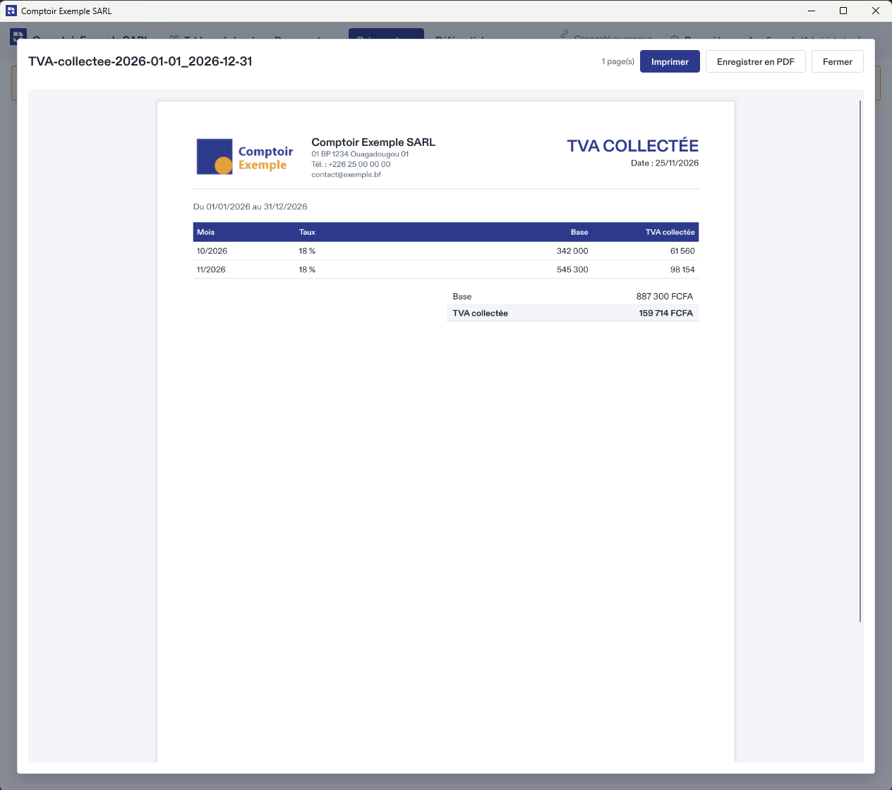

# 09 Comptabilité et export SYSCOHADA

Kadenz ne tient pas une comptabilité complète : il prépare, pour votre comptable, les écritures de vos ventes et de vos encaissements selon le plan de comptes SYSCOHADA, ainsi que l'état de la TVA collectée. Vous les exportez ensuite vers un fichier que votre comptable reprend dans son logiciel.

La page **Comptabilité** se trouve dans le menu **Paiements**. Elle compte deux onglets : **Journal** et **TVA collectée**. Les comptes utilisés se règlent dans **Paramètres**, rubrique **Comptabilité**.

> **Attention** Les comptes proposés suivent le plan de comptes SYSCOHADA (Journal officiel de l'OHADA du 15 février 2017). Faites-les confirmer par votre comptable avant le premier export.

La page et le bouton **Clore le mois** sont accessibles aux comptes qui ont le droit « Exporter la comptabilité et clore une période » : par défaut, l'Administrateur et le Comptable (chapitre 10).

## 9.1 Régler les comptes

Dans **Paramètres**, rubrique **Comptabilité**, chaque compte porte, entre parenthèses, le numéro proposé :

- **Compte clients** (4111) ;
- **Ventes de marchandises** (7011) ;
- **Services vendus** (7061) ;
- **TVA facturée sur ventes** (4431) ;
- **TVA facturée sur prestations de services** (4432) ;
- **Compte d'attente**, vide au départ.

La nature d'un produit, **Marchandise** ou **Service** (chapitre 03), décide du compte de vente de ses lignes : 7011 ou 7061.

La section **Trésorerie par mode de paiement** associe un compte à chaque mode : Espèce (5711), Chèque (513), Virement bancaire (5211), Carte bancaire (515), Moov money et Orange money (552). Un mode sans compte est écrit au **compte d'attente** ; l'export le signale avant d'écrire le fichier.

Plus bas, les **Codes des journaux** : **Journal des ventes** (VT) et **Journal des encaissements** (EN).

**Enregistrer** valide vos choix, et **Revenir aux comptes proposés** rétablit tous les numéros proposés.

## 9.2 Le journal des écritures

### Choisir la période

L'onglet **Journal** présente les écritures d'un mois, à choisir dans la liste. Le choix **Période libre** remplace la liste par deux dates, **Du** et **Au**.

Deux cases choisissent les journaux affichés : **Ventes** et **Encaissements**.

### Lire les écritures

Chaque ligne indique le **Journal** (VT ou EN), la **Date**, la **Pièce** (le numéro du document), le **Compte**, le **Compte tiers**, le **Libellé**, le **Débit** et le **Crédit**. Une ligne par écriture, et chaque pièce est équilibrée. En bas de la liste, Kadenz compte les écritures et les pièces, et affiche le **Total débit** et le **Total crédit**, toujours égaux.

Dans l'exemple de novembre :

- la facture F2026-11-0001 débite le compte clients 4111 de 683 810 FCFA (TTC), crédite les ventes 7011 de 579 500 (base de TVA) et la TVA 4431 de 104 310 ;
- l'avoir A2026-11-0001 passe les écritures inverses : 40 356 au crédit du compte clients, 34 200 et 6 156 au débit des ventes et de la TVA ;
- les deux règlements par virement (400 000 et 243 454 FCFA) débitent la banque 5211 et créditent le compte clients 4111.

Les documents annulés sont absents du journal.

> **Astuce** À l'ouverture de la page, la liste peut apparaître vide. Rechoisissez le mois dans la liste pour afficher ses écritures.

### Un export provisoire

Tant qu'un mois n'est pas clos, une mention orange « Export provisoire : mois non clos 11/2026. » rappelle que ses écritures peuvent encore changer. Un mois non clos peut être exporté autant de fois que vous le souhaitez.

### Exporter

**Exporter en CSV** et **Exporter en Excel** enregistrent le journal affiché.

- Le **CSV** est en UTF-8 avec séparateur point-virgule, pour que Excel ouvre correctement les accents. Sa première ligne contient `Journal;Date;Pièce;Compte;Compte tiers;Libellé;Débit;Crédit`. Les dates s'écrivent JJ/MM/AAAA et les montants en FCFA entiers, sans séparateur de milliers ni décimale. Il ne contient aucune ligne de total.
- Le fichier se nomme `journal-AAAA-MM.csv` pour un mois, ou `journal-AAAA-MM-JJ_AAAA-MM-JJ.csv` pour une période libre, avec le suffixe `-provisoire` quand la période contient un mois non clos.
- Le fichier **Excel** reprend les écritures avec les totaux.

Les fichiers s'enregistrent dans le **Dossier d'export** réglé dans **Paramètres**, **Textes imprimés et exports** (chapitre 08), ou dans un dossier que Kadenz vous demande de choisir si ce réglage est vide.

## 9.3 Clore un mois

Quand vous avez remis l'export d'un mois à votre comptable, vous pouvez **clore** ce mois. Un export remis ne doit plus changer.

Le bouton **Clore le mois**, en bas de la page, demande confirmation : « Ensuite, aucune facture ni aucun avoir daté de ce mois ne peut être validé ou annulé, et aucun règlement de ce mois ne peut être ajouté ou supprimé. Une correction passe par un avoir daté d'un mois ouvert. La clôture ne s'annule pas. »

Cliquez sur **Revenir** pour renoncer, ou sur **Clore le mois** pour confirmer.

> **Attention** La clôture est définitive : il n'y a pas de réouverture. Un mois clos garde aussi les comptes en vigueur au moment de la clôture : changer un compte plus tard ne modifie pas son export. La clôture se fait connecté au serveur, et seulement pour un mois entièrement passé.

## 9.4 L'état de la TVA collectée

L'onglet **TVA collectée** donne, mois par mois et taux par taux, la base et la TVA des factures, moins celles des avoirs du mois.

Saisissez l'**Année AAAA** (l'année en cours si le champ est vide), puis cliquez sur **Aperçu** pour obtenir l'état imprimable, ou sur **Exporter en Excel**. En bas de la liste figure le total de la période : dans l'exemple, une base de 887 300 FCFA et 159 714 FCFA de TVA collectée.

L'aperçu reprend votre en-tête et vos logos. Ses boutons sont **Imprimer**, **Enregistrer en PDF** et **Fermer**. Les avoirs sont déduits dans le mois de leur propre date.

## 9.5 À retenir

- Faites confirmer les comptes par votre comptable avant le premier export.
- Le journal contient les ventes (VT) et les encaissements (EN), équilibrés pièce par pièce.
- Un mois non clos s'exporte en mode provisoire ; une fois remis, clore le mois fige l'export.
- La clôture ne s'annule pas : une correction passe par un avoir d'un mois ouvert.
- La TVA collectée se lit par mois et par taux, avec les avoirs déduits.

Le chapitre suivant décrit les utilisateurs et leurs droits.
