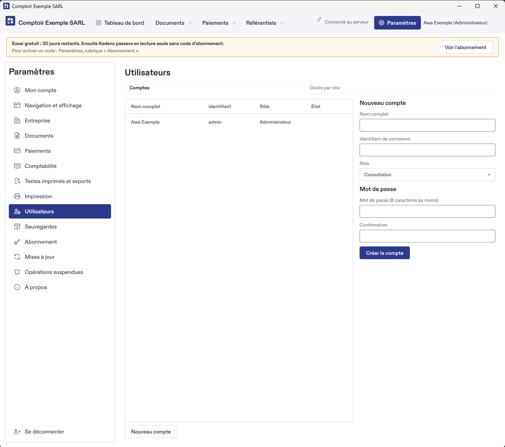
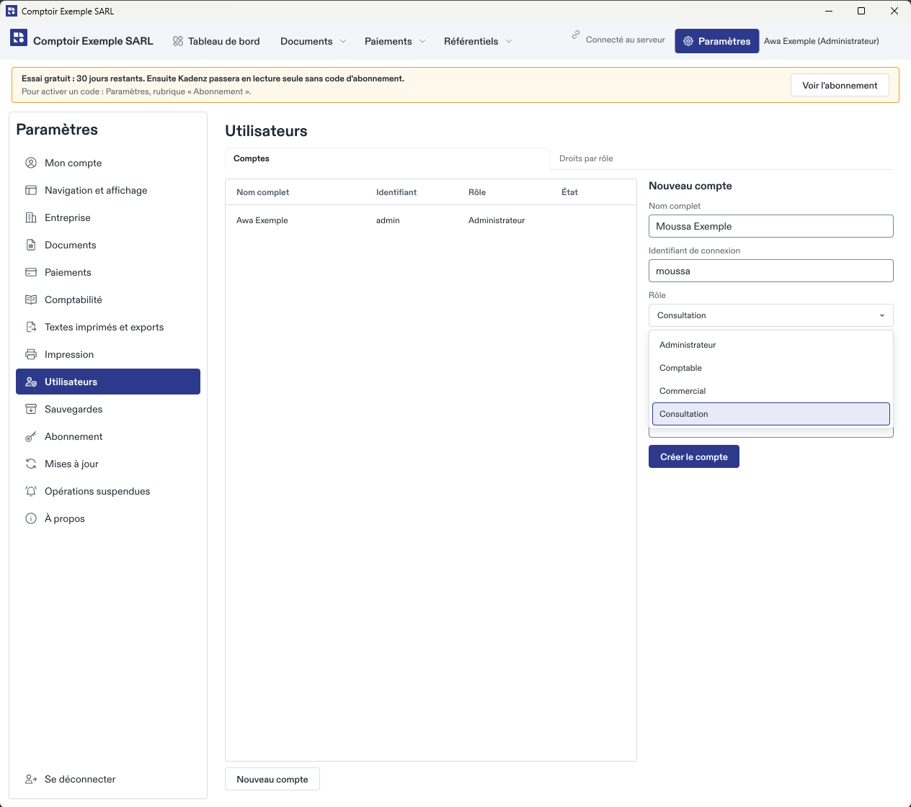
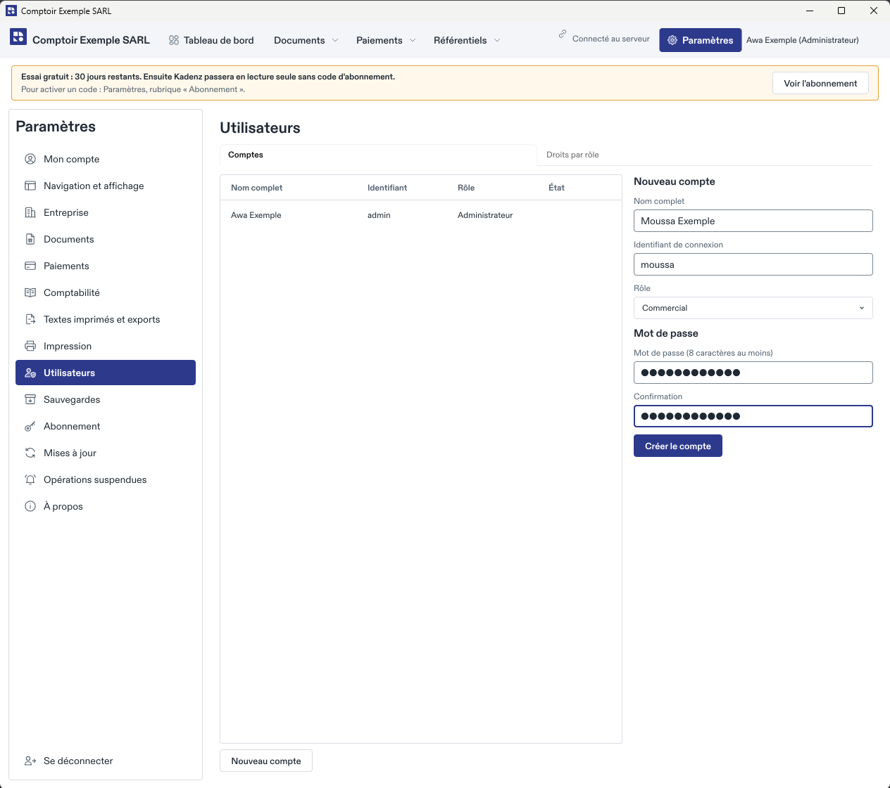
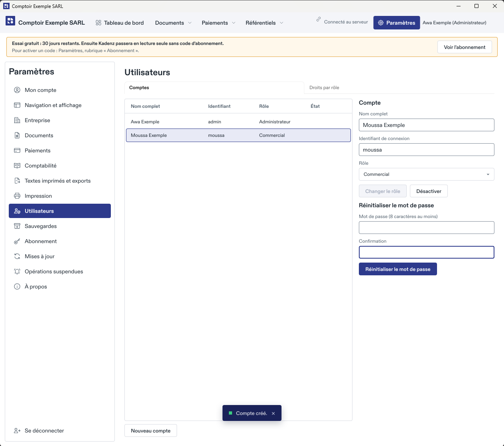
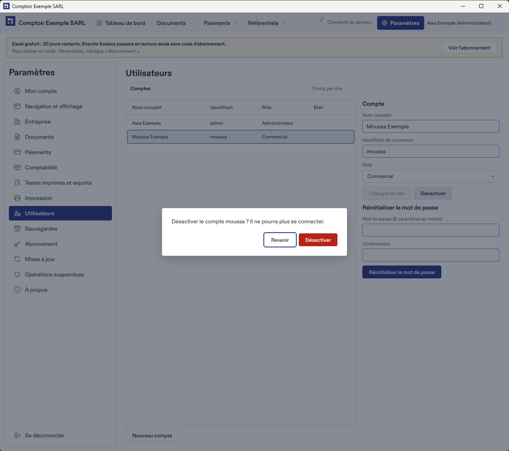
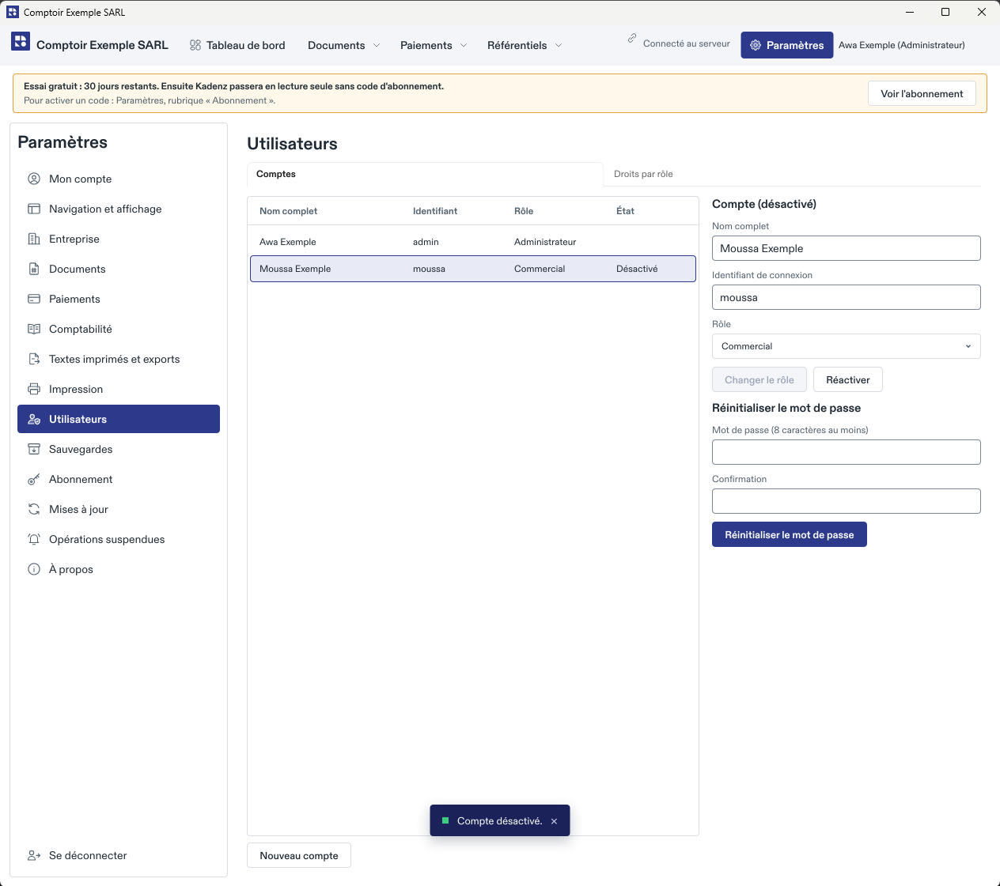
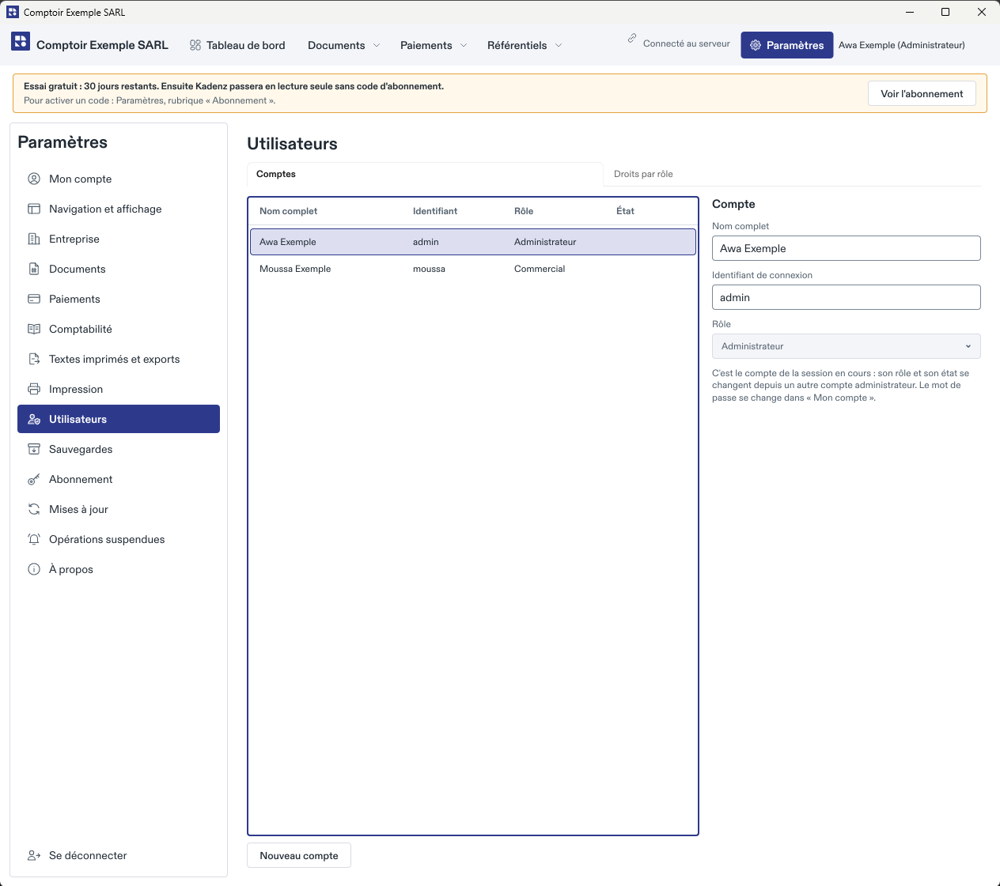
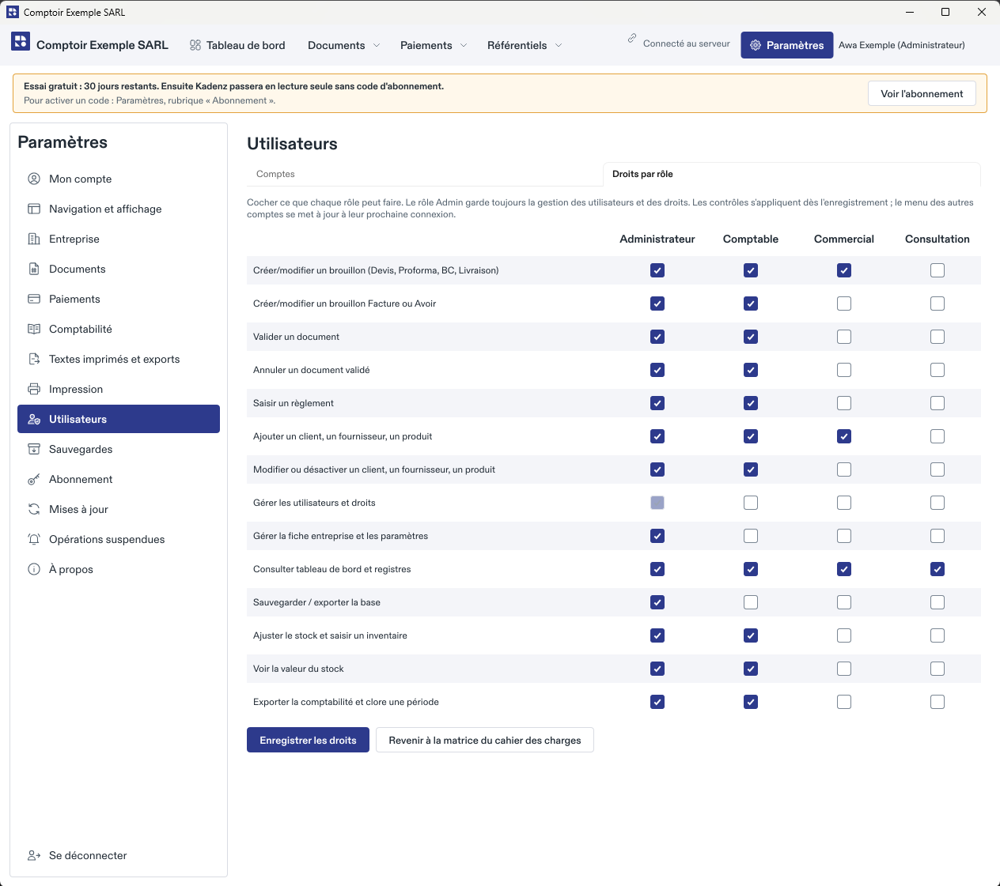

# 10 Utilisateurs et droits

Ce chapitre explique comment créer les comptes des personnes qui utilisent Kadenz, comment leur donner un rôle, désactiver un compte, réinitialiser un mot de passe, et comment régler ce que chaque rôle a le droit de faire.

> **Attention** La rubrique **Utilisateurs** des **Paramètres** n'est ouverte qu'aux comptes qui ont le droit « Gérer les utilisateurs et droits » : par défaut, le rôle Administrateur.

## 10.1 Les quatre rôles

Chaque compte a un seul rôle. Kadenz en propose quatre :

| Rôle | Pour qui |
| --- | --- |
| **Administrateur** | le responsable de l'entreprise : il règle tout et gère les comptes |
| **Comptable** | la personne qui valide les documents, saisit les règlements et tient la comptabilité |
| **Commercial** | la personne qui prépare les devis, les brouillons et les fiches clients |
| **Consultation** | la personne qui regarde le tableau de bord et les registres, sans rien modifier |

Ce que chaque rôle peut faire est coché dans l'onglet **Droits par rôle** (section 10.6).

## 10.2 Ouvrir la rubrique

Cliquez sur **Paramètres**, puis sur **Utilisateurs** dans la liste de gauche. La page a deux onglets : **Comptes** et **Droits par rôle**.

À gauche, la liste des comptes avec quatre colonnes : **Nom complet**, **Identifiant**, **Rôle** et **État** (vide quand le compte est actif, **Désactivé** sinon). À droite, le formulaire **Nouveau compte**.

## 10.3 Créer un compte

1. Dans le formulaire **Nouveau compte**, saisissez le **Nom complet** de la personne.
2. Saisissez son **Identifiant de connexion**. Il est obligatoire, ne contient aucun espace et ne doit pas déjà être pris par un autre compte.
3. Choisissez le **Rôle** dans la liste déroulante : Administrateur, Comptable, Commercial ou Consultation. Par défaut, la liste propose Consultation, le rôle le moins puissant.

4. Saisissez un **Mot de passe** de 8 caractères au moins, puis répétez-le dans **Confirmation**. Les caractères sont masqués.

5. Cliquez sur **Créer le compte**. Le message « Compte créé. » s'affiche, et le compte apparaît dans la liste. Le formulaire est alors celui du compte créé (section 10.4).

Communiquez à la personne son identifiant et son mot de passe. Elle peut ensuite changer son mot de passe elle-même dans **Paramètres**, rubrique **Mon compte**.

Pour créer un autre compte, cliquez sur **Nouveau compte**, sous la liste : le formulaire se vide.

> **Astuce** Donnez à chaque personne son propre compte, et ne partagez pas un mot de passe : chacun garde ainsi la main sur son accès.

## 10.4 Modifier un compte

Cliquez sur une ligne de la liste : le formulaire de droite devient celui du compte choisi. Le nom complet et l'identifiant s'affichent ; le rôle se change et le compte se désactive ou se réactive avec les boutons qui suivent.

### Changer le rôle

Choisissez un autre rôle dans la liste **Rôle**, puis cliquez sur **Changer le rôle**. Le bouton reste grisé tant que le rôle choisi est celui que le compte a déjà.

### Désactiver et réactiver un compte

Kadenz ne supprime pas de compte : on le **désactive**. Cliquez sur **Désactiver**. Une fenêtre demande confirmation : « Désactiver le compte moussa ? Il ne pourra plus se connecter. » Cliquez sur **Désactiver** pour confirmer, ou sur **Revenir** pour renoncer.

Le message « Compte désactivé. » s'affiche. Le compte reste dans la liste, avec la mention **Désactivé** dans la colonne **État** ; son titre devient « Compte (désactivé) » et le bouton devient **Réactiver**.

Rien n'est supprimé : le compte et son historique restent. Pour rendre l'accès à la personne, cliquez sur **Réactiver**.

> **Astuce** Désactivez le compte d'une personne qui quitte l'entreprise plutôt que de changer son rôle : elle ne peut plus se connecter, et le compte reste dans la liste.

### Réinitialiser le mot de passe

Dans le même formulaire, la zone **Réinitialiser le mot de passe** sert quand une personne a oublié le sien. Saisissez le nouveau mot de passe (8 caractères au moins) et sa confirmation, puis cliquez sur **Réinitialiser le mot de passe**. Communiquez-le à la personne.

## 10.5 Votre propre compte et le dernier administrateur

Quand vous cliquez sur le compte avec lequel vous êtes connecté, le rôle est grisé et les boutons de changement de rôle et de désactivation disparaissent. Kadenz explique : « C'est le compte de la session en cours : son rôle et son état se changent depuis un autre compte administrateur. Le mot de passe se change dans « Mon compte ». »

De plus, Kadenz refuse toute opération qui retirerait le dernier administrateur actif : « impossible : l'installation doit garder au moins un administrateur actif ». Avant de rétrograder ou de désactiver un administrateur, assurez-vous qu'un autre administrateur actif existe.

## 10.6 Les droits par rôle

Cliquez sur l'onglet **Droits par rôle**. La page affiche une grille : une ligne par action possible, une colonne par rôle. Une case cochée veut dire que le rôle a le droit.

Les actions de la grille sont :

- créer ou modifier un brouillon de devis, proforma, bon de commande ou livraison ;
- créer ou modifier un brouillon de facture ou d'avoir ;
- valider un document ;
- annuler un document validé ;
- saisir un règlement ;
- ajouter un client, un fournisseur, un produit ;
- modifier ou désactiver un client, un fournisseur, un produit ;
- gérer les utilisateurs et les droits ;
- gérer la fiche entreprise et les paramètres ;
- consulter le tableau de bord et les registres ;
- sauvegarder et exporter la base ;
- ajuster le stock et saisir un inventaire ;
- voir la valeur du stock ;
- exporter la comptabilité et clore une période.

Pour changer un droit, cochez ou décochez la case, puis cliquez sur **Enregistrer les droits**. Tant que vous n'avez pas enregistré, rien n'est modifié.

> **Attention** Dans la colonne Administrateur, la case « Gérer les utilisateurs et droits » est grisée et reste cochée : le rôle Administrateur garde toujours la gestion des utilisateurs et des droits, pour qu'on ne puisse pas se priver de l'accès à cette page.

Les droits s'appliquent dès l'enregistrement ; le menu des autres comptes se met à jour à leur prochaine connexion.

### Revenir à la grille d'origine

Le bouton **Revenir à la matrice du cahier des charges** remet les cases dans leur état d'origine. Une fenêtre de confirmation prévient que les droits cochés vont être remplacés ; **rien n'est enregistré** avant d'avoir cliqué sur **Enregistrer les droits**.

## 10.7 À retenir

- Quatre rôles : Administrateur, Comptable, Commercial, Consultation.
- Un compte se crée dans **Paramètres**, **Utilisateurs** : nom complet, identifiant sans espace, rôle, mot de passe de 8 caractères au moins.
- On ne supprime pas un compte : on le désactive, et on peut le réactiver.
- On ne change pas son propre rôle et on ne se désactive pas soi-même ; on ne peut pas retirer le dernier administrateur actif.
- La grille **Droits par rôle** règle ce que chaque rôle peut faire ; rien ne change avant **Enregistrer les droits**.

Le chapitre suivant explique les sauvegardes.
