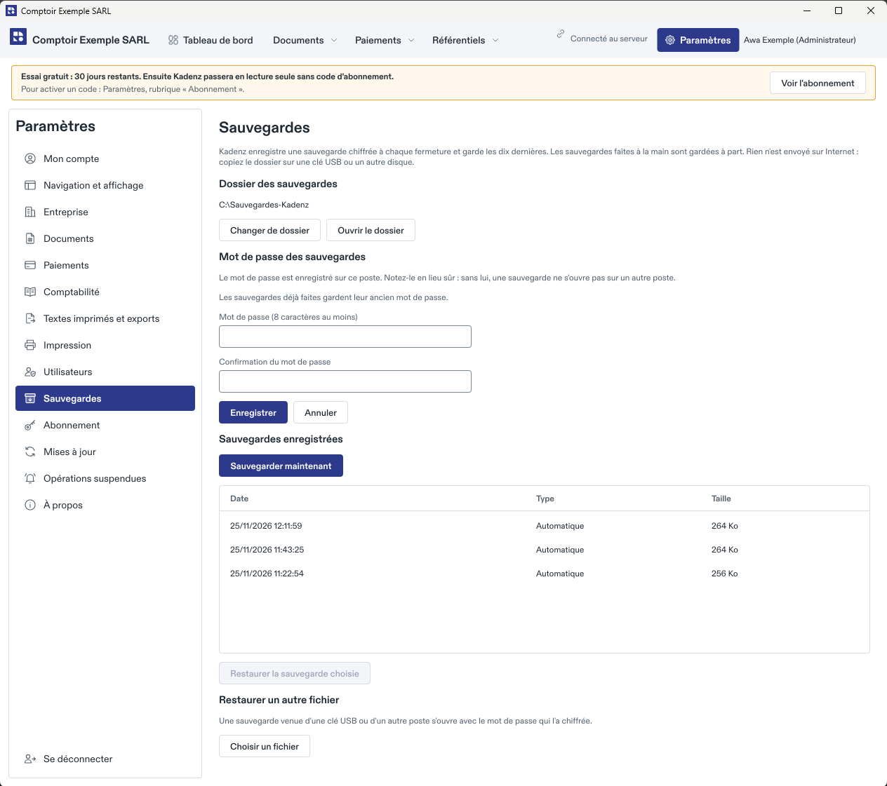
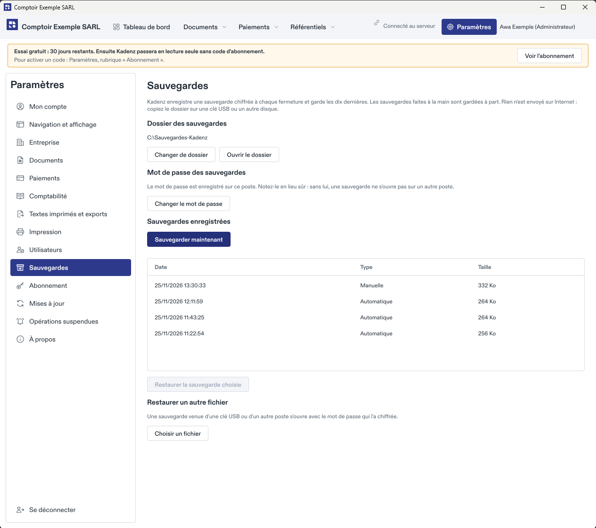
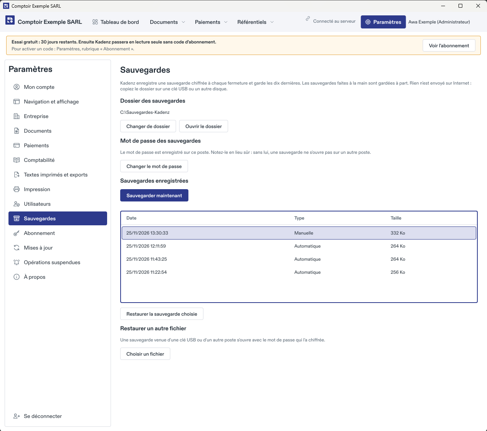
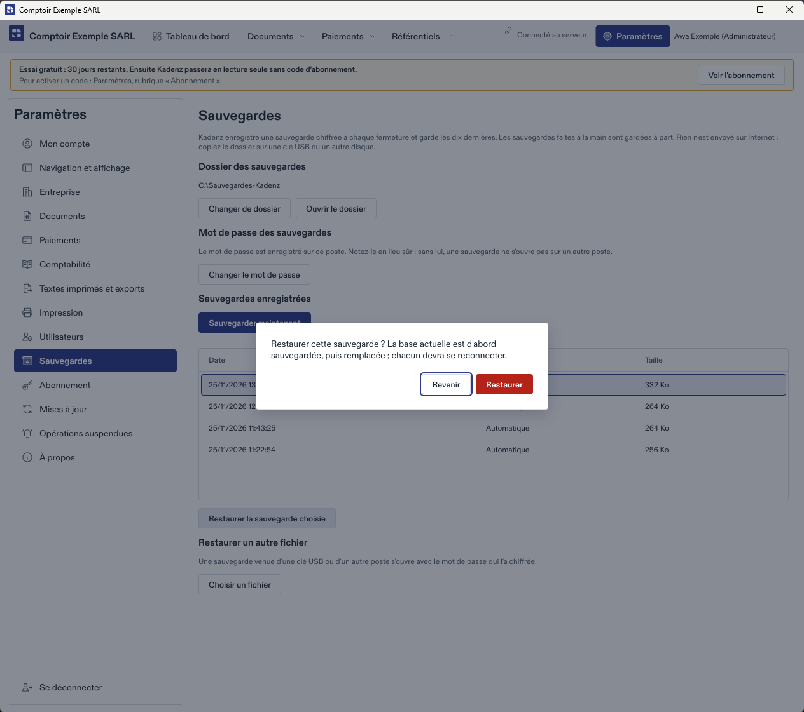

# 11 Sauvegardes

Vos factures, vos clients et votre stock sont dans la base de données de Kadenz. Une panne de disque, un vol ou une fausse manipulation peut la détruire : la sauvegarde est votre assurance. Ce chapitre explique ce que Kadenz sauvegarde seul, ce que vous pouvez faire à la main, et comment restaurer.

Les sauvegardes se règlent dans **Paramètres**, rubrique **Sauvegardes**.

Le texte en haut de la page résume le principe : « Kadenz enregistre une sauvegarde chiffrée à chaque fermeture et garde les dix dernières. Les sauvegardes faites à la main sont gardées à part. Rien n'est envoyé sur Internet : copiez le dossier sur une clé USB ou un autre disque. »

> **Attention** Une sauvegarde laissée sur le même disque que Kadenz ne protège pas d'une panne de ce disque. Copiez régulièrement le dossier des sauvegardes sur une clé USB ou un autre disque, et rangez-le ailleurs que dans le local de travail.

## 11.1 Ce que Kadenz fait seul

- À chaque **fermeture** de Kadenz, une sauvegarde **Automatique** est enregistrée.
- Seules les **dix dernières** sauvegardes automatiques sont conservées ; les plus anciennes sont supprimées.
- Les sauvegardes **Manuelles** et celles faites **avant une restauration** ne sont jamais supprimées.
- Chaque sauvegarde est **chiffrée** par un mot de passe : sans lui, le fichier est illisible. Un fichier de sauvegarde se nomme `kadenz-<type>-AAAAMMJJ-HHMMSS.kzs`.

## 11.2 Le dossier des sauvegardes

La zone **Dossier des sauvegardes** affiche l'emplacement actuel. Par défaut, c'est le dossier `Documents\Kadenz\Sauvegardes`, volontairement en dehors du dossier des données, que la désinstallation efface. Dans les captures de ce manuel, le dossier est `C:\Sauvegardes-Kadenz`.

- **Changer de dossier** ouvre la fenêtre de choix de dossier de Windows : choisissez par exemple une clé USB ou un second disque.
- **Ouvrir le dossier** l'ouvre dans l'Explorateur Windows, pour le copier.

Seuls les fichiers `.kzs` de ce dossier sont listés ou supprimés : le dossier peut contenir autre chose sans risque.

## 11.3 Le mot de passe des sauvegardes

Le mot de passe est enregistré sur ce poste, protégé par Windows, pour que la sauvegarde automatique n'ait rien à demander. Cliquez sur **Changer le mot de passe**, saisissez le nouveau mot de passe (8 caractères au moins) et sa confirmation, puis **Enregistrer** (ou **Annuler**). Le message « mot de passe des sauvegardes enregistré » confirme.

> **Attention** Notez ce mot de passe en lieu sûr. Sans lui, une sauvegarde ne s'ouvre pas sur un autre poste, et personne ne peut le retrouver à votre place. Les sauvegardes déjà faites gardent l'ancien mot de passe : retenez aussi les anciens tant que vous gardez les anciennes sauvegardes.

## 11.4 Sauvegarder maintenant

Avant une opération délicate (import, inventaire, clôture de mois) ou en fin de journée, cliquez sur **Sauvegarder maintenant**. Le message « sauvegarde enregistrée » apparaît et une ligne de type **Manuelle** s'ajoute à la liste.

La liste **Sauvegardes enregistrées** donne la **Date**, le **Type** (**Automatique**, **Manuelle** ou **Avant restauration**) et la **Taille**. Kadenz n'a rien demandé pour cette sauvegarde : il utilise le mot de passe enregistré.

## 11.5 Restaurer une sauvegarde

Restaurer remplace les données actuelles par celles de la sauvegarde.

### Depuis la liste

Cliquez sur une ligne de la liste, puis sur **Restaurer la sauvegarde choisie**.

Kadenz demande confirmation : « Restaurer cette sauvegarde ? La base actuelle est d'abord sauvegardée, puis remplacée ; chacun devra se reconnecter. »

**Revenir** annule. **Restaurer** lance l'opération : une sauvegarde de type **Avant restauration** est faite d'abord, puis la base est remplacée, et tous les utilisateurs doivent ouvrir une nouvelle session.

> **Attention** Tout ce qui a été saisi après la date de la sauvegarde choisie n'est plus dans la base restaurée. Choisissez la sauvegarde la plus récente qui précède le problème.

### Depuis un autre fichier

Pour une sauvegarde venue d'une clé USB ou d'un autre poste, utilisez **Restaurer un autre fichier**, puis **Choisir un fichier**. Dans la fenêtre de Windows, choisissez le fichier `.kzs`. Kadenz affiche son nom et demande le **Mot de passe de la sauvegarde** : celui qui l'a chiffrée, qui peut différer du mot de passe actuel. Cliquez sur **Restaurer**, puis confirmez.

### Rien n'est jamais effacé

La restauration ne supprime rien : l'ancienne base et, si elle est illisible, l'ancienne clé de chiffrement sont mises de côté sous un nom `.avant-restauration-` suivi de la date et de l'heure.

## 11.6 Si Kadenz ne démarre plus

Si la base est illisible ou la clé de la base endommagée, Kadenz affiche l'écran **Démarrage impossible** avant tout identifiant. Il propose de restaurer une sauvegarde (choix du fichier et mot de passe de la sauvegarde) et d'**Ouvrir le dossier des données**.

Dans l'édition un poste, si le dossier du serveur intégré a disparu alors que la copie des données du poste existe encore, l'écran propose aussi **Repartir à neuf**. La copie des données du poste est alors mise de côté, renommée avec la date, et jamais effacée.

## 11.7 À retenir

- Kadenz sauvegarde à chaque fermeture et garde les dix dernières sauvegardes automatiques.
- Faites une sauvegarde manuelle avant toute opération délicate.
- Copiez le dossier des sauvegardes sur une clé USB ou un autre disque.
- Notez le mot de passe des sauvegardes : sans lui, aucune restauration sur un autre poste.
- Une restauration ne supprime rien : l'état d'avant est conservé.

Le chapitre suivant décrit l'abonnement, la licence et les mises à jour.
