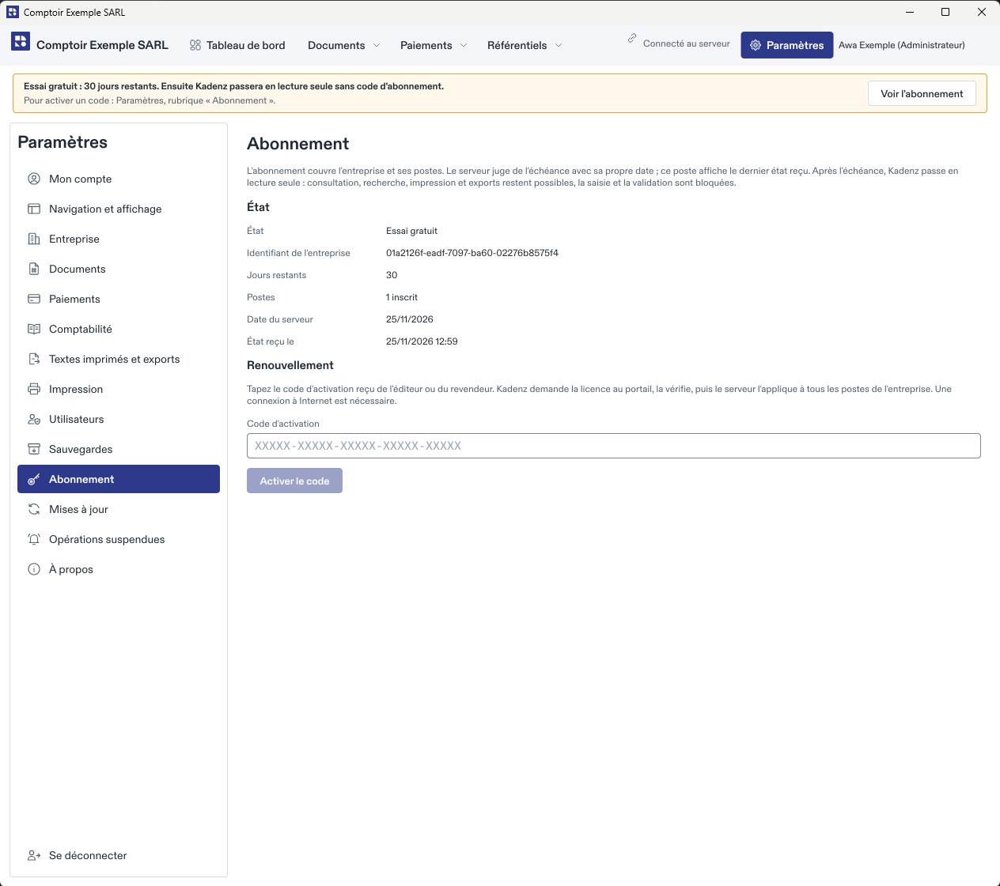
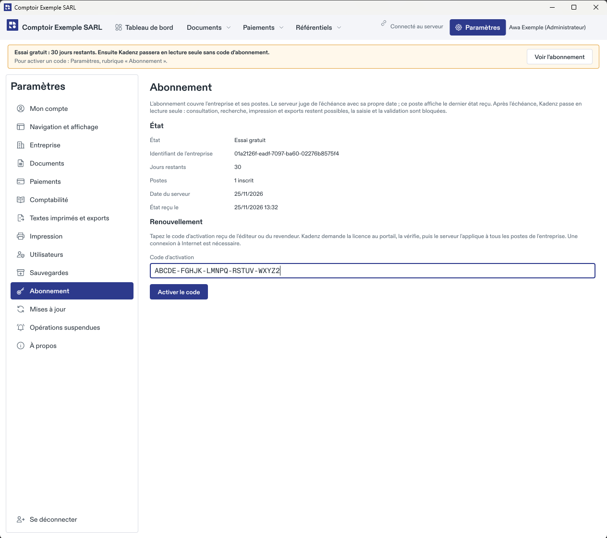
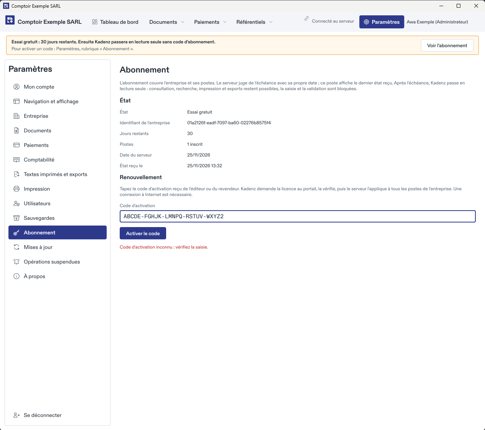
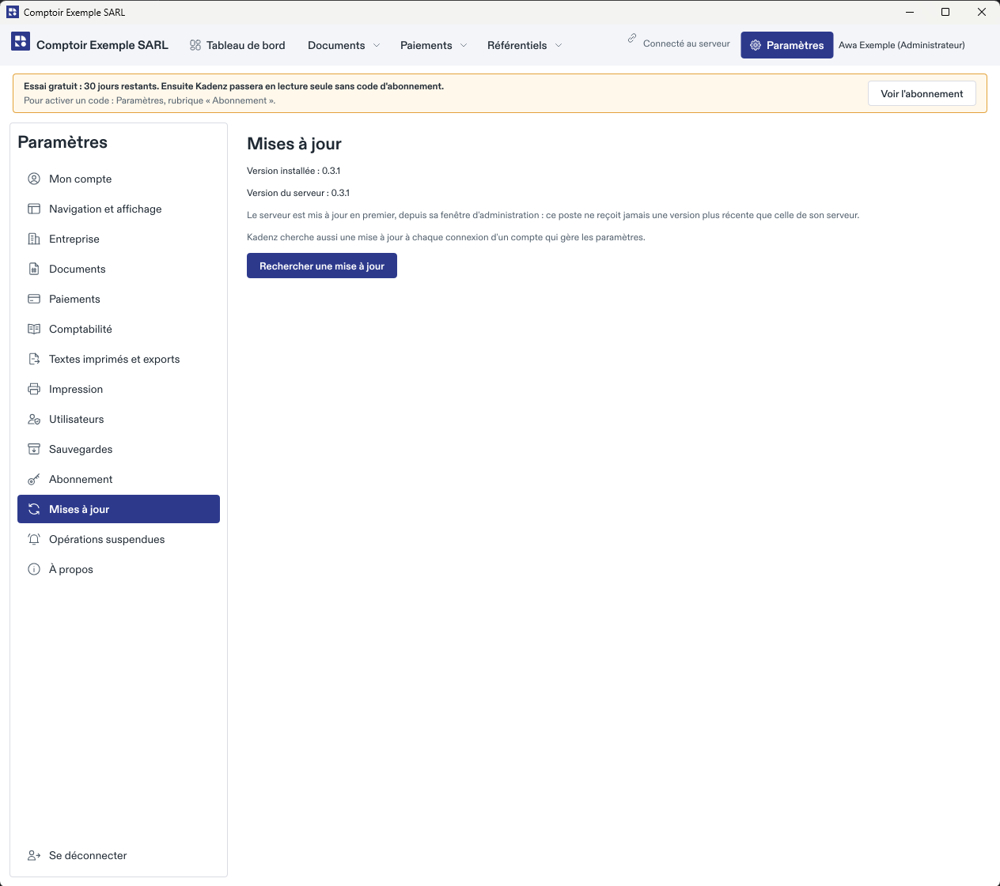

# 12 Abonnement, licence et mises à jour

Ce chapitre explique comment fonctionne l'abonnement de Kadenz : l'essai gratuit, l'activation d'un code, ce qui change quand l'abonnement prend fin, et comment mettre Kadenz à jour. Tout se trouve dans **Paramètres**, rubriques **Abonnement** et **Mises à jour**.

## 12.1 L'essai gratuit

À la première installation, Kadenz démarre en **essai gratuit** de 30 jours, avec tous les modules. Un bandeau en haut de la fenêtre rappelle les jours restants.

Le bandeau dit, par exemple : « Essai gratuit : 30 jours restants. Ensuite Kadenz passera en lecture seule sans code d'abonnement. » Dans les derniers jours, il annonce « il se termine demain », puis « il se termine aujourd'hui ». Le bouton **Voir l'abonnement** ouvre la rubrique **Abonnement**. Sans le droit de gérer les paramètres, un compte voit à la place : « Adressez-vous à l'administrateur pour activer un code d'abonnement. »

## 12.2 La rubrique Abonnement

Un abonnement couvre l'**entreprise et tous ses postes**. C'est le serveur qui juge de l'échéance avec sa propre date : ce poste affiche le dernier état reçu.

La zone **État** liste :

- l'**État** : **Essai gratuit**, **Actif**, **Échu : lecture seule**, **Aucun abonnement : lecture seule** ou **Licence refusée : lecture seule** ;
- l'**Identifiant de l'entreprise** ;
- les **Jours restants** ;
- le nombre de **Postes** inscrits ;
- la **Date du serveur** et la date de l'**État reçu**.

Avec un abonnement actif, la zone ajoute le **Client**, la **Formule** (**Mensuelle** ou **Annuelle**), la **Période**, les **Modules** (« socle seul » s'il n'y en a pas), l'**Émetteur** (l'éditeur ou un revendeur) et la date d'émission.

## 12.3 Activer ou renouveler avec un code

Pour passer à un abonnement payant, ou renouveler, il faut un **code d'activation** reçu de l'éditeur ou du revendeur. Il se compose de 25 caractères en 5 groupes : `XXXXX-XXXXX-XXXXX-XXXXX-XXXXX`.

1. Ouvrez **Paramètres**, rubrique **Abonnement**, zone **Renouvellement**.
2. Cliquez dans le champ **Code d'activation** et saisissez ou collez le code. Kadenz met les lettres en majuscules et place les tirets tout seul.
3. Cliquez sur **Activer le code**, actif dès que le code est complet.

Kadenz demande la licence au portail de l'éditeur, la vérifie, puis le serveur l'applique à tous les postes de l'entreprise. **Une connexion à Internet est nécessaire.**

> **Astuce** Les lettres O et I et les chiffres 0 et 1 ne servent jamais dans un code, pour éviter les confusions. Si vous en tapez un, Kadenz ne le remplace pas en silence : il vous le signale.

Si le code est inconnu ou mal recopié, un message rouge le dit. Ici, avec un code fictif : « Code d'activation inconnu : vérifiez la saisie. »

Un code ne s'active qu'une fois. Il est lié à une formule (mensuelle ou annuelle), à un nombre de postes et à des modules.

## 12.4 Quand l'abonnement prend fin

Quelques jours avant l'échéance, le bandeau prévient : « L'abonnement prend fin le JJ/MM/AAAA (dans N jours) : Kadenz passera ensuite en lecture seule. »

Après l'échéance, ou à la fin de l'essai sans code, Kadenz passe en **lecture seule** : « aucune saisie n'est possible avant le renouvellement de l'abonnement ». Concrètement :

- **restent possibles** : la consultation, la recherche, l'impression et les exports ;
- **sont bloquées** : la saisie et la validation.

Vos données restent intactes. Il suffit d'activer un nouveau code pour retrouver la saisie.

## 12.5 Les modules

Certains menus dépendent des modules de l'abonnement (par exemple le suivi fournisseurs, les relances et le tableau de bord, chapitre 06). Pendant l'essai gratuit, tous les modules sont actifs. Avec un abonnement, la ligne **Modules** de la rubrique **Abonnement** liste ceux qui sont inclus ; sans module, c'est le **socle seul**.

## 12.6 Les mises à jour

La rubrique **Mises à jour** donne la **Version installée** et la **Version du serveur**. Le serveur est mis à jour en premier, depuis sa fenêtre d'administration (chapitre 13) : un poste ne reçoit jamais une version plus récente que celle de son serveur. Kadenz cherche aussi une mise à jour à chaque connexion d'un compte qui gère les paramètres.

Le bouton **Rechercher une mise à jour** lance la recherche. Les réponses possibles :

- « Kadenz est à jour. » ;
- une nouvelle version est proposée : Kadenz affiche un message avec deux boutons, **Installer** et **Plus tard**. Avec **Installer**, l'installateur est téléchargé, sa signature est vérifiée, puis Kadenz se ferme pour le laisser remplacer le programme. La base est refermée proprement ;
- « La version X de Kadenz est disponible, mais le serveur est en version Y : mettez d'abord à jour le serveur, depuis sa fenêtre d'administration. » ;
- « Une version plus récente a été trouvée, mais sa signature n'est pas valide : elle n'est pas proposée. » ;
- « Recherche impossible : le serveur des mises à jour ne répond pas. Vérifiez la connexion à Internet. » ;
- « Kadenz X est une nouvelle génération : elle s'installe séparément. »

> **Attention** Faites une sauvegarde manuelle avant d'installer une mise à jour (chapitre 11).

## 12.7 À retenir

- L'essai gratuit dure 30 jours avec tous les modules.
- Un code d'activation de 25 caractères, saisi dans Paramètres > Abonnement, active ou renouvelle l'abonnement de toute l'entreprise. Internet est nécessaire.
- Après l'échéance, Kadenz passe en lecture seule : on consulte, cherche, imprime et exporte, mais on ne saisit plus.
- Mettez le serveur à jour avant les postes, après une sauvegarde.

Le chapitre suivant décrit l'administration du serveur.
