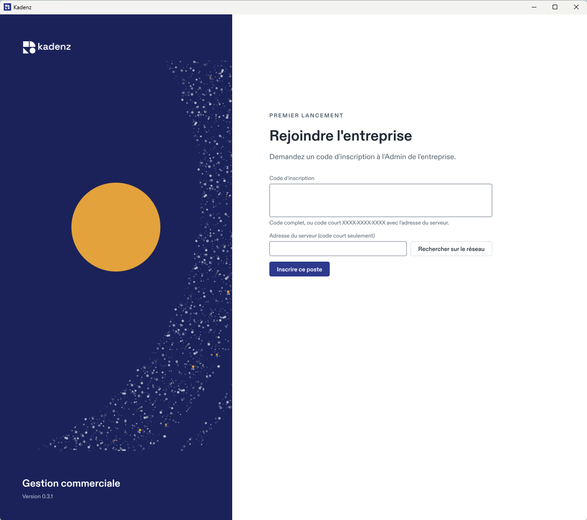
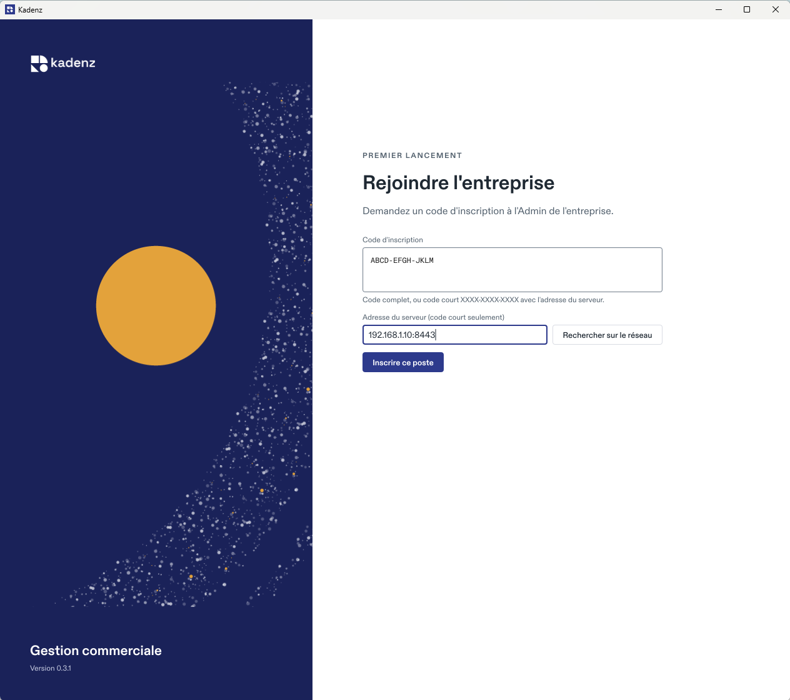
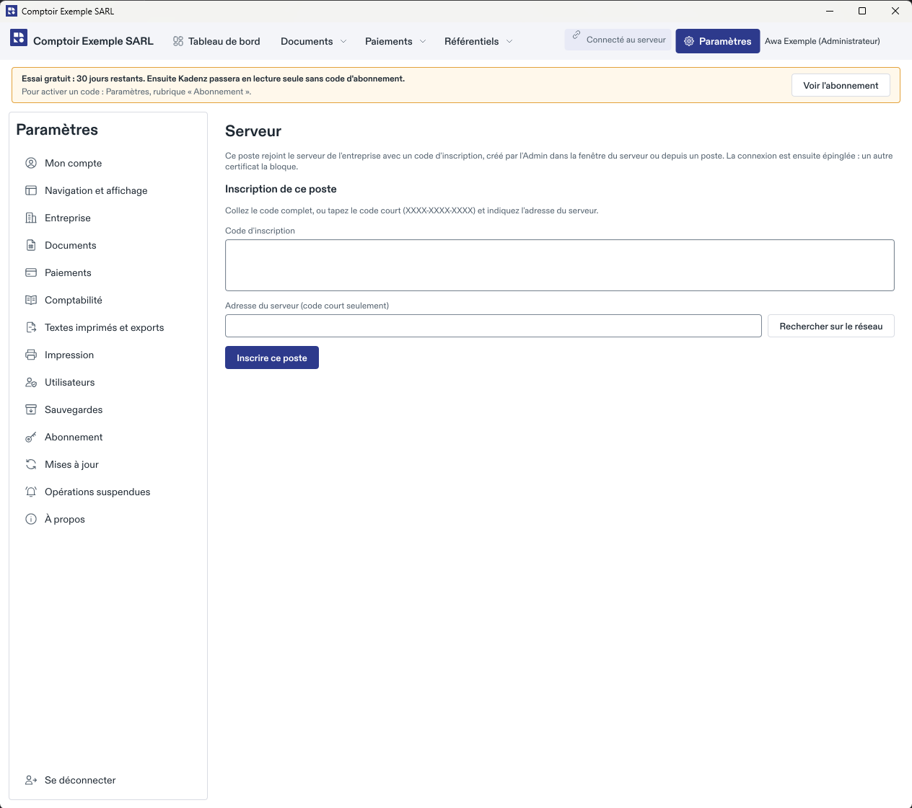
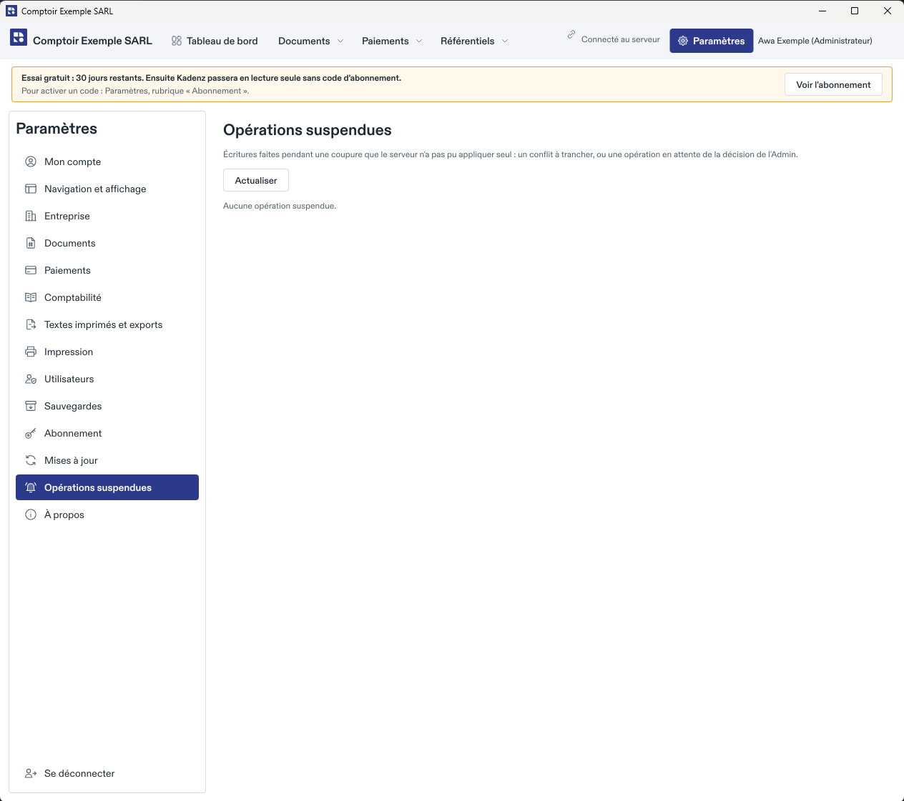
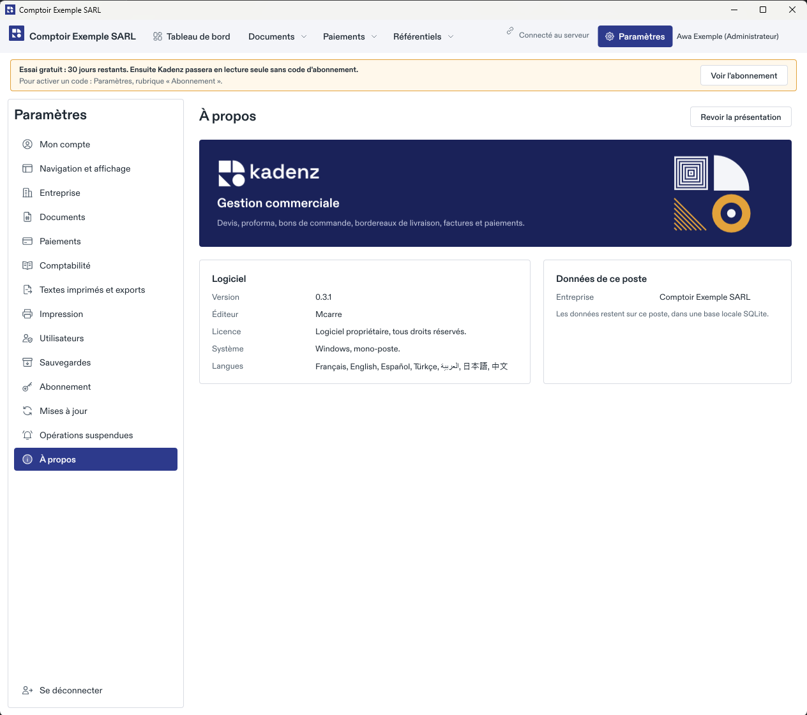

# 13 Le serveur, les postes reliés et le travail hors connexion

Kadenz fonctionne avec un **serveur** : un programme qui garde la base de données de l'entreprise, attribue les numéros des documents, applique l'abonnement et sert un ou plusieurs **postes**. Ce chapitre explique le rôle du serveur, comment relier un poste à l'entreprise, ce que fait la fenêtre d'administration du serveur, et ce qui se passe quand la connexion est coupée.

## 13.1 Le principe

- Le **serveur** s'installe sur une machine de l'entreprise, comme un service Windows qui démarre avec elle. Il garde la base, les comptes et l'abonnement.
- Chaque **poste** est un ordinateur où l'on travaille avec Kadenz. Il garde une copie de la base pour rester rapide, et s'accorde avec le serveur.
- Pour une entreprise d'un seul poste (édition Kadenz un poste), le serveur est intégré : il n'y a rien d'autre à installer.
- Les comptes (chapitre 10) sont **communs à toute l'entreprise** : on se connecte avec le même identifiant sur n'importe quel poste.

Le nombre de postes qu'une entreprise peut relier dépend de son abonnement (chapitre 12).

## 13.2 Relier un poste à l'entreprise

Au premier lancement d'un poste de l'édition multiposte, l'assistant présente Kadenz en quelques écrans, puis propose **Rejoindre l'entreprise**.

Il faut un **code d'inscription**, que vous demandez à l'Admin de l'entreprise (section 13.4). Il existe deux formes de code :

- le **code complet**, long : collez-le tel quel. Il contient l'adresse du serveur et l'empreinte de son certificat, et le poste vérifie seul qu'il parle au bon serveur ;
- le **code court**, de la forme `XXXX-XXXX-XXXX` : tapez-le, puis indiquez l'**Adresse du serveur** (code court seulement).

Le bouton **Rechercher sur le réseau** cherche les serveurs Kadenz du réseau local et propose leur adresse. La recherche ne sert qu'à trouver l'adresse : elle ne prouve pas que le serveur est le bon. Avec un code court, comparez l'empreinte affichée sur le poste à celle de la fenêtre du serveur (section 13.4) avant de confirmer.

Cliquez sur **Inscrire ce poste**. Le poste copie alors la base du serveur ; vous vous connectez ensuite avec votre compte.

> **Attention** Un code d'inscription sert une seule fois, pour un seul poste, pendant 24 heures. Si l'abonnement limite le nombre de postes et que la limite est atteinte, l'inscription est refusée et le message renvoie vers l'abonnement.

Un poste déjà installé garde cet écran dans **Paramètres**, rubrique **Serveur** : un clic sur l'indicateur de connexion, en haut de la fenêtre, l'ouvre.

Une fois inscrit, le poste se souvient du certificat du serveur : « La connexion est ensuite épinglée : un autre certificat la bloque. »

## 13.3 L'indicateur de connexion

En haut à droite de la fenêtre, une mention permanente donne l'état de la liaison avec le serveur :

| Mention | Signification |
| --- | --- |
| **Connecté au serveur** | tout va bien, sur le réseau de l'entreprise |
| **Connecté à distance** | le poste est relié par l'accès à distance (chapitre 14) |
| **Synchronisation...** | le poste reçoit ou envoie des modifications ; un pourcentage s'affiche |
| **Envoi au serveur : N opérations en attente** | le poste vide sa file d'envoi |
| **Hors connexion : N opérations en attente d'envoi** | le serveur ne répond pas |
| **Hors connexion : serveur injoignable** | aucune réponse du serveur |
| **Serveur non reconnu** | le certificat du serveur a changé : la connexion est bloquée, jamais acceptée en silence |
| **Poste retiré du serveur** | l'Admin a retiré ce poste de l'entreprise |
| **Mise à jour de ce poste requise** | le serveur est plus récent que ce poste |
| **Mise à jour du serveur attendue** | ce poste est plus récent que son serveur |

## 13.4 La fenêtre d'administration du serveur

Sur la machine du serveur, le programme **KadenzAdmin** (Kadenz - Administration du serveur) sert au **dépannage**. Il s'ouvre en administrateur Windows et lit directement la base du serveur. Les comptes, l'abonnement et les autres réglages se gèrent depuis un poste connecté avec un compte Admin, pas depuis cette fenêtre.

### Service

La section **Service** indique l'**État** du service (**Démarré**, **Démarrage en cours**, **Arrêt en cours**, **Arrêté**, **Service non installé**), la **Dernière erreur**, le **Dossier des données** et la **Version** du serveur.

### Mise à jour du serveur

Mettez à jour le serveur **avant** les postes : un poste plus récent que son serveur attend sa mise à jour et travaille hors connexion en attendant. **Rechercher une mise à jour** vérifie, puis **Installer** télécharge l'installateur, vérifie son empreinte, le lance et ferme la fenêtre. Les données du serveur sont gardées.

### Sauvegardes

Le service sauvegarde la base **chaque jour à l'heure choisie** (**Heure de la sauvegarde quotidienne**, au format HH:MM, par exemple 12:00) **et à son arrêt**. Seules les plus récentes sont gardées. Chaque sauvegarde est chiffrée par un mot de passe et porte l'identité du serveur : restaurée sur une autre machine, les postes la reconnaissent.

- **Dossier des sauvegardes** : **Choisir un dossier**.
- **Mot de passe des sauvegardes** (8 caractères au moins) et sa confirmation. Tant qu'aucun mot de passe n'est choisi, aucune sauvegarde n'est faite, et un bandeau le rappelle. Notez le mot de passe en lieu sûr.
- **Enregistrer le réglage**, **Sauvegarder maintenant** et **Restaurer depuis un fichier**.

> **Attention** Un bandeau d'avertissement s'affiche tant que les sauvegardes sont sur le même disque que la base : une panne de ce disque les perdrait toutes. Choisissez un dossier sur un autre disque, un disque externe ou un partage réseau.

La **restauration** passe par plusieurs temps : choix du **Fichier**, saisie du **Mot de passe de la sauvegarde**, **Vérifier la sauvegarde**, puis **Restaurer** après confirmation. Elle arrête le service : les postes sont déconnectés quelques instants. La base actuelle est d'abord sauvegardée, puis mise de côté sans être effacée, et chaque poste refait ensuite sa copie de la base.

### Empreinte du certificat

Le serveur a un certificat. Son **empreinte** s'affiche dans la fenêtre, avec un bouton **Copier**. Un poste qui s'inscrit avec le code complet la vérifie seul. Avec le code court, comparez l'empreinte affichée sur le poste à celle-ci avant de confirmer.

### Codes d'inscription

C'est ici que vous préparez l'arrivée d'un nouveau poste. Saisissez le **Nom du poste**, puis cliquez sur **Créer un code**. La fenêtre affiche :

- le **Code court**, à taper sur le poste ;
- le **Code complet**, à coller sur le poste, qui contient aussi l'adresse et l'empreinte du serveur.

> **Attention** « Notez-le maintenant : il ne sera plus affiché. » Un code sert une seule fois, pour un poste, pendant 24 heures. Un nouveau code pour le même nom de poste annule le précédent. **Masquer le code** l'efface de l'écran.

La liste **Codes en cours** montre les codes pas encore utilisés, avec leur date de validité, et un bouton **Annuler le code** (après confirmation) pour un code créé par erreur.

### Relais d'accès à distance

Cette section enregistre l'adresse et l'empreinte du relais par lequel passent les postes hors du bureau (chapitre 14). Elle ne sert qu'une fois, à la mise en place. **Enregistrer le relais** et **Effacer le relais** valident ou retirent le réglage.

### Postes inscrits

La liste des **Postes inscrits** donne, pour chaque poste, son nom et sa date d'inscription. Le bouton **Retirer** coupe un poste de l'entreprise, après confirmation : « Il ne pourra plus se connecter ; il faudra un nouveau code pour l'inscrire de nouveau. » **Actualiser** relit la liste.

## 13.5 Travailler hors connexion

Quand le serveur ne répond pas (coupure de réseau, serveur arrêté), le poste continue à fonctionner avec sa copie : on consulte, on crée et on modifie des fiches et des brouillons. Les modifications attendent dans une file d'envoi, et la mention **Hors connexion : N opérations en attente d'envoi** compte ce qui reste à envoyer. Au retour du serveur, elles partent toutes seules.

Une seule chose n'est pas possible hors connexion : **valider** un document. Le bouton reste inactif, avec ce texte : « La validation attend le serveur : le numéro est attribué par le serveur. » Le document reste en brouillon, ce qui évite qu'un même numéro soit attribué deux fois.

## 13.6 Les opérations suspendues

Quand deux postes modifient la même fiche pendant une coupure, ou qu'une opération faite hors connexion est refusée par le serveur pour un compte ou un droit (compte désactivé, droit retiré), le serveur ne tranche pas seul. L'opération arrive dans **Paramètres**, rubrique **Opérations suspendues**.

La page liste les écritures « faites pendant une coupure que le serveur n'a pas pu appliquer seul » : un **CONFLIT** à trancher, ou une opération **EN ATTENTE** de la décision de l'Admin. **Actualiser** relit la liste ; sans rien à traiter, elle affiche « Aucune opération suspendue. »

Pour chaque ligne, **Examiner** ouvre le détail.

- **Conflit sur une fiche** : « La fiche a changé sur un autre poste pendant la coupure. » Un tableau compare, champ par champ, la **Version du serveur** et la **Version du poste**. Gardez une version entière avec **Garder la version du serveur** ou **Garder la version du poste**, ou cliquez sur la valeur à garder pour chaque champ qui diffère, puis **Garder mon choix**.
- **Conflit sur un document** : gardez la version du serveur ou celle du poste.
- **Opération en attente** : « Opération faite hors connexion et refusée par le serveur pour un compte ou un droit : acceptez-la pour l'appliquer, ou rejetez-la. » Boutons **Accepter** et **Rejeter**.

La décision se prend poste connecté : « La décision attend le serveur : elle se prend quand le poste est connecté. »

## 13.7 La page À propos

**Paramètres**, rubrique **À propos**, donne la version du logiciel, l'éditeur, la licence du logiciel, les langues de l'interface et le nom de l'entreprise. Le bouton **Revoir la présentation** rejoue les écrans de bienvenue.

Indiquez la **version** quand vous demandez de l'aide (chapitre 15).

## 13.8 À retenir

- Le serveur garde la base et attribue les numéros ; chaque poste garde une copie.
- Pour relier un poste : demandez un code d'inscription à l'Admin, puis **Rejoindre l'entreprise**. Un code sert une fois, 24 heures.
- Mettez toujours le serveur à jour avant les postes.
- Choisissez le mot de passe des sauvegardes du serveur et placez-les sur un autre disque.
- Hors connexion, tout est possible sauf valider un document.
- Les conflits se tranchent dans **Opérations suspendues**.

Le chapitre suivant explique l'accès à distance, pour travailler hors du bureau.
